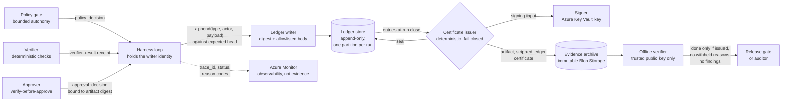

# Evidence Ledger and Run Certificate

> **Maturity:** preview · **Kind:** design-pattern · **Category:** `orchestration-and-workflows` · **Version:** 0.1.0

An answer that only sounds right is not a finished task. When an agent drafts a risk summary, a prior authorization note or a case decision, someone eventually asks several questions:

- Which sources did it read?
- Which tools did it call, and was each call allowed?
- Which checks ran on the exact artifact that shipped, and did they pass?
- Who approved it?

Logs and traces rarely answer these questions with confidence. They are sampled, they can be edited or rotated, they often contain the very content you must not keep, and nothing ties them to the artifact that was released.

This pattern adds two things to the agent harness:

- **An evidence ledger.** This is an append-only, hash-chained record of every step in a run: the run start, policy decisions, tool calls, retrieved sources, model output, the artifact, verifier results, the approval decision and the run close. Each entry stores **digests, references and a small allowlisted summary**, never raw prompts, documents or tool payloads. Each entry hash covers the previous one, so editing, reordering or removing an entry breaks the chain.
- **A run certificate.** At the end of the run, a deterministic issuer checks the ledger and signs a certificate. The certificate binds:
  - The ledger head hash and entry count
  - The artifact digest
  - The verifier receipt and its required checks
  - The approval decision
  - The policy profile
  - The agent and model versions

The issuer **fails closed**. If any condition is not met, it still signs the certificate, but with status `withheld` and a list of machine-readable reasons. A run is **done** only when its certificate is `issued`, has no withheld reasons, and verifies offline against a trusted key. Anyone holding the public key can repeat that check later, without access to the agent, its logs or its model.

> **Core thesis:** *Completion is a claim that must carry its own proof. The harness records what happened as tamper-evident digests, and a signed certificate binds the result, its checks and its approval to that record. No valid, non-withheld certificate means the work is not done, however good the answer looks.*

This asset is for:

- Solution architects
- Agent developers
- Platform and security engineers
- The owners of agent operations
- Auditors, risk owners and compliance teams who need to check agent work after the fact

The [Governed Context-Aware Agent Harness](../governed-context-aware-agent-harness/README.md) emits this ledger and certificate as the last stage of its loop. This asset is a focused deep dive on that mechanism, and it works with or without the harness. A stdlib-only [ledger and certificate sample](samples/evidence_ledger.py) makes every rule executable, including the tamper drills.

## Architecture and implementation map

| Layer / concern | Deep-dive documentation | Executable reference |
|---|---|---|
| **Ledger entries, canonical JSON, hash chain, redaction allowlist, append-only store** | [`docs/architecture.md`](docs/architecture.md) sections 4 to 6 and 10 to 11 · [ADR 0001](docs/decisions/0001-hash-chain-plus-signed-certificate.md) · [ADR 0002](docs/decisions/0002-digests-not-content-in-ledger.md) | [`samples/evidence_ledger.py`](samples/evidence_ledger.py): `canonical`, `build_entry`, `verify_chain`, `strip_bodies`, `EvidenceLedger`, and the `LedgerStore` and `EvidenceArchive` seams |
| **Certificate issuance, withheld reasons, signing, offline verification, definition of done** | [`docs/architecture.md`](docs/architecture.md) sections 7 to 9 · [ADR 0003](docs/decisions/0003-withheld-certificate-means-not-done.md) | `issue_certificate`, `signing_input`, `verify_offline`, `is_done`, and the `Signer` seams |
| **Writer and signer identities, separation of duties, key rotation, retention and erasure, audit, threat model** | [`docs/authentication-and-governance.md`](docs/authentication-and-governance.md) | Scenarios for self-approval, stale heads, sealed ledgers, purge and stub adapters |
| **Tamper drills, content-free telemetry, troubleshooting by reason code, release gates** | [`docs/evaluation-and-troubleshooting.md`](docs/evaluation-and-troubleshooting.md) | The `--self-test` suite: 20 scenarios across 4 Domain Packs |

## Domain Packs

The ledger, the certificate and the verification code are the same in every industry. Only the artifact, the sources, the required checks and the blocked action change. The organizations are fictional.

| Domain Pack | Organization | Artifact | Required checks | Action that policy denies |
|---|---|---|---|---|
| **financial-report** (default) | Contoso Bank | Quarterly liquidity risk summary | `recompute.totals`, `grounding.citations`, `disclosure.distribution_list` | `send_external_email` |
| **prior-auth** | Fabrikam Health | Prior authorization summary | `eligibility.service_date`, `grounding.criteria_cited`, `phi.minimum_necessary` | `write_claims_system` |
| **quality-deviation** | Northwind Manufacturing | Quality deviation report | `spec.limits_recomputed`, `traceability.lot_genealogy`, `capa.owner_assigned` | `release_quarantined_lot` |
| **case-decision** | Northwind County | Benefit case decision notice | `eligibility.recompute`, `statute.references_valid`, `notice.appeal_deadline` | `send_notice_to_applicant` |

[Architecture section 17](docs/architecture.md#17-domain-packs) lists the agents, profiles, initiators and approvers for each pack. Run any pack with `--domain`.

## When to use

- Agents produce artifacts that people or systems act on: reports, summaries, decisions, notices, change records. Someone will later ask how a specific artifact was produced, checked and approved.
- You need to prove, after the fact and to someone who does not trust your logs, that required checks ran on the exact bytes that shipped and that the approval named that artifact.
- Regulated or sensitive content flows through the agent, so the audit record must not become a second copy of that content.
- A release gate, a downstream system or an auditor needs a simple, verifiable yes or no: "is this run done?"
- You already run a harness, a verifier and an approval gate, and you need their outcomes bound together rather than scattered across logs.

## When not to use

- You only need operational visibility: latency, errors, token use, which step is slow. Use traces and metrics, for example the [Hosted Agent OpenTelemetry Trace Receiver](../../agent-runtime/hosted-agent-otel-trace-receiver/README.md). Traces are observability. This ledger is evidence, with different guarantees and a different audience.
- The agent only answers questions in a chat, and no artifact is released or acted on. Grounding, content safety and evaluation from [Enterprise Agent Security and Tool Governance](../../security-and-governance/agent-security-and-governance/README.md) cover that case.
- You need to decide whether a step may run at all. That is the job of [Bounded Autonomy](../bounded-autonomy/README.md) and the tool policy. The ledger records those decisions; it does not make them.
- You need to gate a human approval on verifier results. Use [Verify Before Approve](../verify-before-approve/README.md). This pattern records the verifier receipt and the approval decision and binds them into the certificate.
- You need the whole agent runtime, including context assembly, memory, the verifier and approvals. Start from the [Governed Context-Aware Agent Harness](../governed-context-aware-agent-harness/README.md), and use this pattern as its evidence layer.

## Architecture



- **Harness loop.** Owns the run and is the only writer. It appends an entry for each step, in order, before acting on the step's result. The model never holds the writer object, its identity or its credentials.
- **Ledger writer.** For each step it builds an entry header: the run ID, a sequence number, the type, the time, the actor, the trace ID, the digest of the full payload, an optional reference, the digest of the redacted body and the previous entry's hash. The entry hash is the digest of that header. The full payload is hashed and discarded. Only the fields on the per-type allowlist are kept as a readable body.
- **Ledger store.** Accepts an append only if the caller's expected head is still the current head, the sequence is next and the run is not sealed. A rejected append changes nothing. In production this is a per-run partition in Azure Cosmos DB, updated with a transactional batch.
- **Policy gate, verifier and approver.** These components decide and check. The ledger records their outputs: the policy decision with its rule ID, the verifier receipt bound to the artifact digest, and the approval decision bound to both the artifact digest and the receipt.
- **Certificate issuer.** A deterministic function with no model calls. It verifies the chain, re-derives every condition from the ledger, the artifact bytes, the receipt and the approval, and signs the result. If any condition fails, it signs a `withheld` certificate with reasons. After issuance, the run's ledger is sealed.
- **Signer.** Signs the canonical certificate. In production this is an asymmetric key in Azure Key Vault, so the private key never leaves the vault and anyone with the public key can verify.
- **Evidence archive.** Stores the artifact, the ledger with bodies stripped and the certificate as write-once objects. In production this is Azure Blob Storage with version-level immutability.
- **Offline verifier.** Checks the signature against a trusted key list, re-verifies the chain from headers alone, and compares the head, the entry count and the bound digests with the ledger and the supplied artifact, receipt and approval.
- **Telemetry.** Azure Monitor receives content-free signals that share the run's `trace_id`, such as certificate status and reason codes. Telemetry helps operators; it is not the evidence.

### What a ledger entry holds

| Field | Meaning | In the entry hash |
|---|---|---|
| `schema`, `run_id`, `seq`, `type`, `at`, `actor`, `trace_id` | Identity and position of the step | Yes |
| `payload_digest` | Digest of the full payload, including content that is never stored | Yes |
| `payload_ref` | Optional pointer to content held in its system of record, for example `evidence://contoso-bank/finance/liquidity-extract-q3.csv` | Yes |
| `redacted_digest` | Digest of the allowlisted body | Yes |
| `prev_hash` | Entry hash of the previous entry, or the genesis value for the first entry | Yes |
| `entry_hash` | Digest of the canonical header above | It is the hash |
| `redacted` | The allowlisted body, such as `action`, `outcome` and `rule_id` | No. It is bound by `redacted_digest`, so it can be purged without breaking the chain |

### What the certificate binds

| Section | Binds |
|---|---|
| `subject` | Artifact digest, media type and artifact reference |
| `ledger` | Head hash and entry count of the closed ledger |
| `verification` | Receipt digest and ID, verifier version, the required check codes, and each check's result |
| `approval` | Approval decision digest, decision ID, approver, decision and time, or `null` |
| `policy` | Profile ID, profile version and the digest of the policy that applied |
| `execution` | Agent ID and version, model deployment and model version |
| `timestamps` | Run start, run close and issue time |
| `status`, `withheld_reasons` | `issued` with an empty list, or `withheld` with reason codes |
| `signature` | Algorithm, key ID and value. The algorithm and key ID are inside the signed input, so neither can be swapped |

### What tampering looks like

| Attack | How it is detected |
|---|---|
| Edit an entry's body | `ledger.redacted_digest` |
| Edit an entry's header | `ledger.entry_hash` |
| Edit an entry and recompute its hash | `ledger.prev_hash` on the next entry |
| Reorder entries | `ledger.sequence` and `ledger.prev_hash` |
| Remove an entry from the middle | `ledger.sequence`, `ledger.prev_hash` and `certificate.entry_count_mismatch` |
| Truncate the tail | The chain still verifies; `certificate.head_mismatch` and `certificate.entry_count_mismatch` catch it |
| Rewrite the whole chain consistently | The chain still verifies; `certificate.head_mismatch` catches it |
| Add a field that is not on the allowlist | `ledger.redaction_policy` |
| Promote a withheld certificate to issued | `certificate.signature_invalid` |
| Ship a different artifact under the same certificate | `certificate.artifact_mismatch` |

A hash chain alone cannot detect a consistent rewrite or a truncated tail, because a chain is only evidence relative to a known head. The signed certificate supplies that head. See [ADR 0001](docs/decisions/0001-hash-chain-plus-signed-certificate.md).

### Withheld, not missing

The issuer always returns a signed certificate. When it cannot certify the run, the status is `withheld`, and the reasons explain why:

| Group | Reason codes |
|---|---|
| Ledger | `ledger.chain_invalid`, `ledger.not_closed` |
| Run | `run.not_completed` |
| Artifact | `artifact.missing`, `artifact.digest_mismatch` |
| Verification | `verification.no_required_checks`, `verification.missing`, `verification.report_not_in_ledger`, `verification.stale_artifact`, `verification.required_check_missing:<code>`, `verification.required_check_failed:<code>` |
| Approval | `approval.missing`, `approval.not_in_ledger`, `approval.rejected`, `approval.artifact_mismatch`, `approval.receipt_mismatch`, `approval.self_approval` |
| Policy | `policy.unauthorized_tool_call:<seq>`, `policy.profile_mismatch` |

A `run_closed` entry with status `completed` means execution finished. It does not mean the work is done. A clean artifact does not redeem a run that executed a denied tool call. See [architecture section 7](docs/architecture.md#7-certificate-issuance-and-withheld-reasons) and [ADR 0003](docs/decisions/0003-withheld-certificate-means-not-done.md).

## Key design decisions

| Decision | Choice | Why | Trade-off |
|---|---|---|---|
| How tampering is made evident | A hash chain per run, plus a signed certificate that binds the head hash and entry count | A chain localizes edits, reorders and removals; only a signed head catches a consistent rewrite or a truncated tail | Key management and an issuance step for every run |
| What the ledger stores | Digests, references and allowlisted fields. Raw prompts, documents, model text and tool payloads are hashed, never stored | The ledger is retained for a long time and read widely, so it must not become a second copy of regulated content | Proving content later needs the original bytes from their system of record |
| When a run is done | Only with an `issued`, non-withheld certificate that verifies offline | "The answer looks right" and "execution completed" are not evidence | More runs end as not done, and callers must handle that outcome |
| What happens when a condition fails | Sign a `withheld` certificate with reason codes, rather than return nothing | A missing certificate is ambiguous; a signed withheld certificate says what failed | Consumers must check status, not presence |
| How certificates are signed | An asymmetric key in Azure Key Vault in production; HMAC only in the sample | The private key never leaves the vault, and anyone with the public key can verify offline | One sign call per run and a key rotation process |
| How writes are ordered | Optimistic append against an expected head, and a seal after issuance | Prevents forks and late appends after certification | One writer per run, and retries on a stale head |

Recorded as ADRs:

- [ADR 0001: Hash chain plus a signed run certificate](docs/decisions/0001-hash-chain-plus-signed-certificate.md)
- [ADR 0002: The ledger stores digests and references, not content](docs/decisions/0002-digests-not-content-in-ledger.md)
- [ADR 0003: A withheld certificate means the run is not done](docs/decisions/0003-withheld-certificate-means-not-done.md)

## Getting started

1. **Run the sample.** It needs Python 3.10 or later. It uses no packages, no network and no credentials. From the repository root:

   ```powershell
   # 20 scenarios, including the tamper drills; exits non-zero if any fails.
   python assets\orchestration-and-workflows\evidence-ledger-and-run-certificate\samples\evidence_ledger.py --self-test

   # Readable demo run: the ledger, an issued certificate and offline verification. Exits 0.
   python assets\orchestration-and-workflows\evidence-ledger-and-run-certificate\samples\evidence_ledger.py

   # Same code, another industry.
   python assets\orchestration-and-workflows\evidence-ledger-and-run-certificate\samples\evidence_ledger.py --domain prior-auth

   # A required check fails, so the certificate is withheld. Exits 2.
   python assets\orchestration-and-workflows\evidence-ledger-and-run-certificate\samples\evidence_ledger.py --fail-check recompute.totals

   # A required check is missing from the verifier receipt. Exits 2.
   python assets\orchestration-and-workflows\evidence-ledger-and-run-certificate\samples\evidence_ledger.py --skip-check grounding.citations

   # A tool call that policy denied still ran. The artifact is clean, but the run is not done. Exits 2.
   python assets\orchestration-and-workflows\evidence-ledger-and-run-certificate\samples\evidence_ledger.py --unauthorized-tool-call

   # No approval recorded; print the certificate, ledger headers and findings as JSON. Exits 2.
   python assets\orchestration-and-workflows\evidence-ledger-and-run-certificate\samples\evidence_ledger.py --domain case-decision --no-approval --json

   # List the Domain Packs and their required checks.
   python assets\orchestration-and-workflows\evidence-ledger-and-run-certificate\samples\evidence_ledger.py --list-domains
   ```

2. **Define entry types and the redaction allowlist.** List the step types your harness records, and for each type the few fields that may be stored in readable form. Everything else is hashed only. See [the data model](docs/architecture.md#4-data-model) and [ADR 0002](docs/decisions/0002-digests-not-content-in-ledger.md).

3. **Make the harness the only writer.** Give the ledger write permission to the harness identity alone, never to the model, a tool or an end user. See [the identity inventory](docs/authentication-and-governance.md#1-identity-inventory).

4. **Choose the store and the archive.** Use a per-run partition with an optimistic head check for the live ledger, and immutable storage for the sealed evidence. See [implementation on Azure](docs/architecture.md#15-implementation-on-azure).

5. **Sign with a key the verifier can trust.** Use an asymmetric key in Azure Key Vault, publish the public key, and keep a versioned key ID in every certificate. See [key management and rotation](docs/authentication-and-governance.md#4-key-management-and-rotation).

6. **Gate on the certificate.** Make every release gate and downstream consumer call the equivalent of `is_done`: an issued status, no withheld reasons and no offline findings. Work through the [production checklist](docs/architecture.md#20-production-checklist) and the [release gates](docs/evaluation-and-troubleshooting.md#release-gates). Then follow the [Agent Production Readiness Guide](../../agentops-and-readiness/agent-production-readiness/README.md).

## Files

| Path | Purpose |
|---|---|
| [`manifest.yaml`](manifest.yaml) | Catalog metadata for this asset |
| [`CHANGELOG.md`](CHANGELOG.md) | Version history |
| [`docs/architecture.md`](docs/architecture.md) | Covers:<br/>• Problem and forces<br/>• Components<br/>• Data model of entries and certificates<br/>• Canonical JSON<br/>• Chain verification<br/>• Issuance and withheld reasons<br/>• Offline verification<br/>• Threat model<br/>• Redaction and purge<br/>• Sequences<br/>• Azure mapping<br/>• Failure modes and anti-patterns<br/>• Production checklist and extension points |
| [`docs/authentication-and-governance.md`](docs/authentication-and-governance.md) | Covers:<br/>• Identity inventory<br/>• App roles and data-plane RBAC<br/>• Separation of duties<br/>• Key management and rotation<br/>• Retention, legal hold and erasure<br/>• Releasing changes<br/>• Kill switch<br/>• Audit<br/>• Threat model<br/>• Operating model |
| [`docs/evaluation-and-troubleshooting.md`](docs/evaluation-and-troubleshooting.md) | Covers:<br/>• What to evaluate<br/>• Scenarios as evaluation cases<br/>• Tamper drills<br/>• Telemetry and dashboards<br/>• Troubleshooting by reason code<br/>• Debugging a single run<br/>• Release gates |
| [`docs/decisions/0001-hash-chain-plus-signed-certificate.md`](docs/decisions/0001-hash-chain-plus-signed-certificate.md) | ADR 0001: a hash chain plus a signed certificate |
| [`docs/decisions/0002-digests-not-content-in-ledger.md`](docs/decisions/0002-digests-not-content-in-ledger.md) | ADR 0002: digests and references, not content |
| [`docs/decisions/0003-withheld-certificate-means-not-done.md`](docs/decisions/0003-withheld-certificate-means-not-done.md) | ADR 0003: a withheld certificate means not done |
| [`samples/evidence_ledger.py`](samples/evidence_ledger.py) | Single-file, stdlib-only ledger, issuer and offline verifier. Flags: `--self-test`, `--domain`, `--list-domains`, `--fail-check`, `--skip-check`, `--no-approval`, `--unauthorized-tool-call` and `--json` |
| [`samples/README.md`](samples/README.md) | How to run, read and extend the sample, and its production seams |

## Related assets

| Asset | Relationship |
|---|---|
| [Governed Context-Aware Agent Harness](../governed-context-aware-agent-harness/README.md) | The reference architecture that emits this ledger and certificate at the end of its loop. This asset is the deep dive on the hash-chained evidence and the certificate |
| [Verify Before Approve](../verify-before-approve/README.md) | Produces the verifier receipt and the digest-bound approval decision. This asset records both and binds them into the certificate |
| [Bounded Autonomy](../bounded-autonomy/README.md) | Makes the allow, deny and escalate decisions. This asset records them, and withholds the certificate when a denied action ran anyway |
| [Progressive Tool Loading](../progressive-tool-loading/README.md) | Decides when tools are exposed to the model. The ledger records which tools were actually called and under which policy decision |
| [Hosted Agent OpenTelemetry Trace Receiver](../../agent-runtime/hosted-agent-otel-trace-receiver/README.md) | Traces are observability: sampled, mutable and built for operators. The ledger is evidence: complete, hash-chained and signed. They share `trace_id` for correlation |
| [Enterprise Agent Security and Tool Governance](../../security-and-governance/agent-security-and-governance/README.md) | The agent identity, guardrail and governance controls that surround the ledger and the signer |
| [Agent Production Readiness Guide](../../agentops-and-readiness/agent-production-readiness/README.md) | The release gates and operating model that consume the certificate |

## Production-readiness pillar mapping

This asset contributes to three pillars of the [Agent Production Readiness Guide](../../agentops-and-readiness/agent-production-readiness/README.md).

| Pillar | How this asset contributes |
|---|---|
| [**Proven patterns for agent architectures**](../../agentops-and-readiness/agent-production-readiness/docs/pillars/06-proven-patterns-for-agent-architectures.md) | The ledger as the harness's evidence layer, a deterministic certificate issuer, and a definition of done that does not depend on the model |
| [**AI security and observability**](../../agentops-and-readiness/agent-production-readiness/docs/pillars/04-ai-security-and-observability.md) | Covers:<br/>• Tamper evidence<br/>• Signed attestations verified offline<br/>• A harness-only writer identity<br/>• Content kept out of the audit record<br/>• Detection of denied actions that ran<br/>• The threat model<br/>• A clear split between evidence and telemetry |
| [**Agent ops**](../../agentops-and-readiness/agent-production-readiness/docs/pillars/03-agent-ops.md) | Covers:<br/>• Release gates on certificate status<br/>• Reason-code telemetry and alerts<br/>• Troubleshooting runbooks<br/>• Retention and erasure procedures<br/>• Key rotation<br/>• The tamper drills in CI |

## Security and responsible AI

- **The model never writes evidence.** Only the harness identity can append. Model output enters the ledger as a digest, recorded by the harness.
- **Keep content out of the evidence.** Entries carry digests, references, IDs and reason codes. Prompts, documents, model text, tool arguments and results are hashed only. Review every allowlist change as a privacy change.
- **Fail closed.** The issuer never certifies a run it cannot fully check. A missing check, a missing approval or a denied tool call that ran each produce a withheld certificate.
- **Keep people accountable.** The approval decision names the artifact digest and the receipt it approved. The initiator and the agent cannot approve their own run.
- **Respect erasure duties.** Purging the readable bodies keeps the chain and the certificate valid. Content held in systems of record follows those systems' own retention and erasure rules.
- **Verification must not need trust in the operator.** An auditor needs only the public key, the archived ledger, the certificate and the artifact.
- **Defense in depth.** The ledger records and certifies; it does not prevent. Policy enforcement points must still block denied actions before they run.

## Limitations

- The sample is a simulation:
  - It makes no model calls, executes no tools and uses a fake clock.
  - The ledger store, the archive and the signer are in-memory fakes. The sample signs with HMAC and a sample-only key.
  - The Azure adapters are stubs that raise `NotImplementedError`, and they make no network calls.
- Wire contracts are illustrative. Field names, entry types and schema versions are for discussion, not a stable contract.
- Tamper evidence is not tamper prevention. A writer with store access can still delete a whole run before issuance. Immutable storage, separation of duties and monitoring reduce that risk; they do not remove it.
- The sample's offline verifier does not recompute the policy digest or re-derive the withheld reasons. It checks the signature, the chain and the bound digests. See [extension points](docs/architecture.md#21-extension-points).
- A certificate proves which checks ran and passed. It does not prove that the checks were sufficient, or that the artifact is correct beyond them.
- Azure service capabilities change over time, including hosted agents, immutability policies and key types. Some of these are in preview. Verify them against current documentation before you rely on a specific capability.
- This asset intentionally contains no latency, throughput, storage-volume or cost figures. Measure in your own environment.

## References

- [Architecture deep dive](docs/architecture.md)
- [Authentication and governance](docs/authentication-and-governance.md)
- [Evaluation and troubleshooting](docs/evaluation-and-troubleshooting.md)
- [Samples guide](samples/README.md)
- [What is Microsoft Foundry Agent Service?](https://learn.microsoft.com/azure/foundry/agents/overview)
- [About Azure Key Vault keys](https://learn.microsoft.com/azure/key-vault/keys/about-keys)
- [Store business-critical blob data with immutable storage](https://learn.microsoft.com/azure/storage/blobs/immutable-storage-overview)
- [Transactional batch operations in Azure Cosmos DB](https://learn.microsoft.com/azure/cosmos-db/nosql/transactional-batch)
- [Enable Azure Monitor OpenTelemetry](https://learn.microsoft.com/azure/azure-monitor/app/opentelemetry-enable)
- [Add app roles to your application and receive them in the token](https://learn.microsoft.com/entra/identity-platform/howto-add-app-roles-in-apps)
- [Contribution and Standardization Guide](../../../docs/contribution-guide.md)
