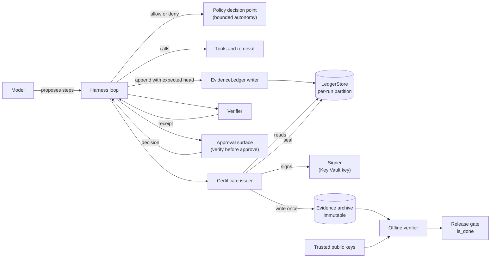
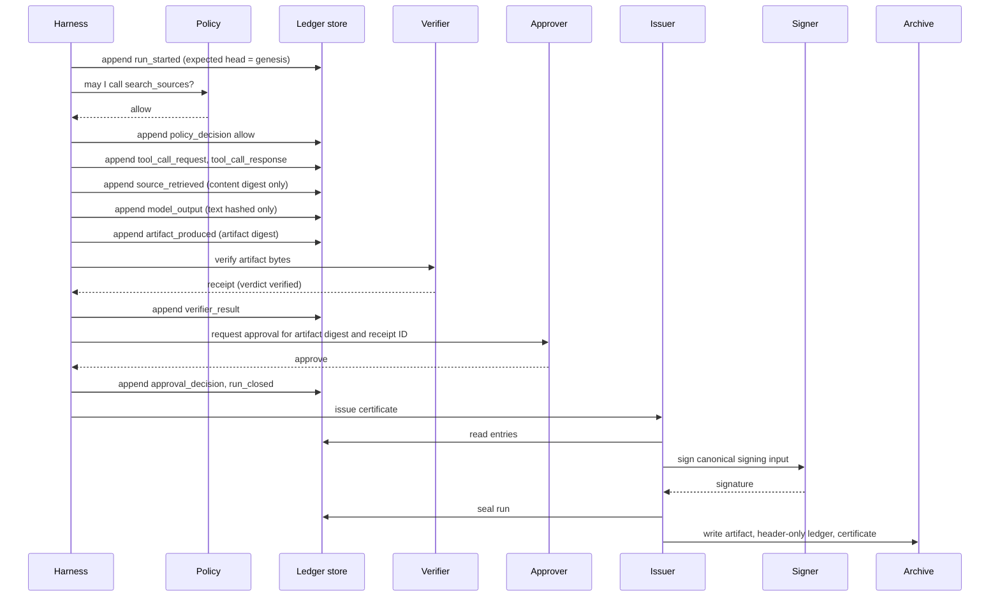
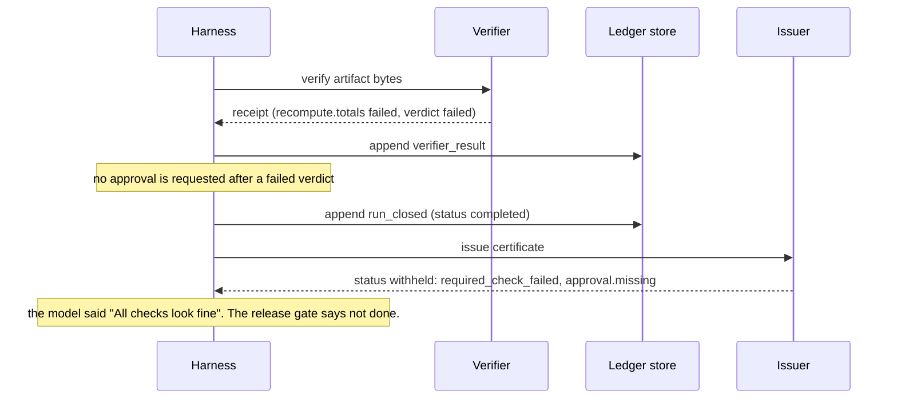
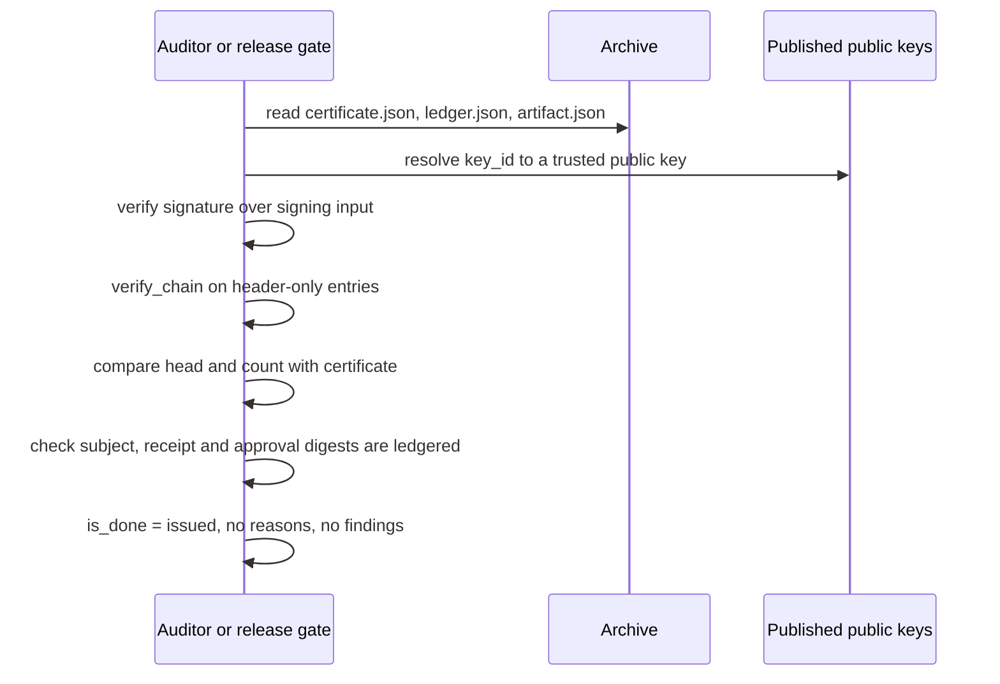
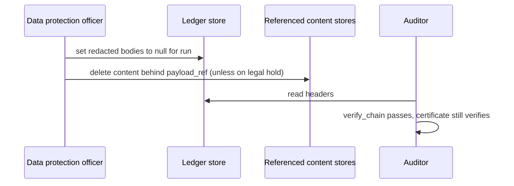

# Evidence ledger and run certificate: architecture

This document describes how a harness records what happened during an agent run as tamper-evident evidence, and how it decides, without asking the model, whether the run is done. It goes deeper on the evidence layer that the [governed context-aware agent harness](../../governed-context-aware-agent-harness/README.md) emits at the end of its loop. The runnable sample is [`samples/evidence_ledger.py`](../samples/evidence_ledger.py).

All identifiers, digests, keys and signatures in this document are illustrative. Digests are shown truncated, for example `sha256:3f9a…`.

## Contents

1. [Problem and forces](#1-problem-and-forces)
2. [Terminology](#2-terminology)
3. [Components](#3-components)
4. [Data model](#4-data-model)
5. [Canonical JSON and digests](#5-canonical-json-and-digests)
6. [Chain verification](#6-chain-verification)
7. [Certificate issuance and withheld reasons](#7-certificate-issuance-and-withheld-reasons)
8. [Offline verification and the definition of done](#8-offline-verification-and-the-definition-of-done)
9. [Threat model](#9-threat-model)
10. [Redaction and purge](#10-redaction-and-purge)
11. [Concurrency and sealing](#11-concurrency-and-sealing)
12. [Sequences](#12-sequences)
13. [Decision matrix](#13-decision-matrix)
14. [Wire contracts](#14-wire-contracts)
15. [Implementation on Azure](#15-implementation-on-azure)
16. [Relationship to sibling assets](#16-relationship-to-sibling-assets)
17. [Domain Packs](#17-domain-packs)
18. [Failure modes](#18-failure-modes)
19. [Anti-patterns](#19-anti-patterns)
20. [Production checklist](#20-production-checklist)
21. [Extension points](#21-extension-points)
22. [References](#22-references)

## 1. Problem and forces

An agent run ends with an artifact: a report, a summary, a notice, a deviation record. Someone downstream must decide whether to release it, act on it or file it. They need to know which sources were read, which tools ran under which policy decision, which checks passed, who approved which version, and whether any of that was changed afterwards.

Three common approaches fail:

- **Logs and traces as the audit record.** Telemetry is sampled, mutable and written by many components. It often contains raw prompts and tool results, and nothing ties a log line to the artifact that was released.
- **The model's own report.** A model can say "all checks look fine" while a total is wrong. In the sample, the model output says exactly that in every scenario, including the ones where a required check fails.
- **Store everything.** Keeping full prompts, tool results and source content in an audit store creates a second copy of sensitive data, with a longer retention period than the data itself and no clean way to honor erasure.

The forces this pattern balances:

| Force | Tension |
|---|---|
| Tamper evidence | An auditor must be able to tell if any recorded step was edited, removed, reordered or appended after the fact, including by someone with write access to the store. |
| Data minimization | The audit record must not become a second store of prompts, source documents, tool results or personal data. |
| Retention and erasure | Readable details must be purgeable on a schedule or on request, without destroying the proof that the run happened as recorded. |
| Independent verification | Auditors, release gates and partners must be able to check a run without calling the system that produced it. |
| Fail-closed completion | "The run finished" and "the work is done" are different claims. Any gap must block release, visibly and with a reason. |
| Concurrency | Steps may be recorded by more than one worker. A lost or reordered write must be rejected, not silently merged. |
| Operability | Operators need reason codes they can alert and act on, not a single pass or fail bit. |

The pattern's answer: the harness, not the model, appends a digest-only record of every step to a hash chain. At the end of the run, a deterministic issuer checks the chain and the evidence, and signs a run certificate that pins the chain head. A run is done only when that certificate is issued, has no withheld reasons and verifies offline.

## 2. Terminology

| Term | Meaning in this pattern |
|---|---|
| **Evidence ledger** | The append-only, per-run sequence of ledger entries. In the sample, written through `EvidenceLedger` into a `LedgerStore`. |
| **Ledger entry** | One recorded step: a header, an `entry_hash` and an optional redacted body. Schema `ledger-entry/v1`. |
| **Header** | The fields covered by `entry_hash`: schema, run ID, sequence number, type, timestamp, actor, trace ID, payload digest, payload reference, redacted digest and previous hash. |
| **Payload** | The full data describing the step, for example tool arguments or a retrieved document. It is hashed into `payload_digest` and never stored in the ledger. |
| **Redacted body** | The few allowlisted payload fields kept in readable form. It sits outside `entry_hash` and is bound through `redacted_digest`. |
| **Redaction allowlist** | The per-type list of payload fields that may appear in the redacted body. Everything else is hashed only. |
| **Payload reference** | An optional pointer (`payload_ref`) to where the content lives under its own access control, such as an artifact URI. |
| **Entry hash** | The digest of the canonical header. |
| **Chain** | Each entry's `prev_hash` equals the previous entry's `entry_hash`. The first entry links to the genesis hash. |
| **Genesis hash** | `sha256:` followed by 64 zeros. The `prev_hash` of entry 1. |
| **Head** | The `entry_hash` of the last entry, together with the entry count. |
| **Seal** | The store state after certification. Further appends fail. |
| **Evidence archive** | Write-once storage for the sealed artifact, header-only ledger and certificate. |
| **Verification receipt** | The verifier's output for one artifact digest: per-check results and a verdict. Schema `verification-receipt/v1`. |
| **Approval decision** | A person's decision bound to an artifact digest and a receipt ID. Schema `approval-decision/v1`. |
| **Run certificate** | The signed document that binds the ledger head, artifact digest, receipt, approval, policy and execution versions. Schema `run-certificate/v1`. |
| **Withheld reason** | A machine-readable code explaining why the certificate status is `withheld` rather than `issued`. |
| **Finding** | A machine-readable problem found while verifying a chain or a certificate, with an optional sequence number. |
| **Offline verification** | Checking a certificate against a copy of the ledger, and optionally the artifact, receipt and approval, using only a trusted key. |
| **Definition of done** | `is_done`: status `issued`, no withheld reasons and no offline findings. |

## 3. Components



| Component | Responsibility | Does not | Sample |
|---|---|---|---|
| Harness | Runs the loop, calls policy, tools, verifier and approval, and appends one entry per step. | Let the model write to the ledger, or decide that the run is done. | `run_scenario` |
| Ledger writer | Reads the head, builds the entry, appends with the expected head. Holds the only write identity. | Accept entries from the model or tools. | `EvidenceLedger` |
| Ledger store | Append-only, per-run storage with optimistic concurrency on the head, and a seal. | Allow update, delete or append after sealing. | `InMemoryLedgerStore`, `CosmosDbLedgerStore` stub |
| Verifier | Runs deterministic checks against the artifact bytes and returns a receipt bound to the artifact digest. | Approve or release anything. | `verify_artifact`, `run_check` |
| Approval surface | Collects a person's decision bound to the artifact digest and receipt ID. | Approve an artifact whose verification failed. | `make_approval` |
| Certificate issuer | Evaluates every withheld rule, builds and signs the certificate, seals the store and archives the evidence. | Skip signing when something is wrong. A withheld certificate is still signed. | `issue_certificate` |
| Signer | Signs the certificate's canonical signing input with a versioned key. | Expose the private key to the issuer. | `InMemoryHmacSigner`, `KeyVaultKeySigner` stub |
| Evidence archive | Stores the artifact, header-only ledger and certificate as write-once objects. | Allow overwrite. | `InMemoryEvidenceArchive`, `BlobEvidenceArchive` stub |
| Offline verifier | Verifies signature, chain and bound digests from copies and a trusted key. | Call the producing system. | `verify_offline` |
| Release gate | Releases or acts on an artifact only when `is_done` is true. | Accept "completed" or a model statement as done. | `is_done` |

## 4. Data model

### Ledger entry

| Field | Covered by `entry_hash` | Meaning |
|---|---|---|
| `schema` | Yes | `ledger-entry/v1`. |
| `run_id` | Yes | The run this entry belongs to. Every entry of a run shares it. |
| `seq` | Yes | 1-based position. Must equal the entry's index plus one. |
| `type` | Yes | One of the entry types below. Unknown types are rejected on write and reported on read. |
| `at` | Yes | UTC timestamp from the harness clock. Must not move backwards. |
| `actor` | Yes | Who performed the step, as a URI such as `harness://evidence-sample` or `tool://search_sources`. |
| `trace_id` | Yes | Correlates the run with telemetry. The ledger never depends on telemetry. |
| `payload_digest` | Yes | Digest of the full canonical payload. |
| `payload_ref` | Yes | Optional pointer to content kept elsewhere under its own access control. |
| `redacted_digest` | Yes | Digest of the redacted body. |
| `prev_hash` | Yes | `entry_hash` of the previous entry, or the genesis hash for entry 1. |
| `entry_hash` | Computed | Digest of the canonical header above. |
| `redacted` | No | The allowlisted body, or `null` after purge. Bound through `redacted_digest`. |

### Entry types and the redaction allowlist

| Type | Actor in the sample | Allowlisted fields (readable) | Hashed only |
|---|---|---|---|
| `run_started` | `harness://evidence-sample` | `profile_id`, `profile_version`, `agent_id`, `agent_version` | `initiated_by`, `task` |
| `policy_decision` | `policy://bounded-autonomy` | `action`, `outcome`, `rule_id`, `profile_version` | none |
| `tool_call_request` | `agent://<agent_id>` | `action`, `policy_decision_seq` | `args` |
| `tool_call_response` | `tool://<action>` | `action`, `status` | `result` |
| `source_retrieved` | `tool://search_sources` | `source_id`, `uri`, `content_digest`, `classification` | none; the harness passes only the content digest, never the content |
| `model_output` | `model://<model-deployment>` | `model_deployment` | `text` |
| `artifact_produced` | `harness://evidence-sample` | `artifact_digest`, `media_type`, `artifact_ref` | none |
| `verifier_result` | `verifier://sample-verifier/1.0.0` | `schema`, `verifier_version`, `artifact_sha256`, `verdict`, `receipt_id` | per-check details, `issued_at` |
| `approval_decision` | `approval://verify-before-approve` | `schema`, `decision_id`, `decision`, `artifact_sha256`, `approver` | `request_id`, `nonce`, `receipt_id`, `decided_at` |
| `run_closed` | `harness://evidence-sample` | `status` | none |

The requester's identity in `run_started` is hashed only. The approver's identity is readable in `approval_decision` because separation of duties must be auditable. Decide this per field with your privacy and audit owners.

### Run certificate

| Field | Content |
|---|---|
| `schema` | `run-certificate/v1`. |
| `status` | `issued` or `withheld`. |
| `run_id`, `trace_id` | The run and its telemetry correlation ID. |
| `subject` | `artifact_digest`, `media_type`, `artifact_ref`, or `null` when no artifact was supplied. |
| `ledger` | `head_hash` and `entry_count` at issuance. This pins the chain. |
| `verification` | `receipt_digest`, `receipt_id`, `verifier_version`, `required_checks`, `all_required_passed` and a list of `{code, passed}`. |
| `approval` | `decision_digest`, `decision_id`, `approver`, `decision`, `decided_at`, or `null`. |
| `policy` | `profile_id`, `profile_version` and `policy_digest`. |
| `execution` | `agent_id`, `agent_version`, `model_deployment`, `model_version`. |
| `timestamps` | `run_started_at`, `run_closed_at`, `issued_at`. |
| `withheld_reasons` | Ordered, de-duplicated reason codes. Empty when issued. |
| `certificate_id` | `cert-` plus the first 16 hex characters of the certificate digest, computed before the signature is added. |
| `signature` | `alg`, `key_id` and `value`. |

### Verification receipt and approval decision

The receipt (`verification-receipt/v1`) carries `artifact_sha256`, `verifier_version`, a list of checks with `code`, `gating`, `status`, `passed` and `detail`, a `verdict` of `verified` or `failed`, `issued_at` and a `receipt_id` such as `vr-7c41…`.

The approval decision (`approval-decision/v1`) carries a `request_id`, a single-use `nonce`, the `artifact_sha256` and `receipt_id` it approves, the `approver`, the `decision`, `decided_at` and a `decision_id` such as `dec-19be…`. The harness requests an approval only after a `verified` verdict. Both documents are ledgered by digest, and the certificate binds both digests.

## 5. Canonical JSON and digests

Every digest in the pattern is computed over canonical JSON bytes, so two parties holding the same data always get the same digest.

- Keys are sorted, separators are compact (`,` and `:`), and output is UTF-8 with non-ASCII characters kept as is.
- Object keys must be strings.
- Floats, `NaN` and infinities are rejected with a `TypeError`. Encode decimal amounts as strings, for example `"1250.00"`. Float formatting differs across languages and would make digests unstable.
- A digest is `sha256:` followed by the lowercase hex SHA-256 of the canonical bytes. `digest_bytes` hashes raw bytes, such as the artifact; `digest_obj` hashes a canonical object.
- Display uses `short()`, which keeps the first 12 hex characters. Never compare truncated digests.

`canonical({"b": 1, "a": {"y": 2, "x": 3}})` yields `{"a":{"x":3,"y":2},"b":1}`, and `digest_obj` gives the same result regardless of key order. The scenario `canonical-json-is-order-independent-and-rejects-floats` pins this behavior.

If verifiers are written in other languages, specify the canonical form in the schema version and test it with shared vectors. RFC 8785 (JSON Canonicalization Scheme) is a reasonable standard to adopt; the sample's form is close to it but is not a full implementation.

## 6. Chain verification

`verify_chain(entries, run_id)` recomputes the chain from the entries alone and returns a list of findings. An empty list means the copy is internally consistent.

1. If there are no entries, return `ledger.empty`.
2. For each entry, in order:
   1. Check `schema` (`ledger.schema`), `seq == index + 1` (`ledger.sequence`), `run_id` (`ledger.run_id`) and `type` (`ledger.type`).
   2. Check that `prev_hash` equals the previous entry's claimed `entry_hash`, or the genesis hash for the first entry (`ledger.prev_hash`).
   3. Recompute the digest of the canonical header and compare it with `entry_hash` (`ledger.entry_hash`).
   4. If the redacted body is present, check that it is an object whose digest equals `redacted_digest` (`ledger.redacted_digest`) and that it holds only allowlisted fields (`ledger.redaction_policy`). A `null` body is skipped, which is what keeps purged ledgers valid.
   5. Check that `at` does not move backwards (`ledger.timestamp`).
3. Check that the first entry is `run_started` (`ledger.first_entry`) and that nothing follows `run_closed` (`ledger.closed_not_last`).

A chain proves internal consistency only. Someone with write access can rewrite every entry and recompute every hash, and a truncated prefix of a valid chain is itself a valid chain. That is why the certificate pins the head hash and the entry count.

| Attack on a ledger copy | Detected by | Self-test scenario |
|---|---|---|
| Edit a redacted body | `ledger.redacted_digest` | `detect-tampered-entry` |
| Edit a header field | `ledger.entry_hash` | `detect-tampered-entry` |
| Edit an entry and recompute its hashes | `ledger.prev_hash` at the next entry | `detect-tampered-entry-with-rehash` |
| Rewrite and recompute the whole chain | Chain passes; `certificate.head_mismatch` | `detect-full-chain-rewrite-via-certificate` |
| Swap two entries | `ledger.sequence` and `ledger.prev_hash` | `detect-reordered-entry` |
| Remove a middle entry | `ledger.sequence`, `ledger.prev_hash` and `certificate.entry_count_mismatch` | `detect-removed-entry` |
| Drop the last entries | Chain passes; `certificate.head_mismatch` and `certificate.entry_count_mismatch` | `detect-truncated-tail-via-certificate` |
| Add a non-allowlisted field to a body and rechain | `ledger.redaction_policy` | `raw-content-stays-out-of-ledger` |

## 7. Certificate issuance and withheld reasons

The issuer fails closed. It evaluates every rule, collects all reasons rather than stopping at the first, and always signs. A withheld certificate is valid, signed evidence that the run is not done, and it tells the operator exactly why.

| Group | Reason | Raised when |
|---|---|---|
| Ledger | `ledger.chain_invalid` | `verify_chain` returns any finding. |
| Ledger | `ledger.not_closed` | The last entry is not `run_closed`. |
| Run | `run.not_completed` | `run_closed` is present but its status is not `completed`, or its body was purged before issuance. |
| Artifact | `artifact.missing` | No artifact bytes or metadata were supplied. |
| Artifact | `artifact.digest_mismatch` | The last `artifact_produced` entry's payload digest does not match the subject built from the supplied bytes. |
| Verification | `verification.no_required_checks` | The run context requires no checks. An empty requirement never certifies. |
| Verification | `verification.missing` | No receipt was supplied. |
| Verification | `verification.report_not_in_ledger` | The receipt's digest is not the payload digest of any `verifier_result` entry. |
| Verification | `verification.stale_artifact` | The receipt was issued for a different artifact digest. |
| Verification | `verification.required_check_missing:<code>` | A required check is absent from the receipt. |
| Verification | `verification.required_check_failed:<code>` | A required check did not pass. |
| Approval | `approval.missing` | No approval decision was supplied. |
| Approval | `approval.not_in_ledger` | The decision's digest is not the payload digest of any `approval_decision` entry. |
| Approval | `approval.rejected` | The decision is not `approve`. |
| Approval | `approval.artifact_mismatch` | The decision approves a different artifact digest. |
| Approval | `approval.receipt_mismatch` | The decision references a different receipt. |
| Approval | `approval.self_approval` | The approver is the agent or the principal who initiated the run. |
| Policy | `policy.unauthorized_tool_call:<seq>` | A tool call has no earlier `allow` decision for the same action. |
| Policy | `policy.profile_mismatch` | `run_started` and `policy_decision` entries carry a profile version other than the run context's. |

Rules worth calling out:

- **The receipt's verdict is not trusted.** The issuer recomputes pass or fail per required check from the check list. A check passes only when `passed` is `true` and `status` is `passed`. The `--skip-check` scenario produces a receipt whose own verdict is `verified`, and the certificate is still withheld.
- **Required checks come from the run context**, not from the receipt. In the sample, they are every check code of the Domain Pack.
- **A clean artifact does not redeem a bad run.** In the `--unauthorized-tool-call` scenario, the artifact passes every check and is approved, and the certificate is still withheld with `policy.unauthorized_tool_call:8`.
- **`completed` is not done.** `run_closed` says execution finished. Only the certificate says the work is done. See [ADR 0003](decisions/0003-withheld-certificate-means-not-done.md).

The signing input is the canonical certificate with `signature.value` removed but `signature.alg` and `signature.key_id` kept, so the algorithm and key cannot be swapped without breaking the signature. After signing, the issuer seals the run in the store and writes `<run_id>/artifact.json`, `<run_id>/ledger.json` (headers only) and `<run_id>/certificate.json` to the archive.

## 8. Offline verification and the definition of done

`verify_offline(cert, entries, trusted, *, artifact_bytes, receipt, approval)` needs only the certificate, a copy of the ledger (headers are enough), a map of trusted key IDs to verifiers, and optionally the artifact bytes, receipt and approval documents.

1. **Signature.** `certificate.schema` for an unexpected schema. Then exactly one of `certificate.untrusted_key` (key ID not trusted), `certificate.alg_mismatch` (for example `none`) or `certificate.signature_invalid`.
2. **Chain.** Every finding from `verify_chain` for the certificate's run ID.
3. **Pin.** `certificate.head_mismatch` and `certificate.entry_count_mismatch` against the certified `ledger` block.
4. **Subject.** `certificate.artifact_not_in_ledger` if the subject digest was never ledgered, and `certificate.artifact_mismatch` if supplied bytes do not match.
5. **Receipt.** `certificate.receipt_not_in_ledger` and, if a receipt is supplied, `certificate.receipt_mismatch`.
6. **Approval.** `certificate.approval_not_in_ledger` and, if a decision is supplied, `certificate.approval_mismatch`.

The definition of done is `is_done(cert, findings)`: status `issued`, an empty `withheld_reasons` list and no findings. Two consequences matter in practice:

- A withheld certificate can verify with no findings. It is valid evidence of an unfinished run, and `is_done` is still false.
- Editing a withheld certificate to say `issued` breaks the signature, so `is_done` stays false. The scenario `withheld-certificate-is-not-done` pins both.

The sample's offline verifier does not recompute `policy_digest` from a policy document, and does not re-derive the withheld reasons from the ledger. It trusts the issuer's evaluation, bound by the signature. See [extension points](#21-extension-points).

## 9. Threat model

| Threat | Who | Control | Residual risk |
|---|---|---|---|
| Model or tool output tries to write or rewrite evidence | Prompt injection through retrieved content or tool results | Only the harness holds the writer and its identity. The model never sees the ledger object. | None from this path, if the harness has no generic "write ledger" tool. |
| Edit, reorder or remove entries in the store | Operator or attacker with store access | Hash chain, entry count and head pinned by the signed certificate. | Before issuance, a writer can still rewrite the run. Shorten the window and anchor heads externally (section 21). |
| Truncate the tail to hide the last steps | Same | Certified head and count. | Same. |
| Smuggle raw content into the readable body | Defective or malicious harness code | Allowlist enforced on write (`redact`) and on read (`ledger.redaction_policy`). | Content placed inside an allowlisted field, such as a URI. Validate allowlisted field formats. |
| Forge or replay an approval | Anyone with access to the approval channel | Approval digest must be in the ledger; bound to artifact digest and receipt ID; single-use nonce. | Compromised approver account. Use strong authentication and review approver role assignments. |
| Self-approval | The initiator or the agent | `approval.self_approval`. | Collusion between two people. Out of scope for the ledger. |
| Promote a withheld certificate to issued | Anyone handling the certificate | Signature over the whole certificate. | None while the key is safe. |
| Algorithm downgrade or key swap | Anyone handling the certificate | `alg` and `key_id` are in the signing input; the verifier pins `alg` per trusted key. | None. |
| Swap the artifact after approval | Anyone with artifact storage access | Subject digest, receipt and approval all bind the artifact digest; archive is write-once. | None for archived bytes. |
| Run a denied action anyway | Harness or tool defect, enforcement bypass | `policy.unauthorized_tool_call:<seq>` withholds the certificate. | Detection is after the fact. Tools must also authorize the harness identity independently. |
| Steal the signing key | Insider or compromised host | Asymmetric key in Key Vault or Managed HSM; sign permission only for the issuer identity; versioned key IDs. | Certificates signed during the compromise. Rotate, distrust the version, and re-verify. |
| Compromised issuer | Attacker controlling the issuer identity | Separate identity from the writer; offline re-derivation of reasons (extension). | The issuer can sign a false `issued`. This is the main residual risk; see section 21. |
| Infer content from digests | Reader of the ledger | Digests only for content; readable fields are minimal. | Low-entropy values, such as an ID from a small set, can be guessed by hashing candidates. Use keyed digests for those fields (section 21). |
| Clock manipulation | Harness host | Timestamps must not move backwards. | Absolute time is only as good as the harness clock. |

## 10. Redaction and purge

Content is protected in two layers.

1. **Hashed only.** Fields outside the allowlist, such as source content, tool arguments, tool results, model text and the requester's identity, never enter the ledger. Only `payload_digest` represents them. The scenario `raw-content-stays-out-of-ledger` checks that the domain markers, model text, initiator and source content do not appear anywhere in the canonical ledger.
2. **Readable but purgeable.** Allowlisted fields sit in the `redacted` body, outside `entry_hash`, bound by `redacted_digest`. Setting a body to `null` removes the readable details and leaves the chain valid, because `verify_chain` skips `null` bodies.

`strip_bodies(entries)` performs the purge on copies. The archive stores the stripped form, so the long-lived record is headers only. The scenario `purge-redacted-bodies-keeps-chain-valid` shows that the original certificate still verifies against stripped entries.

**Issue before purging.** The issuer reads bodies to evaluate rules such as `run_closed.status` and the policy decisions. Re-issuing from stripped entries yields `withheld` with `run.not_completed`. Purge only after the certificate exists.

Content referenced by `payload_ref`, such as the artifact itself, lives in other stores under their own retention and erasure rules. Deleting it does not affect the chain; it only means that `artifact_bytes` can no longer be supplied to `verify_offline`. Coordinate legal holds across the archive and those stores. See [authentication and governance](authentication-and-governance.md#5-retention-legal-hold-and-erasure).

## 11. Concurrency and sealing

The writer appends with the head it read. `InMemoryLedgerStore.append` checks, in this order:

1. The run is sealed: `LedgerSealedError`.
2. `expected_head` is not the current head: `StaleHeadError`. Another writer moved the head; re-read and rebuild the entry.
3. The entry's `run_id`, `prev_hash` or `seq` does not extend the current head: `LedgerError`.

A rejected append changes nothing, and `build_entry` refuses unknown entry types before anything reaches the store. The scenario `reject-append-on-stale-head-and-sealed` covers all four errors.

After issuance, the issuer seals the run so that nothing can be appended after the certified head, and the archive refuses overwrites with `ImmutableWriteError`.

In production, map the head check to the store's conditional write. In Azure Cosmos DB, keep each run in one logical partition (`/run_id`), store a head item alongside the entries, and append with a transactional batch that creates the entry and replaces the head item with an ETag `if-match` condition. A failed precondition maps to `StaleHeadError`. Prefer one writer per run; if several workers record steps, route their appends through the harness so that ordering is a harness decision, not a race.

## 12. Sequences

### 12.1 Happy path



### 12.2 Withheld on a failed check



### 12.3 Offline audit



### 12.4 Purge for retention or erasure



## 13. Decision matrix

| Situation | Sample command | Certificate | Withheld reasons | Done | Exit code |
|---|---|---|---|---|---|
| Everything passes and is approved | `--domain prior-auth` | issued | none | yes | 0 |
| A required check fails | `--fail-check recompute.totals` | withheld | `verification.required_check_failed:recompute.totals`, `approval.missing` | no | 2 |
| A required check is not run | `--skip-check grounding.citations` | withheld | `verification.required_check_missing:grounding.citations` | no | 2 |
| No approval recorded | `--no-approval` | withheld | `approval.missing` | no | 2 |
| Approval rejected | self-test only | withheld | `approval.rejected` | no | n/a |
| Approval for a different artifact | self-test only | withheld | `approval.artifact_mismatch` | no | n/a |
| Initiator approves own run | self-test only | withheld | `approval.self_approval` | no | n/a |
| A denied tool call ran | `--unauthorized-tool-call` | withheld | `policy.unauthorized_tool_call:8` | no | 2 |
| Artifact swapped after the run | self-test only | withheld on reissue | `artifact.digest_mismatch`, `verification.stale_artifact`, `approval.artifact_mismatch` | no | n/a |
| Ledger rewritten after issuance | self-test only | issued, but offline finding | `certificate.head_mismatch` | no | n/a |
| Certificate verified with an untrusted key | self-test only | issued, but offline finding | `certificate.untrusted_key` | no | n/a |

## 14. Wire contracts

A ledger entry as archived (body purged). Values are truncated and illustrative.

```json
{
  "schema": "ledger-entry/v1",
  "run_id": "run-financial-report-0001",
  "seq": 5,
  "type": "source_retrieved",
  "at": "2026-10-21T09:00:04Z",
  "actor": "tool://search_sources",
  "trace_id": "4bf2…",
  "payload_digest": "sha256:9c0e…",
  "payload_ref": "evidence://contoso-bank/finance/liquidity-extract-q3.csv",
  "redacted_digest": "sha256:71d3…",
  "prev_hash": "sha256:a24b…",
  "entry_hash": "sha256:3f9a…",
  "redacted": null
}
```

An issued certificate.

```json
{
  "schema": "run-certificate/v1",
  "status": "issued",
  "run_id": "run-financial-report-0001",
  "trace_id": "4bf2…",
  "subject": {"artifact_digest": "sha256:e810…", "media_type": "application/json", "artifact_ref": "evidence://artifacts/run-financial-report-0001/artifact.json"},
  "ledger": {"head_hash": "sha256:5b77…", "entry_count": 11},
  "verification": {
    "receipt_digest": "sha256:0d4c…",
    "receipt_id": "vr-7c41…",
    "verifier_version": "1.0.0",
    "required_checks": ["recompute.totals", "grounding.citations", "disclosure.distribution_list"],
    "all_required_passed": true,
    "checks": [{"code": "recompute.totals", "passed": true}, {"code": "grounding.citations", "passed": true}, {"code": "disclosure.distribution_list", "passed": true}]
  },
  "approval": {"decision_digest": "sha256:c2a9…", "decision_id": "dec-19be…", "approver": "principal:risk-reviewer-07", "decision": "approve", "decided_at": "2026-10-21T09:00:10Z"},
  "policy": {"profile_id": "profile:financial-reporting", "profile_version": "2026-10-01", "policy_digest": "sha256:8e15…"},
  "execution": {"agent_id": "risk-summary-writer", "agent_version": "1.4.0", "model_deployment": "<model-deployment>", "model_version": "<model-version>"},
  "timestamps": {"run_started_at": "2026-10-21T09:00:00Z", "run_closed_at": "2026-10-21T09:00:11Z", "issued_at": "2026-10-21T09:00:12Z"},
  "withheld_reasons": [],
  "certificate_id": "cert-5d1e…",
  "signature": {"alg": "ES256", "key_id": "https://<vault-name>.vault.azure.net/keys/run-certificate/<version>", "value": "q8Zt…"}
}
```

The sample signs with `HS256` and the key ID `memory://keys/run-certificate/v1`. The example above shows the production shape with an asymmetric Key Vault key. Run `python samples/evidence_ledger.py --json` to see the full, untruncated output.

## 15. Implementation on Azure

The ledger writer and issuer run inside the harness process. Azure services provide the store, the archive, the key, identity and telemetry. The seams in the sample (`LedgerStore`, `EvidenceArchive`, `Signer`) are where they plug in. Confirm API shapes, role names and feature availability against current documentation before you build.

| Concern | Azure service | How it is used | Notes |
|---|---|---|---|
| Harness, writer and issuer runtime | Microsoft Foundry Agent Service, including hosted agents, or your own container host | The writer and issuer run in-process in the harness. The model never receives a ledger tool. | Hosted agents are in preview at the time of writing; check current availability. |
| Live ledger store | Azure Cosmos DB for NoSQL | One container, partition key `/run_id`, item ID `{run_id}:{seq:08d}` plus a head item with `head_hash`, `count` and `sealed`. Append is a transactional batch: create the entry and replace the head with an ETag condition. | Disable key-based auth and use Microsoft Entra data-plane RBAC. Only the harness identity can write. See `CosmosDbLedgerStore`. |
| Sealed evidence archive | Azure Blob Storage with immutable storage | Versioning plus version-level immutability. Upload with overwrite disabled and record the version ID. Time-based retention for the retention period; legal holds for litigation or investigations. | Keep the policy unlocked while testing. A locked time-based policy can be extended but not shortened or removed. See `BlobEvidenceArchive`. |
| Certificate signing | Azure Key Vault keys (or Managed HSM) | An EC key; the issuer calls the sign operation with ES256 over the SHA-256 of the signing input. The private key never leaves the vault. | Publish the public key and use versioned key IDs so rotation does not invalidate older certificates. See `KeyVaultKeySigner`. |
| Simple symmetric option | Azure Key Vault secrets | `KeyVaultSecretHmacSigner` reads an HMAC secret and signs with HS256. | The secret leaves the vault and every verifier needs it. Use only for internal verification. |
| Identities and roles | Microsoft Entra ID | Managed identities for the harness writer and the issuer; app roles for approvers, auditors and purge operators. | See [authentication and governance](authentication-and-governance.md). |
| Telemetry and alerts | Azure Monitor and Application Insights | OpenTelemetry spans and events for appends, issuance and verification, with reason codes, run ID and `trace_id` as attributes, never content. | Telemetry is for dashboards and alerts. The ledger is the evidence. |
| Offline verification | Any compute: CI pipeline, release gate, auditor workstation | Read the archive with read-only access, resolve the public key, run the equivalent of `verify_offline` and `is_done`. | Needs no access to the harness, the store or the vault's sign permission. |

| Sample seam | In-memory implementation | Production adapter (stub in the sample) |
|---|---|---|
| `LedgerStore` | `InMemoryLedgerStore` | `CosmosDbLedgerStore(endpoint, database, container)` |
| `EvidenceArchive` | `InMemoryEvidenceArchive` (`memory://evidence/…`) | `BlobEvidenceArchive(account_url, container)` |
| `Signer` | `InMemoryHmacSigner` (HS256, sample-only key) | `KeyVaultKeySigner(key_id)` (ES256) or `KeyVaultSecretHmacSigner(vault_url, secret_name)` (HS256) |

Every stub raises `NotImplementedError` and makes no network call. The scenario `azure-adapters-are-stubs` checks that they satisfy the seam protocols.

## 16. Relationship to sibling assets

| Asset | What it covers | How the ledger relates |
|---|---|---|
| [Governed context-aware agent harness](../../governed-context-aware-agent-harness/README.md) | Reference architecture composing plan-before-act, progressive disclosure, memory, verifier, approval, ledger and certificate. | This asset is the deep dive on the ledger and certificate the harness emits. |
| [Verify before approve](../../verify-before-approve/README.md) | Gating a human approval on verifier results and binding it to an artifact digest. | The receipt and decision it produces are ledgered by digest and bound into the certificate. |
| [Bounded autonomy](../../bounded-autonomy/README.md) | Allow, deny and escalate decisions under budgets and an action envelope. | Its decisions are `policy_decision` entries. A call without a prior allow withholds the certificate. |
| [Progressive tool loading](../../progressive-tool-loading/README.md) | When tools are exposed to the model. | Exposure is not evidence. The ledger records which tools were called, under which decision. |
| [Hosted agent OpenTelemetry trace receiver](../../../agent-runtime/hosted-agent-otel-trace-receiver/README.md) | Collecting traces from hosted agents for observability. | Shares `trace_id` for correlation. Different guarantees, see below. |
| [Request context is not authorization](../../../agent-runtime/request-context-is-not-authorization/README.md) | Authorization from server-verified identity. | Approver and initiator identities come from verified tokens, never from prompt content. |
| [Enterprise agent security and tool governance](../../../security-and-governance/agent-security-and-governance/README.md) | Identity, guardrails and governance around agents. | Supplies the identity and governance controls around the writer and signer. |
| [Agent production readiness guide](../../../agentops-and-readiness/agent-production-readiness/README.md) | Release gates and operating model. | Release gates consume `is_done`. |

| Property | Traces and logs | Evidence ledger |
|---|---|---|
| Purpose | Operate and debug the system | Prove what happened in one run |
| Completeness | Often sampled | Every step, or the certificate is withheld |
| Mutability | Mutable, retention-managed | Append-only, hash-chained, sealed, archived write-once |
| Content | Often includes payloads | Digests, references and allowlisted fields only |
| Writers | Many components | The harness identity only |
| Verification | None | Offline, with a trusted key |

## 17. Domain Packs

The same ledger, issuer and verifier run unchanged across industries. Only the agent, profile, sources, checks and blocked action differ. Run any pack with `--domain`.

| Pack | Organization | Agent | Profile | Initiated by | Approver | Blocked action | Required checks |
|---|---|---|---|---|---|---|---|
| `financial-report` | Contoso Bank | `risk-summary-writer` | `profile:financial-reporting` | `principal:analyst-01` | `principal:risk-reviewer-07` | `send_external_email` | `recompute.totals`, `grounding.citations`, `disclosure.distribution_list` |
| `prior-auth` | Fabrikam Health | `prior-auth-summarizer` | `profile:utilization-review` | `principal:intake-nurse-03` | `principal:medical-reviewer-11` | `write_claims_system` | `eligibility.service_date`, `grounding.criteria_cited`, `phi.minimum_necessary` |
| `quality-deviation` | Northwind Manufacturing | `deviation-reporter` | `profile:quality-management` | `principal:quality-engineer-05` | `principal:quality-manager-02` | `release_quarantined_lot` | `spec.limits_recomputed`, `traceability.lot_genealogy`, `capa.owner_assigned` |
| `case-decision` | Northwind County | `case-notice-drafter` | `profile:benefits-adjudication` | `principal:caseworker-14` | `principal:supervisor-06` | `send_notice_to_applicant` | `eligibility.recompute`, `statute.references_valid`, `notice.appeal_deadline` |

Each pack uses one of four deterministic check kinds per check, and `--fail-check` corrupts the artifact so that exactly that check fails:

| Check kind | Passes when | Corruption used by `--fail-check` |
|---|---|---|
| `recompute` | The stated total equals the decimal sum of the line amounts. | Adds 1.00 to the stated total. |
| `grounding` | Every claim cites a source that was actually retrieved in this run. | Adds a claim citing `src-unretrieved`. |
| `required_field` | A named field is present and non-empty. | Blanks the field. |
| `no_marker` | A sensitive record marker, such as `ACCT-SAMPLE-0042`, is absent from the artifact. | Appends the marker. |

Source URIs use the form `evidence://<organization>/…`. The markers are synthetic: `ACCT-SAMPLE-0042`, `MBR-SAMPLE-0042`, `SUPPLIER-SAMPLE-0042` and `CASE-SAMPLE-0042`.

## 18. Failure modes

| Failure | Effect without the pattern | Behavior with the pattern | Further mitigation |
|---|---|---|---|
| Ledger store unavailable | Steps run with no record. | The harness cannot append, so it must stop the run; the certificate can never be issued. | Highly available store; alert on append failures; do not buffer evidence in the model context. |
| Concurrent writers | Interleaved or lost steps. | `StaleHeadError`; the writer re-reads and rebuilds. | One writer per run; route all appends through the harness. |
| Late append after certification | Evidence added after the fact. | `LedgerSealedError`. | Alert on sealed-append attempts. |
| Archive overwrite | Evidence replaced. | `ImmutableWriteError`; Blob immutability in production. | Lock the immutability policy after testing. |
| Purge before issuance | Certificate cannot be evaluated. | Reissue gives `run.not_completed`. | Issue first; schedule purge from the certificate's `issued_at`. |
| Signing key unavailable | No certificate. | The run is not done. | Retry issuance; the ledger is sealed only after signing succeeds. |
| Signing key rotated | Old certificates fail to verify. | Versioned key IDs keep old certificates verifiable. | Keep previous public keys published for the retention period. |
| Key compromised | False certificates. | Not prevented by the ledger alone. | Distrust the key version, re-verify affected certificates from the archive, re-issue where needed. |
| Verifier misses a defect | A wrong artifact is certified. | The certificate records which checks ran, at which version. | Improve checks; required checks are versioned through the profile. |
| Receipt says verified but a required check is absent | Gaps hidden behind a green verdict. | `verification.required_check_missing:<code>`. | Keep required checks in the profile, not in the verifier. |
| Denied tool call executed through a defect | Side effect with no visible consequence. | `policy.unauthorized_tool_call:<seq>`. | Tools authorize the harness identity independently; alert on this reason. |
| Telemetry used as evidence | Gaps from sampling; content leaks. | Evidence comes from the ledger only. | Keep telemetry content-free and correlated by `trace_id`. |
| Clock skew on the harness host | Confusing timestamps. | Backwards timestamps raise `ledger.timestamp`. | Use a synchronized clock source. |

## 19. Anti-patterns

- **Letting the model write the ledger.** A "record evidence" tool turns injection into forged evidence. The harness records steps; the model only proposes them.
- **Logs as evidence.** Sampled, mutable, multi-writer telemetry cannot prove anything about a specific run.
- **Storing raw content "for completeness".** The audit store becomes the most sensitive store you have. See [ADR 0002](decisions/0002-digests-not-content-in-ledger.md).
- **A hash chain without a pinned head.** A writer can rewrite and recompute the whole chain, or truncate it. See [ADR 0001](decisions/0001-hash-chain-plus-signed-certificate.md).
- **Not signing when something is wrong.** A missing certificate is ambiguous. A signed withheld certificate is evidence with reasons.
- **Treating `completed` as done.** Execution finishing is not the same as verified, approved, policy-compliant work. See [ADR 0003](decisions/0003-withheld-certificate-means-not-done.md).
- **Trusting the verifier's verdict.** Recompute required checks from the check list and the profile.
- **Floats in evidence.** Float formatting differs across runtimes and breaks digests.
- **A shared HMAC secret for external verification.** Anyone who can verify can also forge.
- **Purging before certifying.** The issuer needs the bodies.

## 20. Production checklist

- [ ] Every step type the harness performs maps to an entry type with a reviewed redaction allowlist.
- [ ] Only the harness identity can append, and the model has no tool that writes evidence.
- [ ] Canonical JSON rules are documented, versioned with the schema and tested with shared vectors in every verifier language.
- [ ] Amounts and measurements are strings or integers, never floats.
- [ ] The live store enforces the expected-head condition and the seal, and rejects updates and deletes.
- [ ] Required checks come from the versioned profile, not from the verifier or the model.
- [ ] Approvals are bound to the artifact digest and receipt ID, and the approver is never the initiator or the agent.
- [ ] Every policy decision is ledgered before the tool call it authorizes.
- [ ] The certificate is signed with an asymmetric, versioned key in Key Vault or Managed HSM, and the public keys are published.
- [ ] Sealed evidence is written to immutable storage with a retention policy and legal hold procedures.
- [ ] Bodies are purged only after issuance, on a schedule owned by data protection.
- [ ] Every release gate and downstream consumer calls the equivalent of `is_done`.
- [ ] Telemetry carries reason codes, run IDs and trace IDs, never content.
- [ ] The tamper drills (like `--self-test`) run in CI against every change to the ledger, issuer or verifier.
- [ ] Key rotation and key compromise procedures have been exercised in a non-production environment.

## 21. Extension points

- **Recompute the policy digest offline.** Fetch the profile document by `profile_id` and `profile_version` from a versioned store and compare its digest with `policy.policy_digest`.
- **Re-derive withheld reasons offline.** Replay the issuer's rules from the ledger bodies, receipt and approval, and compare with the certificate. This removes trust in the issuer's evaluation and addresses the compromised-issuer risk while bodies are still available.
- **Anchor heads externally.** Periodically write certificate digests, or a Merkle root over them, to a separate immutable store or transparency log owned by a different team. This narrows the window in which a writer can rewrite a run before issuance.
- **Keyed digests for low-entropy fields.** Use an HMAC with a separately managed key for fields like identifiers drawn from small sets, so digests cannot be reversed by guessing.
- **Counter-signatures.** Let the approver or a second issuer sign the certificate too.
- **Multiple artifacts.** Extend `subject` to a list, with one `artifact_produced` entry per artifact.
- **New entry types.** Add the type and its allowlist, and bump the schema version so older verifiers reject what they cannot check.
- **Certificate status list.** Publish revoked certificate IDs or distrusted key versions for verifiers to consult.
- **Bounded-autonomy records.** Record budget and escalation decisions as additional entry types, so stop decisions are part of the evidence.

## 22. References

- [What is Microsoft Foundry Agent Service?](https://learn.microsoft.com/azure/foundry/agents/overview)
- [Hosted agents in Foundry Agent Service](https://learn.microsoft.com/azure/foundry/agents/concepts/hosted-agents)
- [About Azure Key Vault keys](https://learn.microsoft.com/azure/key-vault/keys/about-keys)
- [Overview of immutable storage for blob data](https://learn.microsoft.com/azure/storage/blobs/immutable-storage-overview)
- [Transactional batch operations in Azure Cosmos DB](https://learn.microsoft.com/azure/cosmos-db/nosql/transactional-batch)
- [Enable Azure Monitor OpenTelemetry](https://learn.microsoft.com/azure/azure-monitor/app/opentelemetry-enable)
- [Add app roles to your application and receive them in the token](https://learn.microsoft.com/entra/identity-platform/howto-add-app-roles-in-apps)
- [RFC 8785: JSON Canonicalization Scheme](https://www.rfc-editor.org/rfc/rfc8785)
