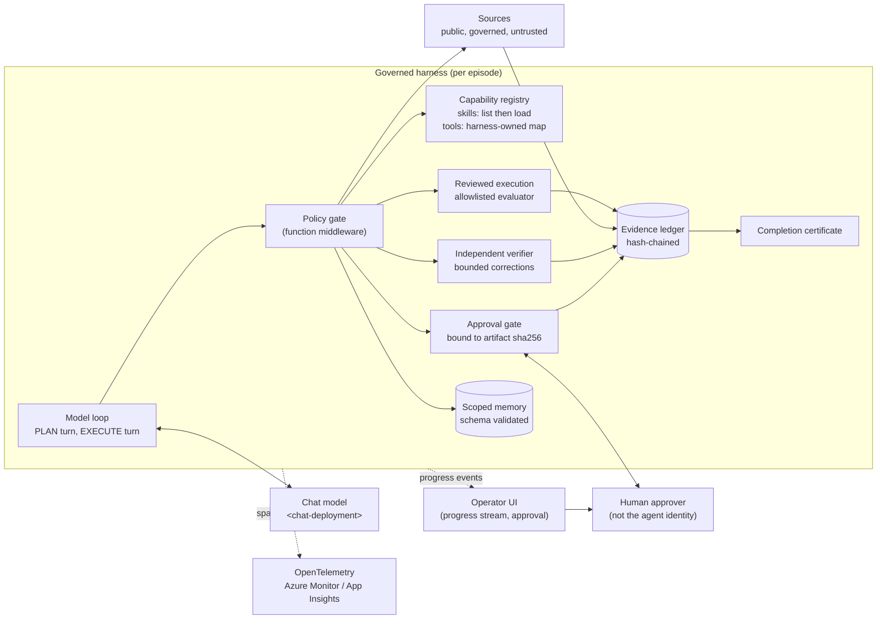

# Governed Context-Aware Agent Harness

> **Maturity:** preview · **Kind:** reference-architecture · **Category:** `orchestration-and-workflows` · **Version:** 0.1.0

A model that writes a fluent, well-cited report has not necessarily done the work. It may have skipped a step, used a number it never computed, aligned an event to the wrong date, cited a source that was never admitted, or asked a human to approve a draft that differs from the one that was checked. Better prompts do not fix this. Neither does better context alone. What fixes it is the **harness**: the runtime code around the model that decides what the model can see, which tools it can call and when, what counts as evidence, who checks the result, who approves it, and what gets recorded.

This reference architecture describes a **governed, context-aware agent harness** for a single agent that does multi-step, evidence-bearing work (research briefings, case summaries, eligibility letters, deviation reports). The harness:

- makes a **plan mandatory** before any domain tool runs, and requires the plan to cover retrieve, compute, render, verify and approve;
- **discloses skills progressively**: the model sees a short catalog, loads a skill's instructions only when it needs them, and the harness (not the skill) decides which tools that unlocks;
- runs computation through a **reviewed, allowlisted evaluator** rather than free-form code generation;
- records every plan, source snapshot, analysis, artifact, verification, approval and memory write in a **hash-chained evidence ledger**;
- has an **independent deterministic verifier** recompute the artifact from admitted evidence, with a **bounded** number of correction attempts;
- binds a **separate human approval** to the **sha256 digest of the exact verified artifact**, never to a description of it;
- keeps **scoped memory** across episodes, validated by schema and policy before it is written or recalled;
- emits a **completion certificate** only when every boundary was satisfied, plus progress events for the UI and OpenTelemetry spans for operations.

> **Core thesis:** *A convincing report is not the same as a correctly completed task. Prompt engineering shapes what the model says; context engineering shapes what it knows; harness engineering decides what counts as done. Enforce the boundaries (plan, evidence, verification, approval), not a fixed transcript, and let only the harness, never the model's narration, declare completion.*

The worked example throughout is an **equity-event briefing (synthetic)**: given a fictional company announcement, compute a market-adjusted abnormal return on the correct trading day and render a cited briefing. The data, company and policy are invented for illustration. **Synthetic example. Not investment advice.** The [Domain Packs](#domain-packs) show the same harness applied to insurance, healthcare, manufacturing and public-sector work.

Microsoft Agent Framework, Microsoft Foundry and Azure Monitor features evolve quickly, and several of the capabilities referenced here (progressive tool exposure, file-backed memory providers) are marked experimental in the framework at the time of writing. Every statement about product behavior is qualitative and must be **verified against current documentation** before you rely on it. The simulator is a standard-library model of the harness, not a deployment of it.

## Architecture and implementation map

| Layer / concern | Deep-dive documentation | Executable reference |
|---|---|---|
| **Problem, invariants, components, lifecycle, module contracts, wire contracts, profiles, context engineering, Agent Framework mapping, production path** | [`docs/architecture.md`](docs/architecture.md) · [ADR 0001](docs/decisions/0001-harness-enforces-boundaries-not-transcripts.md) · [ADR 0002](docs/decisions/0002-progressive-skill-disclosure-over-all-loaded.md) · [ADR 0003](docs/decisions/0003-approval-binds-to-verified-artifact-digest.md) | [`samples/harness_sim.py`](samples/harness_sim.py): offline simulation of the full episode with `--self-test` (17 scenarios), `--near-miss` and profile selection |
| **Identity, separation of duties, immutable controls, audit trail, memory data handling, threat model** | [`docs/authentication-and-governance.md`](docs/authentication-and-governance.md) | Approver separation, digest binding, ledger tamper detection and memory validation scenarios in the simulator |
| **Evaluation, release gates, troubleshooting** | [`docs/evaluation-and-troubleshooting.md`](docs/evaluation-and-troubleshooting.md) | Scenario catalog mapped to simulator tests, qualitative metrics, troubleshooting table |
| **Reference module layout and skill packaging** | [`src/README.md`](src/README.md) | Module-to-class map for `harness_sim.py`; Agent Framework integration notes |

## Domain Packs

The harness is domain-neutral. A Domain Pack supplies the plan stages, the sources and their trust labels, the reviewed computation, the verifier checks, the approver role and the memory lesson. Four examples (all fictional organizations):

| Domain | Artifact | Evidence the verifier recomputes | Approver (separate identity) |
|---|---|---|---|
| **Equity-event briefing (worked example, synthetic)** | Cited briefing with abnormal return | Event date from the filing timestamp and trading calendar; return from admitted prices with the approved expression | Research reviewer |
| **Insurance claims adjudication** (Contoso Insurance) | Claim decision memo | Coverage dates against policy period; payable amount from deductible, limit and line items | Claims adjuster |
| **Healthcare prior-authorization summary** (Fabrikam Health) | Prior-auth summary for a clinician | Criteria checklist against the coverage policy; cited chart elements exist in the admitted record; no restricted identifiers | Licensed clinical reviewer |
| **Manufacturing quality deviation report** (Northwind Manufacturing) | Deviation report and disposition | Out-of-spec values recomputed from sensor and inspection records against the specification revision in force | Quality engineer |
| **Public-sector benefits eligibility letter** (Contoso County) | Eligibility determination letter | Income and household tests recomputed from admitted documents against the rule table for the effective date | Eligibility caseworker |

See [`docs/architecture.md`, section 12](docs/architecture.md#12-domain-packs) for the full mapping, including memory lessons and domain-specific failure modes.

## When to use

- An agent produces an **artifact that someone will act on** (a briefing, decision memo, letter, report) and a wrong number, wrong date or uncited claim has real cost.
- The work has **mandatory steps** (retrieve, compute, verify, approve) that must happen in a defensible order, but the model should still choose how to get there.
- You need to **prove afterwards** what the agent saw, computed and produced, and who approved which exact version.
- The agent has **many possible skills or tools** and loading all of them on every turn bloats context and invites misuse.
- Lessons should **carry across runs** (for example "this rule applied last time") without letting a poisoned memory steer the next run.
- You are moving from a demo to a [hosted agent on Foundry](../../agent-runtime/production-hosted-agents-on-foundry/README.md) and need controls that survive the move.

## When not to use

- **Single-shot Q&A or chat** where nothing is acted on and a human reads the answer anyway. A prompt agent is enough; see [choosing between prompt and hosted agents](../../agent-runtime/choosing-prompt-vs-hosted-agents/README.md).
- **Fixed, fully deterministic pipelines.** If every step and its order are known in advance, write a workflow; do not ask a model to plan it.
- **No deterministic check exists.** If nothing about the artifact can be recomputed or checked from evidence, a verifier cannot be independent and this harness degrades to a review queue. Use human review and the [verify-before-approve](../verify-before-approve/README.md) gate on whatever *can* be checked.
- **Multi-agent decomposition is the core problem.** This architecture is one agent with skills. It does not model sub-agents, delegation or agent-to-agent trust.
- **You need an OS-level sandbox for arbitrary model-written code.** The reference evaluator is an in-process allowlist. Use [sandboxed code execution with session pools](../../agent-runtime/code-execution-sandbox-session-pools/README.md) for untrusted code.

## Architecture



1. **Plan.** The PLAN turn reads episode state and (optionally) validated memory, then records a plan. The policy gate refuses every domain tool until a plan exists that covers the mandatory stages.
2. **Discover and load.** The model lists the skill catalog (names and one-line descriptions) and loads only the skills it needs. Loading a skill reveals its instructions and, through a harness-owned map, the tools that skill unlocks.
3. **Retrieve.** Sources are snapshotted and admitted by trust label: untrusted sources are excluded, restricted ones are projected to a safe field, unknown labels fail closed. Every snapshot is pinned by content hash.
4. **Compute.** The analysis runs through an allowlisted expression evaluator against admitted inputs only. Unsafe expressions are rejected, not executed.
5. **Render.** The artifact is rendered with required sections and citations and hashed.
6. **Verify.** The independent verifier recomputes figures, dates and provenance from the ledger. On failure it returns failed check codes and a correction hint; after the attempt budget is spent the run ends without approval.
7. **Approve.** The harness sends an approval request carrying the artifact's sha256 digest to an approver who is not the agent. A decision for any other digest is rejected. The artifact is frozen once approval is requested.
8. **Retain and certify.** A validated memory lesson is written to the run's scope, and the harness issues a completion certificate listing the plan, skills, sources, verification, approval, artifact digest and ledger head. Narrated "done" without a certificate is not completion.

## Key design decisions

| Decision | Choice | Why | Trade-off |
|---|---|---|---|
| What the harness enforces | Required **boundaries** (plan, evidence, verification, approval), not a fixed transcript ([ADR 0001](docs/decisions/0001-harness-enforces-boundaries-not-transcripts.md)) | Models vary ordering and wording between runs; boundaries are what make a result defensible | Runs are not byte-identical; tests assert outcomes and ledger contents, not text |
| How skills reach the model | **Progressive disclosure**: list, then load on demand; harness owns tool unlocks ([ADR 0002](docs/decisions/0002-progressive-skill-disclosure-over-all-loaded.md)) | Smaller context, fewer distractors, auditable skill use | An extra round trip per skill; the catalog descriptions must be good |
| What a human approves | The **sha256 digest of the exact verified artifact** ([ADR 0003](docs/decisions/0003-approval-binds-to-verified-artifact-digest.md)) | Prevents approving one draft and shipping another | Any post-approval edit needs a new verification and a new approval |
| Who checks the work | An **independent deterministic verifier** that recomputes from admitted evidence | Narration is not evidence; a model grading itself shares its own blind spots | Verifier checks are domain code you must write and maintain |
| How computation runs | **Allowlisted evaluator** for reviewed expressions | Removes the largest class of code-execution risk for arithmetic work | Not general-purpose; real code needs a real sandbox |
| Evidence storage | **Hash-chained, append-only ledger**; snapshots pinned by content hash | Tampering, truncation-in-place and source drift become detectable | Storage grows per run; retention policy needed |
| Memory | **Scoped** per tenant or workload, **schema- and policy-validated**, written only after approval | Cross-run continuity without letting arbitrary text steer future runs | Memory carries less nuance than free-form notes |
| Configuration | Immutable controls (policy, allowlist, telemetry, separate approval) plus versioned knobs that apply to the **next** run | No mid-run weakening; every run is reproducible against its config version | Urgent changes wait for the next episode |
| Live versus scripted | **No silent fallback** from a live model to a scripted one | A rehearsal must never be mistaken for a real run | A missing live client is a hard stop |

## Getting started

The simulator is a single file that needs only Python 3.10 or later. It does not call a model, a network endpoint or Azure.

```powershell
cd assets\orchestration-and-workflows\governed-context-aware-agent-harness\samples

# Readable offline episode trace (scripted model, rehearsal approver)
python harness_sim.py

# The verifier catches a wrong event date, the model corrects within budget
python harness_sim.py --near-miss

# Print the completion certificate as JSON
python harness_sim.py --show-certificate

# Observe-only profile: all skills loaded, no approval, unverified preview only
python harness_sim.py --profile observe-only --model scripted

# Approve the exact digest yourself at the console
python harness_sim.py --approve-interactively

# Run every scenario (prints PASS per scenario and exits non-zero on failure)
python harness_sim.py --self-test
```

Then read [`docs/architecture.md`](docs/architecture.md) for the full design and [`samples/README.md`](samples/README.md) for the scenario catalog and the seams you replace to wire Microsoft Agent Framework, a real approval queue and Azure Monitor.

## Related assets

- [Verify-Before-Approve Gate for Agent Outputs](../verify-before-approve/README.md): the verification-then-approval gate this harness embeds as two of its boundaries.
- [Choosing Prompt Agents vs Hosted Agents in Microsoft Foundry](../../agent-runtime/choosing-prompt-vs-hosted-agents/README.md): why a harness like this implies a hosted (code-owned) agent.
- [Production Hosted Agents on Microsoft Foundry](../../agent-runtime/production-hosted-agents-on-foundry/README.md): where the harness runs in production.
- [Sandboxed Code Execution with Session Pools](../../agent-runtime/code-execution-sandbox-session-pools/README.md): the isolation boundary to use when computation outgrows an allowlisted evaluator.
- [Agent Production Readiness Guide](../../agentops-and-readiness/agent-production-readiness/README.md): release gates and evaluation that consume this harness's certificates.
- [Enterprise Agent Security and Tool Governance](../../security-and-governance/agent-security-and-governance/README.md): the broader control framework (identity, data, content safety) around the agent.

## Production-readiness pillar mapping

| Pillar | How this asset contributes |
|---|---|
| **Agent architecture patterns** | A complete harness design for one agent with skills: plan gate, progressive disclosure, reviewed execution, independent verifier, digest-bound approval, scoped memory, certificate |
| **Agent ops** | Run profiles for development, evaluation and production; versioned configuration that applies to the next run; progress events; release gates driven by certificates and scenario tests |
| **Security and observability** | Immutable controls, separation of duties for approval, source trust labels, hash-chained evidence, OpenTelemetry spans to Azure Monitor, and a threat model covering prompt injection, memory poisoning and approval bait |
