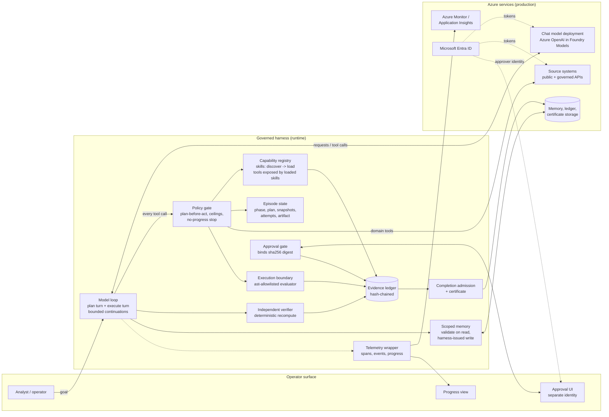
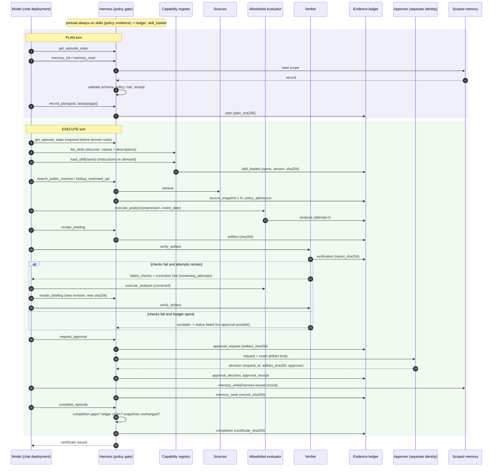
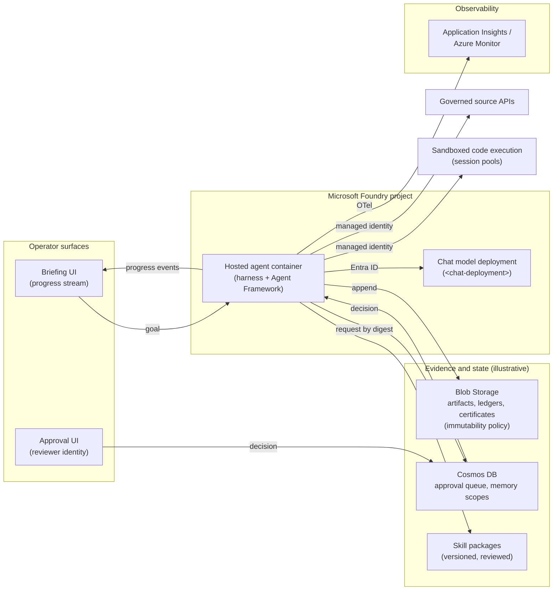

# Architecture: Governed Context-Aware Agent Harness

This document describes the reference architecture of the runtime **harness** that surrounds a
large-language-model (LLM) agent: the code that decides which context the model sees, which
tools it may call, what happens to each tool result, and when an episode counts as complete.
The model plans and drafts; the harness admits, refuses, or stops. The runnable companion is
the stdlib-only simulator [`samples/harness_sim.py`](../samples/harness_sim.py). Every JSON
shape below matches what the simulator produces.

The running example is a **worked example: equity-event briefing (synthetic)**. An analyst
asks for a short briefing on how a fictional issuer's shares moved after an announcement.
Every company, figure, and source is invented, and the example is not investment advice.
[Section 12](#12-domain-packs) shows how the same harness fits other industries.

## Contents

1. [Problem](#1-problem)
2. [Invariants](#2-invariants)
3. [Forces](#3-forces)
4. [Components](#4-components)
5. [Episode lifecycle](#5-episode-lifecycle)
6. [Module contracts](#6-module-contracts)
7. [Run profiles and control matrix](#7-run-profiles-and-control-matrix)
8. [Wire contracts](#8-wire-contracts)
9. [Context engineering](#9-context-engineering)
10. [Mapping to Microsoft Agent Framework](#10-mapping-to-microsoft-agent-framework)
11. [Production path on Microsoft Foundry](#11-production-path-on-microsoft-foundry)
12. [Domain Packs](#12-domain-packs)
13. [Known gaps and honest limitations](#13-known-gaps-and-honest-limitations)
14. [Failure modes](#14-failure-modes)
15. [Anti-patterns](#15-anti-patterns)
16. [Production checklist](#16-production-checklist)
17. [References](#17-references)

## 1. Problem

**A convincing report is not the same as a correctly completed task.** A modern chat model
writes fluent, well-cited prose. It also tends to *say* a task is done when it has only
described doing it. In the naive agent loop, the model calls tools until it decides to stop,
and the last assistant message counts as the result. That loop fails in predictable ways:

| Failure mode | What it looks like | Why prompts alone do not fix it |
|---|---|---|
| **Skipped steps** | The model jumps straight to drafting. Retrieval, policy lookup, or the event-date rule never happen. | A system prompt is advice. Nothing stops a tool call or a final answer that ignores it. |
| **Unverified numbers** | A figure in the report is off: wrong row, wrong date, wrong formula. It looks plausible and is never recomputed. | Asking the same model to "double-check" mostly re-reads its own narrative. It does not recompute from evidence. |
| **Approval of a different artifact** | A reviewer approves version 2 while version 3 ships. Or the approval covers a summary, not the document. | Approval lives in chat. Nothing binds it to the bytes that were verified. |
| **Narrated completion** | The model ends with "Done - briefing approved and saved" while nothing was approved or saved. | Final text is not evidence. The loop has no admission criteria. |
| **Context bloat** | Every tool schema and every skill's instructions load up front. Distractors (unrelated skills) compete for attention. Costs and confusion grow with the catalog. | Prompt engineering cannot shrink a context that the runtime fills unconditionally. |
| **Silent live-to-scripted fallback** | The live model endpoint fails, and a demo path or cached answer quietly takes over. Nobody can tell a rehearsal from a real run. | This is a runtime decision. The prompt never sees it. |
| **Memory poisoning** | A previous run (or an out-of-band write) leaves a "lesson" that steers the next run toward a wrong rule. | Memory is replayed as trusted context unless the harness validates it. |
| **Unbounded retries** | The model loops on the same failing tool call or keeps "fixing" an answer forever. | Ceilings and no-progress detection are runtime controls. |

The progression this asset follows is **prompt engineering -> context engineering ->
harness engineering**. Prompts shape *what the model tries*. Context engineering shapes
*what the model sees*. Harness engineering shapes *what the system accepts*. This asset is
about the third layer, which also owns the second.

The harness controls six things:

1. **Instructions and context**: what goes into each model request (system policy, loaded skills, recalled memory, tool results).
2. **Tools and skills**: which capabilities exist, which are visible, and which are callable *right now*.
3. **Execution**: how computations run (allowlisted evaluator, bounded attempts, sandbox boundary).
4. **Memory and state**: per-episode state, plus a scoped cross-episode memory store.
5. **Control and acceptance**: plan-before-act, independent verification, separate approval, completion admission.
6. **Telemetry**: spans, events, a progress stream, an evidence ledger, and a completion certificate.

## 2. Invariants

These hold for every episode, in every profile, regardless of model behavior. The simulator
self-test exercises each of them (see [evaluation-and-troubleshooting.md](evaluation-and-troubleshooting.md)).

| # | Invariant | Enforced by |
|---|---|---|
| I1 | No domain tool runs before a plan covering every mandatory stage is recorded. | Policy gate (function middleware) |
| I2 | A domain tool is callable only after the skills that own it are loaded, and a skill loads only after the catalog is discovered. | Capability registry + policy gate |
| I3 | Computation goes through an allowlisted evaluator. The model never gets `eval`, `exec`, a shell, or imports. | Execution boundary |
| I4 | An artifact is "verified" only if an independent, deterministic verifier recomputed it from admitted evidence and every check passed. | Verifier |
| I5 | Approval binds to the exact sha256 digest of the verified artifact. A decision for any other digest is rejected. | Approval gate |
| I6 | The agent identity can never approve its own artifact. Live runs require a human approver. | Approval gate |
| I7 | Missing approval stops the episode or leaves it pending. It never auto-approves. | Approval gate |
| I8 | Every admission-relevant event is appended to a hash-chained evidence ledger. Evidence is never overwritten. | Evidence ledger |
| I9 | Completion is a harness decision, backed by a certificate that lists every evidence hash. Final text alone never completes an episode. | Completion admission |
| I10 | The harness never silently substitutes a scripted or cached model for a live one. | Runtime loop |
| I11 | Cross-episode memory is scope-partitioned, schema-validated, and written only from a harness-issued record after approval. | Memory store + policy |
| I12 | Telemetry failures never change an admission decision. | Telemetry wrapper |
| I13 | Configuration changes apply to the *next* episode. Immutable controls cannot be configured at all. | Config store |

## 3. Forces

- **Model freedom vs. process guarantees.** Models are good at choosing *how* to do a task:
  order, wording, which skill to consult. Organizations need guarantees about *what* happened:
  a plan existed, numbers were recomputed, the reviewer saw the shipped bytes. The harness
  should constrain boundaries, not script the transcript
  ([ADR 0001](decisions/0001-harness-enforces-boundaries-not-transcripts.md)).
- **Context breadth vs. focus.** A large skill catalog makes the agent more capable and less
  focused. Progressive disclosure keeps the catalog discoverable while loading instructions
  only when needed ([ADR 0002](decisions/0002-progressive-skill-disclosure-over-all-loaded.md)).
- **Speed vs. evidence.** Every check, hash, and ledger entry costs a little. Skipping them
  costs a lot when a wrong number ships. The harness makes evidence cheap by making it
  automatic.
- **Human oversight vs. throughput.** Approval is expensive, so a reviewer should spend it only
  on an artifact that already passed verification, and that approval must count for exactly
  that artifact ([ADR 0003](decisions/0003-approval-binds-to-verified-artifact-digest.md)).
- **Learning across runs vs. contamination.** Memory lets the agent reuse an approved lesson.
  It also lets one bad run steer the next. Memory must be scoped, validated, and earned.
- **Rehearsal vs. production.** Teams need a deterministic offline mode for tests and demos,
  and that mode must never be mistaken for a live run.

## 4. Components



| Component | Responsibility | Lives in (reference layout) | Simulator class / function |
|---|---|---|---|
| Model loop | Runs a plan turn and an execute turn in one session. Requests a bounded continuation when a phase ends without an admitted result. Enforces model-request ceilings. | `runtime/loop.py` | `GovernedHarness.run_episode`, `_run_phase`, `_next_action` |
| Policy gate | The single enforcement point for every tool call: plan-before-act, state read before acting, skill ownership, artifact freeze, snapshot re-check, tool-call ceiling, no-progress stop. | `harness/policy.py` | `GovernedHarness._dispatch`, `_gate` |
| Capability registry | Catalog of SKILL.md packages. Discovery returns names and descriptions. Load returns instructions. The harness-owned tool-to-skill map decides which tools are exposed. | `harness/capabilities.py` | `InMemorySkillRegistry`, `TOOL_REQUIRED_SKILLS`, `_load_into` |
| Episode state | Typed state for one episode: phase, plan, loaded skills, source snapshots, analyses, artifacts, reports, approval, counters. The model reads it through `get_episode_state`, which also returns `required_next`. | `harness/state.py` | `EpisodeState`, `_tool_get_episode_state` |
| Source admission | Label-based admission of retrieved content. Untrusted content is excluded. Restricted content enters only as a projection. Unknown labels fail closed. Content is snapshotted by hash. | `runtime/sources.py` | `admit_source`, `_snapshot` |
| Execution boundary | Parses expressions with `ast`, allowlists node types and names, bounds size and depth, and evaluates without `eval`. Counts attempts against a budget. | `runtime/analysis.py` | `compile_expression`, `evaluate_expression`, `_tool_execute_analysis` |
| Verifier | Independent, deterministic checks over the rendered artifact and the admitted evidence. It never reads the model's narration as proof. Versioned. | `harness/verifier.py` | `DeterministicBriefingVerifier` |
| Diagnosis | Turns failed checks into a bounded correction hint, or escalates when the budget is spent. | `harness/diagnosis.py` | correction branch of `_tool_verify_artifact` |
| Evidence ledger | Append-only, hash-chained log of every admission-relevant fact. Verified before approval, memory write, and completion. | `harness/ledger.py` | `EvidenceLedger` |
| Approval gate | Builds an approval request bound to the artifact digest. Sends it to a separate approver. Validates the decision. Issues a receipt. | `harness/policy.py` (approval section) | `_tool_request_approval`, `RehearsalApprover`, `ConsoleApprover`, `ApprovalQueueApprover` |
| Scoped memory | Scope-partitioned store. Validated on read. Written only with the harness-issued record after approval. | `harness/memory.py` | `InMemoryMemoryStore`, `_tool_memory_read`, `_tool_memory_write` |
| Completion admission and certificate | Checks completion gaps, re-verifies integrity, and emits a certificate listing plan, skills, sources, verification, approval, artifact, memory, and every ledger hash. | `harness/certificate.py` | `_completion_gaps`, `_build_certificate`, `_tool_complete_episode` |
| Telemetry and progress | OpenTelemetry-shaped spans (`invoke_agent`, `chat`, `execute_tool <name>`) and events, plus a separate `progress-event/v1` stream for the UI. Failures are counted, never propagated. | `runtime/telemetry.py`, `runtime/progress.py` | `InMemoryTelemetry`, `_span`, `_emit`, `_progress` |
| Config store | Versioned configuration. Each episode pins a version. Immutable controls are rejected. | `runtime/config.py` | `HarnessConfig`, `ConfigStore`, `PROFILES` |

## 5. Episode lifecycle

An **episode** is one goal, run as one model session with two turns: a **plan** turn and an
**execute** turn. The model chooses the order of calls inside each turn. The harness only
checks that the required boundaries are crossed in a legal order. Each phase gets up to
three turns. If a turn ends with narration and no admitted result, the harness tells the
model "narration is not completion" and asks it to continue. After the last turn, the
episode stops with `failed`.



Stage-by-stage contract:

| Step | Gate condition (refused if false) | Ledger kind | Progress step |
|---|---|---|---|
| Plan | Plan turn. Memory listed and read when memory is on. Recalled fields match validated memory. 3..8 tasks with unique ids. Every mandatory stage (`retrieve`, `compute`, `render`, `verify`, `approve`) covered. | `plan` | `plan` |
| Discover skills | None. The catalog is filtered by configuration. | (event only) | `select` |
| Load skill | Catalog discovered in this episode, and the name is in it. | `skill_loaded` | `select` |
| Retrieve | Execute turn, plan recorded, state read, owning skill loaded, snapshots unchanged. | `source_snapshot`, `policy_admission` | `retrieve` / `govern` |
| Compute | As above, plus admitted inputs present, expression passes the allowlist, attempts remain, artifact not frozen. | `analysis` | `compute` |
| Render | As above, plus an analysis exists and an admitted primary source exists. | `artifact` | `render` |
| Verify | An artifact exists and is bound to the latest analysis. Ledger chain valid. | `verification` | `verify` |
| Approve | Strict gate. Verification of the *current* artifact passed. Not yet requested. Ledger chain valid. | `approval_request`, `approval_decision`, `approval_receipt` | `approve` |
| Retain | Memory on, receipt issued, key and record equal to the harness-issued values, not yet written. | `memory_write` | `retain` |
| Certify | No completion gaps. Ledger chain valid. Snapshots unchanged. | `completion` | `certify` |

## 6. Module contracts

Each module has a narrow contract. The contracts below are what you keep when you swap the
in-memory fakes for production services.

| Module | Inputs | Outputs | Invariants |
|---|---|---|---|
| **policy** (`harness/policy.py`) | Tool name, arguments, episode state, pinned config | Admit, or `ControlRejected(reason)` returned to the model as a tool error. `HarnessStop` subclasses end the episode. | Domain tools only after plan and state read. Owning skills loaded. Artifact frozen after approval request. Snapshots re-checked on every domain call. Tool-call and model-request ceilings. A call repeated more than the no-progress limit with identical arguments stops the run. Rejections are tool errors, so the model can recover. Stops are terminal. |
| **capabilities** (`harness/capabilities.py`) | SKILL.md texts, configured skill availability | `catalog()` -> `[{name, description, version, always_on, sha256}]`, `load(name)` -> `{name, version, sha256, instructions}`, exposed tool list | The tool-to-skill map is harness-owned. A skill cannot grant itself tools. Always-on skills cannot be disabled. Load requires prior discovery. Every load is ledgered with the skill's content hash. |
| **state** (`harness/state.py`) | Tool results admitted by policy | `get_episode_state` view including `required_next` | State is written only by harness handlers, never by model text. One state object per episode. Nothing is shared across episodes except through the memory store. |
| **ledger** (`harness/ledger.py`) | `(kind, payload)` | Entry `{seq, kind, at, trace_id, payload_sha256, prev_hash, entry_hash, payload}`, `head()`, `verify_chain()` | Append-only. `entry_hash = sha256(canonical(header))`. `prev_hash` links to the previous entry (64 zeros at genesis). Checked before approval, memory write, and completion. A failure stops the episode with `ledger_integrity_failed`. |
| **verifier** (`harness/verifier.py`) | Artifact `{artifact_id, sha256, body}`, evidence `{admitted, analysis, restricted_literals}` | `verification-result/v1` report with typed checks | Deterministic. Recomputes from *admitted* evidence, never from narration. Versioned. All checks must pass. Report is bound to the artifact digest it examined. |
| **diagnosis** (`harness/diagnosis.py`) | Failed report, attempts used, attempt budget, gate mode | Correction `{remaining_attempts, hint}`, or escalation (`CorrectionBudgetExhausted`), or an observe-mode note | Never edits the artifact itself. Hints come from check details, not from model output. Budget exhaustion stops with `failed` and `escalated: true`. |
| **certificate** (`harness/certificate.py`) | Episode state, ledger | `completion-certificate/v1` and its sha256, appended as the `completion` entry | Issued only when no completion gaps remain. Built *before* the completion entry, so it lists every prior evidence hash. Records honest execution facts (for example `timeout_enforced: false`). |
| **progress / telemetry** (`runtime/progress.py`, `runtime/telemetry.py`) | Every dispatch, phase, and stop | `progress-event/v1` stream. Spans `invoke_agent`, `chat`, `execute_tool <name>`. Named events. | Redacts restricted fields before export. Counts its own failures in `telemetry_failures`. Never raises into the harness. Progress events are UI-facing and contain no restricted data. |
| **runtime loop** (`runtime/loop.py`) | Goal, model client, approver, pinned config | `EpisodeResult(status, reason, escalated, state)` | Two turns per episode. Bounded continuations. No silent substitution of model clients. Every stop produces a final `stopped` progress event. |
| **config** (`runtime/config.py`) | Profile plus overrides | Validated `HarnessConfig` and a version number | Immutable controls cannot be named. Value ranges validated. Changes bump the version and apply to the next episode only. |

Run statuses the loop can return:

| Status | Meaning | Certificate? |
|---|---|---|
| `completed` | Plan, verified artifact, bound approval, retained memory (when enabled), certificate issued | Yes |
| `unverified_preview` | Observe-mode run. The artifact is a preview, never approved, whatever verification said. | No |
| `failed` | Correction budget exhausted (escalated), or no admitted result after the continuation budget | No |
| `approval_rejected` | Decision was not `approved`, not bound to the digest, from the agent identity, or not human on a live run | No |
| `awaiting_approval` | Approver returned `pending`. The episode stops and is resumed by a new episode after the decision. | No |
| `tool_budget_exhausted` / `model_budget_exhausted` | A ceiling was reached | No |
| `no_progress_stop` | Identical call repeated past the limit | No |
| `snapshot_changed` | A source changed after it was snapshotted | No |
| `ledger_integrity_failed` | The hash chain failed verification | No |
| `model_client_unavailable` | The configured model client was missing or failed. Nothing was substituted. | No |

## 7. Run profiles and control matrix

The reference defines three run profiles. They share one code path. Only configuration
differs, and the immutable controls apply in all of them.

| Profile | Model client | Skill mode | Memory | Gate mode | Use it for | Never use it for |
|---|---|---|---|---|---|---|
| **governed** | Live chat deployment | Progressive (discover -> load) | On, analyst scope | Strict | Production and pilot runs whose output is acted on | Unattended demos without an approver |
| **observe-only** | Live chat deployment | All-loaded | Off | Observe (failures recorded, not enforced) | Evaluation baselines. Comparing what the model does without enforcement. Collecting failure examples. | Anything a person will act on: output is always an unverified preview |
| **offline** (scripted) | Scripted, seeded tool calls | Progressive | On, rehearsal scope | Strict | Unit tests, CI, workshops, demos without credentials | Measuring model quality. A scripted run proves the harness, not the model. |

Recommended use by lifecycle stage:

| Stage | Profile | Why |
|---|---|---|
| Local development | offline | Deterministic. Exercises every gate without credentials or cost. |
| CI | offline (self-test scenarios) | Regression-tests invariants on every change |
| Model or prompt evaluation | observe-only, then governed | observe-only shows raw behavior. governed shows how often runs complete under enforcement. |
| Pilot | governed with a human approver | The full path, with real reviewers |
| Production | governed | Only profile whose output can be certified |

Controls split into two groups:

| Control | Immutable or configurable | Notes |
|---|---|---|
| Mandatory policy (plan-before-act, mandatory stages, skill ownership) | **Immutable** | A code path, not a setting. Naming it in a config change raises `ConfigError`. |
| Arithmetic allowlist | **Immutable** | Node types, names, size, and depth limits live in code |
| Telemetry | **Immutable** | Always on. Exporter failures are counted, not fatal. |
| Separate approval | **Immutable** | The agent identity can never approve. Live runs need a human. |
| Skill availability | Configurable | Always-on skills cannot be removed |
| Enabled domain tools | Configurable | Disable a tool without redeploying |
| Skill mode (`progressive` / `all_loaded`) | Configurable | `all_loaded` is for baselines |
| Memory on/off and scope | Configurable | Scope must match `[A-Za-z0-9_-]{1,64}` |
| Gate mode (`strict` / `observe`) | Configurable | `observe` can never produce a certificate |
| Execution attempt budget | Configurable (bounded range) | Also the correction budget |
| Tool-call and model-request ceilings | Configurable (bounded range) | |
| Execution timeout | Configurable (bounded range) | Recorded in the certificate. **Not enforced by the in-process reference** (see section 13). |

**Configuration applies to the next run, not in-flight.** Each episode pins the config
version it started with. If an operator changes configuration mid-episode, the running
episode keeps its pinned snapshot and emits a `config_change_deferred` event. The next
episode picks up the new version. This keeps one certificate consistent with one
configuration. An operator cannot weaken a running episode, for example by raising the
attempt budget after verification fails.

## 8. Wire contracts

Every record below is a JSON object hashed with SHA-256 over a **canonical encoding**:
sorted keys, no insignificant whitespace, ASCII-escaped. A record and its hash must be
produced by the same encoder. The shapes match the
[simulator](../samples/harness_sim.py) exactly. Values in angle brackets are placeholders.

### 8.1 Plan record

```json
{
  "schema": "plan-record/v1",
  "episode_id": "ep-0001",
  "trace_id": "<32-hex trace id>",
  "goal": "Brief the desk on the synthetic issuer's guidance event.",
  "tasks": [
    {"id": "t1", "stage": "retrieve", "description": "Retrieve filing, prices, calendar"},
    {"id": "t2", "stage": "compute",  "description": "Align event date; compute market-adjusted return"},
    {"id": "t3", "stage": "render",   "description": "Render the briefing"},
    {"id": "t4", "stage": "verify",   "description": "Verify independently"},
    {"id": "t5", "stage": "approve",  "description": "Request approval of the exact artifact"},
    {"id": "t6", "stage": "retain",   "description": "Retain the approved lesson"}
  ],
  "recalled_trace_id": "<trace id from validated memory, or null>",
  "recalled_rule": "after_close -> next trading day",
  "policy": {"policy_id": "contoso-research-policy", "policy_version": "1.0.0"},
  "plan_sha256": "<sha256 of the record without this field>"
}
```

The harness rejects a plan that cites a recalled trace or rule not matching what it
validated from memory. The model cannot invent continuity.

### 8.2 Ledger entry

```json
{
  "seq": 7,
  "kind": "artifact",
  "at": "<ISO-8601 UTC timestamp>",
  "trace_id": "<32-hex trace id>",
  "payload_sha256": "<sha256(canonical(payload))>",
  "prev_hash": "<entry_hash of seq 6; 64 zeros for seq 1>",
  "entry_hash": "<sha256(canonical({seq, kind, at, trace_id, payload_sha256, prev_hash}))>",
  "payload": {"artifact_id": "briefing-ep-0001-r1", "sha256": "<artifact sha256>", "analysis_id": "analysis-1"}
}
```

Kinds used by the reference: `plan`, `skill_loaded`, `source_snapshot`,
`policy_admission`, `analysis`, `artifact`, `verification`, `approval_request`,
`approval_decision`, `approval_receipt`, `memory_write`, `memory_rejected`, `preview`,
`completion`. `verify_chain()` reports the first sequence gap, broken link, payload-hash
mismatch, or entry-hash mismatch.

### 8.3 Source snapshot (ledger payload)

```json
{
  "source_id": "src-portfolio-001",
  "content_sha256": "<sha256 of full source content>",
  "classification": {"integrity": "trusted", "confidentiality": "restricted"},
  "admitted": true,
  "reason": "restricted_projection_only"
}
```

Admission reasons: `admitted`, `untrusted_excluded` (for example, open-web commentary
carrying an injection), `unknown_label_fail_closed` (missing or unrecognized labels), and
`restricted_projection_only` (only a projected field, such as an exposure band, enters
context).

### 8.4 Verification result

```json
{
  "schema": "verification-result/v1",
  "verifier_version": "1.1",
  "artifact_sha256": "<sha256 of the artifact body examined>",
  "passed": false,
  "checks": [
    {"code": "script_execution",          "category": "execution",  "passed": true,  "detail": "artifact is bound to a successful analysis record"},
    {"code": "approved_method",           "category": "method",     "passed": true,  "detail": "method expression is equivalent to the house-policy expression on probe inputs"},
    {"code": "independent_recalculation", "category": "numeric",    "passed": true,  "detail": "figures recomputed from admitted prices with the approved expression"},
    {"code": "event_date_alignment",      "category": "temporal",   "passed": false, "detail": "event date must follow the house rule (after_close -> next trading day)"},
    {"code": "claim_provenance",          "category": "provenance", "passed": true,  "detail": "required citations present; every citation is an admitted source"},
    {"code": "required_sections",         "category": "structure",  "passed": true,  "detail": "all required sections are present and non-empty"},
    {"code": "restricted_data_excluded",  "category": "privacy",    "passed": true,  "detail": "no restricted values or restricted field names appear in the artifact"},
    {"code": "causal_claim_guard",        "category": "claims",     "passed": true,  "detail": "no unsupported causal attribution in the narrative"}
  ]
}
```

What the `verify_artifact` tool returns to the model in strict mode on failure:

```json
{
  "passed": false,
  "failed_checks": ["event_date_alignment"],
  "report_sha256": "<sha256 of the report>",
  "artifact_sha256": "<sha256 of the artifact>",
  "correction": {"remaining_attempts": 2, "hint": "event date must follow the house rule (after_close -> next trading day)"}
}
```

In observe mode, `correction` is replaced by
`"note": "observe mode: failures are recorded, not enforced; output stays an unverified preview"`.

### 8.5 Approval request and decision

```json
{
  "schema": "approval-request/v1",
  "request_id": "apr-<first 16 hex of artifact sha256>",
  "episode_id": "ep-0001",
  "trace_id": "<32-hex trace id>",
  "artifact_id": "briefing-ep-0001-r2",
  "artifact_sha256": "<sha256 of the exact artifact body>",
  "verification_sha256": "<sha256 of the passing verification report>",
  "verifier_version": "1.1",
  "requested_by": "agent://contoso-briefing-agent",
  "policy": {"policy_id": "contoso-research-policy", "policy_version": "1.0.0", "decision": "allow_after_approval"},
  "summary": {"event_date": "<date>", "security_return": "<number>", "benchmark_return": "<number>", "abnormal_return": "<number>"}
}
```

```json
{
  "schema": "approval-decision/v1",
  "request_id": "apr-<same as request>",
  "artifact_sha256": "<must equal the request's artifact_sha256>",
  "decision": "approved",
  "approver": "reviewer@contoso.com",
  "approver_kind": "human",
  "reason": "Figures and sources checked."
}
```

The harness accepts the decision only when all of these hold:

- `request_id` and `artifact_sha256` match the request.
- The stored artifact still hashes to that digest.
- `approver` is present and is not the agent identity.
- `approver_kind` is `human` or `automated-rehearsal`, and live runs require `human`.
- `decision` is `approved`.

A `pending` decision stops the episode as `awaiting_approval`. The harness never
auto-approves. On acceptance it issues a receipt `rcpt-<16 hex>`, derived from
`trace_id | approver | artifact_sha256`.

### 8.6 Memory record

```json
{
  "kind": "episode-lesson",
  "schema_version": 1,
  "trace_id": "<trace id of the approved episode>",
  "policy_id": "contoso-research-policy",
  "policy_version": "1.0.0",
  "event_date_rule": "after_close -> next trading day",
  "artifact_sha256": "<approved artifact sha256>",
  "approval_receipt": "rcpt-<16 hex>"
}
```

The harness issues this record after approval. The model may only write it back unchanged.
On read, a record that fails validation is withheld from the model and ledgered as
`memory_rejected`. Validation fails on any of: not an object, unexpected fields, wrong kind
or schema, bad trace id, policy mismatch, rule mismatch, bad artifact digest, or missing
approval receipt.

### 8.7 Completion certificate

```json
{
  "schema": "completion-certificate/v1",
  "certificate_type": "governed-episode-completion",
  "episode_id": "ep-0001",
  "trace_id": "<32-hex trace id>",
  "profile": "offline",
  "config_version": 1,
  "model_client": "scripted",
  "policy": {"policy_id": "contoso-research-policy", "policy_version": "1.0.0",
             "decision": "allow_after_approval", "event_date_rule": "after_close -> next trading day"},
  "plan_sha256": "<sha256>",
  "skills_loaded": [{"name": "abnormal-return-model", "version": "1.0.0", "sha256": "<sha256>"}],
  "source_snapshots": [{"source_id": "src-commentary-001", "content_sha256": "<sha256>",
                        "admitted": false, "reason": "untrusted_excluded"}],
  "verification": {"verifier_version": "1.1", "passed": true, "report_sha256": "<sha256>", "attempts": "<int>"},
  "approval": {"request_id": "apr-<16 hex>", "approver": "reviewer@contoso.com",
               "approver_kind": "automated-rehearsal", "receipt": "rcpt-<16 hex>"},
  "artifact": {"artifact_id": "briefing-ep-0001-r1", "sha256": "<sha256>"},
  "memory": {"enabled": true, "scope": "offline-rehearsal", "written": true},
  "ledger": {"entries": "<int>", "head": "<entry_hash>", "chain_valid": true, "evidence": ["<entry_hash>", "..."]},
  "execution": {"evaluator": "ast-allowlist", "max_execution_attempts": 3,
                "timeout_seconds_recorded": 30, "timeout_enforced": false,
                "tool_calls": "<int>", "model_requests": "<int>"},
  "certified": true
}
```

The certificate's own hash goes into the final `completion` ledger entry, together with
the artifact digest. Anyone holding the ledger can check that the certificate, the
approved artifact, and the evidence chain agree.

### 8.8 Progress event

```json
{"schema": "progress-event/v1", "seq": 12, "trace_id": "<32-hex trace id>",
 "step": "render", "status": "refused", "summary": "run execute_analysis before rendering"}
```

For an admitted call, `summary` is the tool name. For a refusal, it is the refusal reason
returned to the model. For a stop, it is the stop reason. A failed verification is still an
*admitted* tool call (`status: ok`). The failure is in the tool result and the ledger,
which is why a UI should show verification outcomes from the result, not from the
progress status.

`step` is one of `plan`, `select`, `retrieve`, `govern`, `compute`, `render`, `verify`,
`approve`, `retain`, `certify`. `status` is `ok`, `refused`, or `stopped`. Progress events
are for the UI. They are not the audit record (that is the ledger), and they never carry
restricted values.

## 9. Context engineering

The harness, not the model, decides what enters the context window. Four mechanisms do
this.

### 9.1 Progressive skill disclosure

A **skill** is a folder with a `SKILL.md`. Frontmatter carries `name`, `description`,
`license`, `metadata.version`, and `metadata.always_on`. The body holds the instructions.

```markdown
---
name: event-date-alignment
description: Align an announcement timestamp to the first tradable session under the house rule.
license: MIT
metadata:
  version: "1.0.0"
  always_on: false
---
# Event date alignment
1. Read the announcement date and timing from the admitted filing.
2. If timing is after the close, the event date is the next trading session ...
```

1. **Discover.** `list_skills` returns name, description, version, and content hash for
   every *available* skill. Instructions are not included. This costs a few lines of
   context per skill.
2. **Load.** `load_skill(name)` returns the instructions for one skill. Loading requires
   prior discovery in the same episode, and every load is ledgered with the skill's
   content hash.
3. **Unlock.** Domain tools are owned by skills through a harness-side map. For example,
   computing requires `event-date-alignment` and `abnormal-return-model`. A domain tool
   called before its owning skill is loaded is refused. The model learns the method
   *before* it can act.
4. **Always-on.** A small set of skills (the research policy and evidence-verification
   rules) is preloaded and cannot be disabled by configuration.

The reference catalog deliberately includes **distractor skills**: plausible but
irrelevant capabilities such as options-surface analysis, credit-event analysis, and
corporate-actions monitoring. A good episode loads only what the goal needs. Comparing
loaded skills across runs is a cheap signal of selection quality (see
[evaluation](evaluation-and-troubleshooting.md)). The trade-offs against loading
everything are in [ADR 0002](decisions/0002-progressive-skill-disclosure-over-all-loaded.md).

### 9.2 Governed retrieval

Sources are classified on two axes: **integrity** (trusted / untrusted / unknown) and
**confidentiality** (public / confidential / restricted). The admission function runs
*before* content reaches the model:

| Integrity | Confidentiality | Admission | What the model sees |
|---|---|---|---|
| trusted | public or confidential | `admitted` | Full content |
| trusted | restricted | `restricted_projection_only` | Only the projected fields (for example `exposure_band`), never quantities or cost basis |
| untrusted | any | `untrusted_excluded` | Nothing. The snapshot hash is still ledgered. |
| unknown or missing | any | `unknown_label_fail_closed` | Nothing |

Excluded sources still produce a `source_snapshot` entry, so the certificate shows what
was *seen and refused* as well as what was used.

### 9.3 Scoped memory across episodes

- **One session per episode.** Model conversation state is never reused across episodes.
  Continuity comes only from the memory store.
- **Scope per configuration**, for example `contoso-analyst` for governed runs and
  `offline-rehearsal` for scripted runs. A rehearsal never contaminates production memory,
  and the reverse also holds.
- **Write after approval only.** The record is harness-issued, carries the approval
  receipt and the approved artifact digest, and the model can only echo it.
- **Validate on read.** A record that fails schema, policy, rule, or receipt checks is
  withheld and ledgered as `memory_rejected`. A plan citing it is refused.
- **Small and structured.** Memory stores *lessons* such as the date-alignment rule, with
  provenance. It does not store transcripts.

### 9.4 Budgets and ceilings

| Budget | Enforced by | On exhaustion |
|---|---|---|
| Model requests per episode | Loop | `model_budget_exhausted` |
| Tool calls per episode | Gate | `tool_budget_exhausted` |
| Execution (and correction) attempts | Compute tool and diagnosis | `ControlRejected` for extra compute. `failed` with `escalated: true` when verification still fails. |
| Continuations per phase | Loop | `failed` ("narration is not completion") |
| Identical repeated calls | Gate | `no_progress_stop` |
| Expression size, node count, depth, constants | Evaluator | `ControlRejected` (unsafe expression) |

### 9.5 Compaction (designed, not implemented)

**Automatic context compaction is OFF in this reference and is not implemented.** The two-turn
episode, the progressive disclosure, and the small structured tool results keep the context
small enough for the worked example. Agent runtimes, Microsoft Agent Framework included,
may offer context-compaction options (check the current docs for what your version supports).
The reference leaves them disabled on purpose: a summarizer that silently rewrites earlier
tool results can erase the evidence the verifier and the approver depend on.

If you add compaction, do it safely:

1. **Compact narration, never evidence.** Ledger entries, the plan record, the current
   artifact digest, and verification results stay authoritative outside the context.
   Compaction may only drop or summarize *conversation* text.
2. **Re-inject state, do not trust summaries.** After compaction, the harness rebuilds
   context from `get_episode_state` (which includes `required_next`) and the ledger head,
   not from a model-written summary.
3. **Ledger the event.** Add a `compaction` ledger kind carrying the hashes of the dropped
   message ranges and the summary, so an auditor can see what the model no longer saw.
4. **Never compact across approval.** The approver must review the exact artifact, which
   is always read from storage by digest, never reconstructed from context.
5. **Test it.** Add self-test scenarios proving that the gate decisions after compaction
   are identical to those without it.

## 10. Mapping to Microsoft Agent Framework

The simulator models each seam as a `typing.Protocol`, so the harness logic does not
depend on any SDK. The source implementation behind this pattern used Microsoft Agent
Framework for Python (`agent-framework-core` 1.18.0 and `agent-framework-openai` 1.14.3
were pinned at the time of writing). Agent Framework APIs change between releases, and
some features used here (progressive tool registration, file-backed memory providers) were
marked **experimental**. **Check every name below against the current Agent Framework
documentation before you build on it.**

| Harness concept | Agent Framework concept (check against current docs) | Notes |
|---|---|---|
| Model client seam | A chat client for Azure OpenAI or Foundry Models, built with an Entra ID credential (`DefaultAzureCredential`) | No API keys. The deployment name is configuration (`<chat-deployment>`). |
| Episode = one session, two turns | An agent session or thread object, reused across the PLAN and EXECUTE turns of one episode, never across episodes | Cross-episode continuity comes only from the memory store |
| Harness tools (`record_plan`, `verify_artifact`, ...) | Function tools declared with the framework's tool decorator, with typed parameters | Tool results are structured JSON, never free text |
| Policy gate | **Function middleware**: an interception point that runs before every tool invocation and can block it or return an error result | The single enforcement point. Do not rely on instructions alone. |
| Phase context injection | A context provider hook that runs before each model invocation and adds instructions or state | Inject `required_next` and the phase rules here |
| Progressive skill disclosure | A skills provider, or a custom context provider plus `list_skills` / `load_skill` tools | If your version has a built-in skills provider, check that it ledgers loads and supports the require-discovery rule. Otherwise keep the custom tools. |
| Scoped memory | A memory or context provider backed by a file or store, keyed by scope | Validate on read in your own code. Do not let the provider inject raw records unvalidated. |
| Telemetry | Built-in OpenTelemetry instrumentation that emits GenAI semantic-convention spans (`invoke_agent`, `chat`, `execute_tool`) | Export with the Azure Monitor OpenTelemetry distro to Application Insights |
| Approval gate | Out of band: the harness calls an approver service and the agent never sees an "approve" tool | The framework's own tool-approval features can supplement this, but they do not replace digest binding |
| Disabled features | Compaction, built-in web search, tool auto-approval | Off by default in the reference. Turning any of them on is a design change that needs an ADR. |

A minimal integration keeps the protocols and swaps the implementations:

```python
# Illustrative wiring. Check class and method names against the current Agent Framework docs.
harness = GovernedHarness(
    model=AgentFrameworkModelClient(deployment="<chat-deployment>"),   # Entra ID credential inside
    skills=FileSkillRegistry("skills/"),                                # SKILL.md folders
    memory=BlobMemoryStore(container="harness-memory"),                 # scope = path prefix
    verifier=DomainVerifier(version="1.1"),                             # authored per domain
    approver=ApprovalQueueApprover(queue="harness-approvals"),          # human UI, separate identity
    telemetry=OpenTelemetrySink(),                                      # Azure Monitor exporter
    config=ConfigStore().pinned(),                                      # applies to the next episode
)
```

In the simulator, `AgentFrameworkModelClient` and `OpenTelemetrySink` are **stubs** whose
docstrings describe the wiring. `AgentFrameworkModelClient` refuses construction unless
the opt-in environment variable `HARNESS_SIM_ENABLE_AGENT_FRAMEWORK=1` is set. Even then it
has no model behind it and raises `NotImplementedError` on its first request.
`OpenTelemetrySink` always raises `NotImplementedError`.
The harness never falls back silently from a live client to the scripted one: a missing or
failing live client ends the run as `model_client_unavailable`.

## 11. Production path on Microsoft Foundry



- **Hosting.** The harness owns the loop, the gate, and the ledger, so it runs as **code**:
  a hosted agent (container) in Foundry, not a prompt-only agent. See
  [Choosing Prompt Agents vs Hosted Agents in Microsoft Foundry](../../../agent-runtime/choosing-prompt-vs-hosted-agents/README.md)
  and [Production Hosted Agents on Microsoft Foundry](../../../agent-runtime/production-hosted-agents-on-foundry/README.md).
- **Approval UI lives outside the agent.** A separate web app reads approval requests from
  a queue, fetches the artifact **by digest** from storage, renders exactly those bytes,
  and writes a decision signed by the reviewer's Entra ID identity. The agent's managed
  identity has no write permission on decisions. See
  [authentication and governance](authentication-and-governance.md).
- **Persistence (illustrative).** Artifacts, ledgers, and certificates go to Blob Storage
  with a time-based immutability (WORM) policy, keyed by `trace_id` and digest. The
  approval queue and memory scopes go to Cosmos DB, or another store with per-scope
  partitioning and RBAC. Pick the services your organization already governs. The pattern
  needs append-only evidence and per-scope memory, not these products specifically.
- **Identity for tools.** The hosted agent uses a managed identity, with a separate
  role assignment per source API. Restricted sources should expose **projections**
  server-side, so the agent identity cannot read raw positions even if the gate were
  bypassed.
- **Code execution.** Replace the in-process evaluator with an isolated execution
  service for anything beyond allowlisted arithmetic. See
  [Sandboxed Code Execution with Session Pools](../../../agent-runtime/code-execution-sandbox-session-pools/README.md).
- **Release path.** Treat skill packages, the verifier version, and the policy version as
  release artifacts. Change them through the stages in
  [Agent Path to Production](../../../delivery-and-ops/agent-path-to-production/README.md),
  with the self-test scenarios as gates.
- **Security baseline.** Apply the controls in
  [Enterprise Agent Security and Tool Governance](../../../security-and-governance/agent-security-and-governance/README.md).
  This harness is one enforcement layer, not the whole security model.

## 12. Domain Packs

The harness is domain-neutral. A **domain pack** supplies the skills, governed sources,
allowlisted computations, verifier checks, artifact schema, approver role, and memory
lessons. The worked example is first. Every organization named is fictional.

| Domain pack | Plan (mandatory stages) | Governed evidence | Allowlisted compute | Deterministic verifier checks | Approval (separate identity) | Retained lesson |
|---|---|---|---|---|---|---|
| **Worked example: equity-event briefing (synthetic)** | retrieve, compute, render, verify, approve | Filing, prices, trading calendar (trusted). Commentary (untrusted, excluded). Portfolio (restricted, band only). | `security_return - benchmark_return` | Recalculation, approved method, event-date alignment, provenance, sections, restricted data, causal-claim guard | Research reviewer | Event-date rule with approval receipt |
| **Insurance claims adjudication (Contoso Insurance)** | retrieve policy and claim, compute payable, render decision letter, verify, approve | Policy wording, claim form, adjuster notes (trusted). Claimant free-text (untrusted, quoted only). Medical detail (restricted, coded projection). | `min(covered_amount, limit) - deductible` | Payable recomputed from policy terms. Coverage clause cited. Exclusions applied. No restricted medical detail in the letter. | Licensed claims adjuster | Interpretation of a clause, with approval receipt |
| **Healthcare prior-authorization summary (Fabrikam Health)** | retrieve criteria and record, compute criteria met, render summary, verify, approve | Payer criteria (trusted). Clinical record (restricted, structured projection). Patient portal messages (untrusted). | Boolean and threshold checks over coded values | Each criterion traced to a record element. Dates inside the lookback window. No free-text PHI beyond what is required. No diagnostic claims. | Clinical reviewer (nurse or physician) | Criteria-version mapping |
| **Manufacturing quality deviation report (Northwind Manufacturing)** | retrieve batch data, compute deviation statistics, render report, verify, approve | MES batch records, specifications (trusted). Operator shift notes (untrusted). Supplier cost data (restricted). | `(measured - target) / tolerance` | Out-of-spec flags recomputed. Spec version matches the batch date. Lot ids cited. No root-cause claim without an investigation reference. | Quality assurance lead | Spec-revision lookup rule |
| **Public-sector benefits eligibility letter (Contoso County)** | retrieve rules and application, compute eligibility, render letter, verify, approve | Statute and rule tables (trusted). Application data (restricted, needed fields only). Public forum posts (untrusted). | Income versus threshold for household size | Threshold recomputed from the rule table effective on the application date. Required notices present. Plain-language and appeal-rights sections present. | Eligibility caseworker | Effective-date rule for threshold tables |

To build a domain pack, start with the verifier. List the checks a careful human reviewer
performs. Make each one deterministic over admitted evidence, and give each a stable
`code` and `category`. If a check cannot be made deterministic, keep it in the human
approval step and say so in the approval UI.

## 13. Known gaps and honest limitations

| Gap | Impact | Mitigation or next step |
|---|---|---|
| **Automatic compaction is not implemented** (and is off) | Long episodes or large tool results could exceed the context window | Keep tool results small and structured. If needed, add compaction per [section 9.5](#95-compaction-designed-not-implemented). |
| **No real sub-agents.** One agent uses many skills. | Skills share one context and one identity. No parallel specialist reasoning. | Treat sub-agents as a separate design. Each would need its own gate, ledger scope, and identity. |
| **Python `-I` (isolated mode) is not an OS sandbox.** The reference runs reviewed scripts and allowlisted arithmetic in process. | A hostile or buggy script could reach the file system, network, or memory of the harness process | Run model-influenced code in an isolated service. See [Sandboxed Code Execution with Session Pools](../../../agent-runtime/code-execution-sandbox-session-pools/README.md). |
| **The execution timeout is recorded, not enforced** in the in-process reference | A pathological computation is bounded only by the allowlist limits | Enforce wall-clock limits in the execution service. The certificate says `timeout_enforced: false` honestly. |
| **Verifier checks are domain-specific** and must be written per domain | A weaker verifier certifies a wrong-but-consistent answer (verifier 1.0 lacks the event-date check and passes a wrong date) | Version the verifier, review its coverage like code, and add the self-test case for every missed defect |
| **Memory poisoning** is mitigated only by schema, policy, and receipt validation plus scope isolation | A record with a valid shape but a misleading lesson, written by a compromised approver flow, would be recalled | Protect the approval path, make memory stores writable only by the harness identity, review lessons periodically, and expire them |
| **Ledger truncation** (dropping trailing entries) is not detectable from the chain alone | An attacker with write access could remove the latest entries | Persist the certificate's `ledger.entries` and `ledger.head` separately, for example in an immutable store, and compare |
| **Approver authenticity** is an identity string in the reference | A forged decision with a plausible approver id would pass | Sign decisions with the approver's Entra ID token and verify the signature, the role, and the separation of duties server-side |
| **Agent Framework API names are hedged** | Names in section 10 may drift between releases | Pin versions and run the self-test after every upgrade |

## 14. Failure modes

How the harness behaves when something goes wrong. Each row has a self-test scenario
behind it (scenario ids in brackets).

| Trigger | Harness behavior | Resulting status | Evidence left behind |
|---|---|---|---|
| Model calls a domain tool before planning [`domain-tool-before-plan-refused`] | Tool error returned to the model ("record a plan first"). The episode continues. | Continues. `completed` if the model recovers. | Refused progress event |
| Model loads a skill it never discovered [`undiscovered-skill-load-refused`] | Tool error. Nothing loaded. | Continues | Refused progress event, no `skill_loaded` entry |
| Expression uses names, calls, attributes, or sizes outside the allowlist [`unsafe-expression-rejected`] | Rejected at parse time. Nothing evaluated. No attempt consumed. | Continues | Refused progress event |
| Verifier finds a wrong number or date [`verifier-catches-wrong-number-then-corrects`] | Failed checks plus a correction hint. The model recomputes and re-renders a new revision with a new digest. | `completed` after a passing revision | Every analysis, artifact, and verification entry, including the failed ones |
| Verification still fails when the attempt budget is spent [`correction-budget-exhausted-unverified-preview-no-approval`] | Escalates. Approval is never requested. | `failed` (`escalated: true`) | Failed verification entries. No approval entries. |
| Approver returns a decision for a different digest [`approval-digest-mismatch-rejected`] | Decision ledgered, then rejected | `approval_rejected` | `approval_request`, `approval_decision`, no receipt |
| Decision names the agent identity as approver [`agent-cannot-approve-its-own-artifact`] | Rejected | `approval_rejected` | As above |
| A ledger entry is edited in place [`ledger-tamper-detected`] | Chain check fails at the next integrity point | `ledger_integrity_failed` | Stop reason names the broken entry |
| Live model client unavailable [`no-silent-live-to-scripted-fallback`] | No substitution | `model_client_unavailable` | Stopped progress event |
| A memory record from another scope, or a poisoned one [`memory-scope-isolation`, `cross-run-memory-recall-validated`] | Other scopes invisible. Invalid records withheld and a plan citing them refused. | Continues | `memory_rejected` entry with reason |
| Tool-call ceiling reached [`tool-call-ceiling-enforced`] | Stop | `tool_budget_exhausted` | Stopped progress event |
| Model narrates "done" without completing [`narrated-done-is-not-completion`] | "Narration is not completion" continuation. Then stop. | `failed` | No `completion` entry |
| Operator changes config mid-episode or targets an immutable control [`immutable-controls-rejected-config-applies-next-run`] | Mid-episode change deferred. Immutable target raises `ConfigError`. | Running episode unchanged | `config_change_deferred` event |
| Untrusted, unlabeled, or restricted source retrieved [`policy-excludes-untrusted-and-restricted`] | Excluded or projected before reaching the model | Continues | `source_snapshot` with reason, `policy_admission` summary |
| Source content changes after snapshot | Stop at the next domain call or integrity point | `snapshot_changed` | Stop reason names the source |
| Approver returns `pending` | Stop, without auto-approving | `awaiting_approval` | `approval_request`, `approval_decision` (pending) |
| Telemetry exporter fails | Counted, ignored for admission | Unchanged | `telemetry_failures` counter |

## 15. Anti-patterns

| Anti-pattern | Why it fails | Do this instead |
|---|---|---|
| **Golden-transcript enforcement**: require the exact call sequence of a recorded good run | Breaks on harmless reorderings and wording changes. Teaches teams to fight the model instead of governing outcomes. | Enforce boundaries: plan before domain tools, skills before their tools, verify before approve ([ADR 0001](decisions/0001-harness-enforces-boundaries-not-transcripts.md)) |
| **"Ask the model to verify itself"** | It re-reads its own narrative and agrees with it | Use a separate deterministic verifier that recomputes from admitted evidence |
| **Approval as a chat message** ("looks good!") | Not bound to bytes, and the artifact can change afterwards | Bind the decision to `artifact_sha256` and reject any mismatch ([ADR 0003](decisions/0003-approval-binds-to-verified-artifact-digest.md)) |
| **An `approve` tool the agent can call** | The agent becomes its own approver | Approval is out of band, under a separate identity |
| **Load every skill and tool up front** | Context bloat. Distractors win attention. Ownership rules cannot be enforced. | Progressive disclosure with skill-owned tools ([ADR 0002](decisions/0002-progressive-skill-disclosure-over-all-loaded.md)) |
| **Free-form memory** ("remember anything useful") | Turns memory into an injection channel | Harness-issued, schema-validated, receipt-bound records per scope |
| **Fallback to a demo path on error** | Rehearsal output masquerades as live output | Fail with `model_client_unavailable`, and label every certificate with its `model_client` |
| **`eval` with a "safe" globals dict** | Python `eval` cannot be made safe with dictionaries | Parse with `ast` and walk an allowlist of node types and names |
| **Observe-only in production** | Nothing is enforced. The output is a preview that looks final. | Use `strict` for anything a person acts on. Label observe-mode output as an unverified preview. |
| **Treat compaction as free** | Summaries can drop the evidence the approver relies on | Keep evidence outside the context and ledger compaction events (section 9.5) |

## 16. Production checklist

- [ ] The policy gate runs as function middleware, or as the single dispatch point, for **every** tool, and the tests prove it.
- [ ] The mandatory stages and skill-to-tool ownership map are in code and reviewed, not in prompts.
- [ ] The verifier is versioned, has a check per known defect class, and every check is deterministic over admitted evidence.
- [ ] The correction budget is bounded, and exhaustion escalates without requesting approval.
- [ ] Approval requests carry `artifact_sha256`. The approval UI renders the artifact fetched by digest. Decisions are bound to the reviewer's Entra ID identity and validated server-side.
- [ ] The agent identity has no write access to decisions, memory scopes other than its own, or the immutable evidence store's retention settings.
- [ ] Ledgers and certificates are persisted append-only (for example Blob Storage with an immutability policy). The certificate head and entry count are stored separately.
- [ ] Memory is scoped per environment and per purpose, validated on read, written only from harness-issued records after approval, and has an expiry or review process.
- [ ] Restricted sources are projected server-side. The verifier checks that no restricted values or field names reach the artifact.
- [ ] Model-influenced code beyond allowlisted arithmetic runs in an isolated execution service with enforced timeouts.
- [ ] The model client uses Entra ID (no keys). A live-client failure surfaces as an error, never as a scripted fallback.
- [ ] OpenTelemetry spans export to Application Insights. Restricted fields are redacted before export. Exporter failures are monitored.
- [ ] Config changes are versioned and apply to the next episode. Immutable controls are not exposed in any admin UI.
- [ ] The self-test scenarios, or your domain's equivalent, run in CI on every change to skills, the verifier, policy, or framework versions.
- [ ] Compaction, built-in web search, and tool auto-approval stay disabled unless an ADR says otherwise.

## 17. References

- Simulator: [`samples/harness_sim.py`](../samples/harness_sim.py) and the [sample guide](../samples/README.md)
- Reference module layout: [`src/README.md`](../src/README.md)
- Decisions: [ADR 0001](decisions/0001-harness-enforces-boundaries-not-transcripts.md),
  [ADR 0002](decisions/0002-progressive-skill-disclosure-over-all-loaded.md),
  [ADR 0003](decisions/0003-approval-binds-to-verified-artifact-digest.md)
- Companion docs: [authentication and governance](authentication-and-governance.md),
  [evaluation and troubleshooting](evaluation-and-troubleshooting.md)
- Related assets in this repo:
  - [Verify-Before-Approve Gate for Agent Outputs](../../verify-before-approve/README.md): the verification-and-approval gate on its own
  - [Choosing Prompt Agents vs Hosted Agents in Microsoft Foundry](../../../agent-runtime/choosing-prompt-vs-hosted-agents/README.md)
  - [Production Hosted Agents on Microsoft Foundry](../../../agent-runtime/production-hosted-agents-on-foundry/README.md)
  - [Sandboxed Code Execution with Session Pools](../../../agent-runtime/code-execution-sandbox-session-pools/README.md)
  - [Agent Path to Production](../../../delivery-and-ops/agent-path-to-production/README.md)
  - [Enterprise Agent Security and Tool Governance](../../../security-and-governance/agent-security-and-governance/README.md)
- External (check for the current versions):
  - Microsoft Agent Framework documentation on Microsoft Learn (agents, tools, middleware, context providers, observability)
  - OpenTelemetry semantic conventions for generative AI systems
  - Azure Monitor OpenTelemetry distro for Python
  - Microsoft Foundry documentation for hosted agents and model deployments
