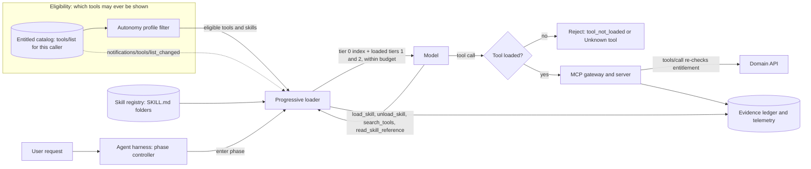

# Progressive Tool and Skill Loading

> **Maturity:** preview · **Kind:** design-pattern · **Category:** `orchestration-and-workflows` · **Version:** 0.1.0

An agent connected to a few MCP servers and a skill library can easily carry hundreds of tool schemas and dozens of pages of instructions. If the harness puts all of them into the model context on every turn, the model reads definitions it will never use, picks look-alike tools, follows instructions meant for a different stage of the work, and pays for all of it on every call. A prompt injection also gets a full menu of capabilities to steer toward.

This design pattern keeps the context small and focused by **disclosing capabilities in tiers**. A run starts with a short index: the meta-tools, plus a name and one-line description for each eligible skill. Full tool schemas and skill instructions are loaded when the run enters the phase that needs them (plan, gather, act, verify), when a router picks them, or when the model asks for them with a meta-tool such as `load_skill(name)` or `search_tools(query)`. Long reference material is returned only on request. A context budget, deterministic ordering, stable identifiers and eviction rules keep the disclosed view bounded and cache-friendly. Every load, unload, refusal and call is recorded.

It is the focused deep dive on the progressive skill disclosure that the [Governed Context-Aware Agent Harness](../governed-context-aware-agent-harness/README.md) composes with planning, memory, verification, approvals and the evidence ledger.

> **Core thesis:** *Entitlement decides WHICH tools a caller may ever see; progressive loading decides WHEN to show them.* Loading is a context-engineering decision, not an authorization decision. The loader only ever discloses tools from the entitled set, the autonomy profile narrows that set further, and the server still enforces entitlement on every call. A call to a tool that is not loaded, including a hallucinated or injected tool name, is rejected by the harness before it reaches any server.

This asset is a **preview** design pattern. The MCP behaviors it relies on (`tools/list`, the `listChanged` capability and `notifications/tools/list_changed`) are described as defined in the MCP specification at the time of writing. Check the current specification revision before you build on them. Budgets in the sample are illustrative defaults, and every benefit stated here is qualitative on purpose.

## Architecture and implementation map

| Layer / concern | Deep-dive documentation | Executable or illustrative reference |
|---|---|---|
| **Problem, components, disclosure tiers, loading triggers, decision matrix** | [`docs/architecture.md`](docs/architecture.md) sections 1 to 6 · [ADR 0002](docs/decisions/0002-phase-driven-loading-with-meta-tool-fallback.md) | [`samples/progressive_loader.py`](samples/progressive_loader.py): `ProgressiveLoader`, `enter_phase`, `handle_tool_call` |
| **Context budget, eviction, unloading, deterministic ordering** | [`docs/architecture.md`](docs/architecture.md) section 7 | `context_view`, `context_chars` and the `evict` / `refuse` overflow policies in the same sample |
| **Skills as folders, MCP alignment, Azure mapping, wire contracts** | [`docs/architecture.md`](docs/architecture.md) sections 8, 9, 12 and 14 | `SKILL.md` round trip; `CatalogSource` and `SkillSearch` seams with production adapter stubs |
| **Loading versus authorization, autonomy profile, ledger events, governance** | [`docs/authentication-and-governance.md`](docs/authentication-and-governance.md) · [ADR 0001](docs/decisions/0001-loading-is-not-authorization.md) | `call_tool` rejection paths, `AutonomyProfile`, `EventSink` |
| **Scenario suite, loaded-versus-used metrics, red-team prompts, troubleshooting** | [`docs/evaluation-and-troubleshooting.md`](docs/evaluation-and-troubleshooting.md) | [`samples/README.md`](samples/README.md): 12 scenarios across 4 Domain Packs, plus a seam check |

## Domain Packs

The mechanics are the same in every industry. What changes is which skills each phase needs, which capabilities sit behind a separate entitlement, and which tools write.

| Domain Pack | Organization | Phase skills (plan → gather → act → verify) | Off-phase skill loaded on request | Tool the caller is not entitled to |
|---|---|---|---|---|
| **Retail customer service** (`retail-service`) | Contoso Retail | `case-triage` → `order-lookup`, `return-eligibility` → `return-processing` → `case-review` | `product-knowledge` (care and sizing guides) | `refunds.approve_exception` |
| **Manufacturing maintenance** (`manufacturing-maintenance`) | Fabrikam | `work-request-triage` → `asset-history`, `spare-parts` → `work-order-scheduling` → `work-order-review` | `diagnostic-procedures` (vibration checklist, lubrication guide) | `safety.override_lockout` |
| **Healthcare intake** (`healthcare-intake`) | Northwind Clinics | `referral-triage` → `coverage-check`, `slot-finder` → `appointment-booking` → `intake-review` | `form-guidance` (language access, accessibility requests) | `clinical.get_visit_notes` (a read tool) |
| **Financial services operations** (`financial-operations`) | Contoso Financial Operations | `exception-triage` → `ledger-lookup`, `counterparty-check` → `exception-resolution` → `reconciliation-check` | `procedure-library` (reason codes, cutoff calendar) | `limits.override_limit` |

Each pack also has a pinned, always-on policy skill (`service-conduct`, `maintenance-safety`, `intake-privacy`, `payment-controls`) that brings rules but no tools, and a restricted skill whose only tool the caller is not entitled to, so the scenarios can prove it never reaches the model. In every pack the act-phase skill brings write tools, so an observe-only profile leaves the act phase with nothing new to load. The healthcare pack withholds a read tool, which shows that entitlement is independent of effect. All data is synthetic; see [`docs/architecture.md`](docs/architecture.md#15-domain-packs) section 15.

## When to use

- The agent can reach **more tools or skills than it needs for any single step**, for example several MCP servers, a large internal API surface or a growing skill library.
- Work moves through **recognizable phases** (plan, gather, act, verify) whose tool needs differ, and write tools should not be in view while the agent is still reading.
- You see **wrong-tool calls, look-alike confusion or instructions bleeding between tasks** that trace back to too many definitions in context.
- Tool definitions and skill instructions are a **large, repeated share of every prompt**, and you want a smaller, stable prompt prefix that caches well.
- You need an **audit trail of what the model could see** at each step, not only what it called.

## When not to use

- **The agent has a handful of tools and short runs.** Send them all. The all-loaded baseline is simpler, has no extra turns and is easy to reason about. Measure first (see [`docs/evaluation-and-troubleshooting.md`](docs/evaluation-and-troubleshooting.md#6-selection-quality-evaluation)).
- **You want to decide which tools a caller is allowed to use.** That is entitlement, not loading. Use the [Entitlement-Aware Tool Catalog](../../ai-gateway/entitlement-aware-tool-catalog/README.md) and enforce at call time as described in [Request Context Is Not Authorization](../../agent-runtime/request-context-is-not-authorization/README.md). Progressive loading sits on top of both, never instead of them.
- **You want to limit what the agent may do without a human.** Approval gates, step limits and write envelopes belong to [Bounded Autonomy](../bounded-autonomy/README.md). Hiding a tool for a phase is not an approval control.
- **You cannot change the harness.** If the tool list is fixed in a declarative agent definition and nothing in your code runs between turns, you can still split agents by task or filter at the MCP server, but per-turn loading needs a harness you control.
- **The plan is to hide tools only by telling the model in a system prompt** not to use them. That is neither loading nor a control.

## Architecture



1. The harness lists tools for the **verified caller** through the MCP gateway. The server returns only entitled tools. The loader applies the run's **autonomy profile** on top, so a write tool under an observe-only profile is not eligible. A skill is eligible only if it brings no tools or at least one eligible tool.
2. The run starts with **tier 0** only: meta-tool definitions, the skill index (name and one-line description per eligible skill) and pinned always-on policy skills. No domain tool schemas are in context yet.
3. When the harness **enters a phase**, the loader unloads non-pinned skills from the previous phase and loads the skills whose metadata lists the new phase: their tool schemas (**tier 1**) and instructions (**tier 2**) together.
4. The model can ask for more with **meta-tools**. `load_skill` discloses an eligible off-phase skill if it fits the budget. `search_tools` returns tier 0 entries from the eligible set only. `read_skill_reference` returns long material (**tier 3**) as a tool result without growing the view.
5. If a load would exceed the **context budget**, the loader either evicts the least recently used non-pinned skill or refuses with `budget_exceeded`, as configured. The view is rebuilt in a deterministic order with stable identifiers, so the same state always produces the same bytes.
6. Every model tool call is checked against the **loaded set** first. Unknown names, names outside the eligible set and names whose skill is not loaded are rejected in the harness. Allowed calls go to the server, which **re-checks entitlement** at call time regardless of what the harness showed.
7. Every load and unload is written to the **evidence ledger** with its trigger and a digest of the resulting view; refusals, searches, reference reads and calls are recorded too. Telemetry compares tools loaded with tools used, and records misses and wrong-tool calls for catalog tuning.

### Disclosure tiers

| Tier | What the model sees | When |
|---|---|---|
| **0: index** | Meta-tools; name and one-line description per eligible skill; pinned policy skills | Always, from the first turn |
| **1: tool schema** | Full definitions (`name`, `description`, `inputSchema`, `annotations`) for the tools of loaded skills | When the skill is loaded |
| **2: skill body** | The skill's instructions, version and tool list | Together with tier 1 |
| **3: references** | Checklists, guides, examples | Only on `read_skill_reference`, as a tool result |

### Who decides what

| Layer | Decides | Never decides |
|---|---|---|
| **Entitlement (server and catalog)** | Which tools a caller may ever see or call | When a tool is shown to the model |
| **Autonomy profile** | Which effects (read, write) are eligible for this run | Whether a specific write is approved; that is the approval gate |
| **Progressive loader** | When an eligible tool or skill is disclosed, and in what order | Whether a caller is allowed to call a tool |
| **Server at `tools/call`** | Whether this caller may run this tool now | What the model saw |

## Key design decisions

| Decision | Choice | Why | Trade-off |
|---|---|---|---|
| Loading versus authorization ([ADR 0001](docs/decisions/0001-loading-is-not-authorization.md)) | The loader draws only from the entitled, profile-filtered set; the harness rejects calls to tools that are not loaded; the server re-checks entitlement on every call | A hidden tool is not a denied tool. Models fabricate names and injections ask for tools by name. | Three checks in the call path. Each is cheap, and none can be skipped. |
| Primary trigger ([ADR 0002](docs/decisions/0002-phase-driven-loading-with-meta-tool-fallback.md)) | Phase-driven loading, pinned policy skills, `load_skill` as the fallback, `search_tools` only for large catalogs | Phases are predictable, auditable and keep the prompt prefix stable within a phase. The meta-tool covers needs the phase map missed. | Requires phase metadata on every skill. Meta-tool loads cost an extra model turn. |
| Unit of disclosure | Load by skill: tool schemas and the instructions that use them arrive together | Tools without instructions, or instructions without tools, produce confused calls | Skills must be scoped so that one skill rarely brings unrelated tools |
| Budget overflow | Configurable: evict least recently used non-pinned skill, or refuse with `budget_exceeded` | Eviction keeps runs moving; refusal keeps the view predictable for regulated flows | Eviction can thrash; refusal can stall. Both are recorded. |
| View construction | Rebuild the view from state in a fixed order with stable IDs; do not append | Same state, same bytes: cache-friendly and diffable in the ledger | Reordering on every load is avoided only if sections stay sorted |
| Size measure | Characters of the canonical view, labeled as an approximation | No tokenizer dependency in the reference sample | Replace with a tokenizer for your `<model-deployment>` when you tune budgets |

## Getting started

1. Run the scenario suite from the repository root (Python 3.9 or later, standard library only, no network):

   ```powershell
   python assets\orchestration-and-workflows\progressive-tool-loading\samples\progressive_loader.py --self-test
   ```

   Expect 49 `PASS` lines (12 scenarios × 4 Domain Packs, plus one seam check) and `49 passed, 0 failed`.
2. Walk one run through the phases and print the disclosed view, telemetry and ledger:

   ```powershell
   python assets\orchestration-and-workflows\progressive-tool-loading\samples\progressive_loader.py --domain manufacturing-maintenance
   python assets\orchestration-and-workflows\progressive-tool-loading\samples\progressive_loader.py --domain healthcare-intake --profile observe-only
   python assets\orchestration-and-workflows\progressive-tool-loading\samples\progressive_loader.py --overflow refuse --budget-chars 4000
   ```

3. Read [`samples/README.md`](samples/README.md) for what each scenario proves, then [`docs/architecture.md`](docs/architecture.md) for tiers, triggers, budgeting and wire contracts.
4. Inventory your capabilities as skills: a folder per skill with a `SKILL.md` (frontmatter `name`, `description`, phases and tools, then the instruction body) and optional reference files. Write each description for selection: what it does and when to use it, in one line.
5. Put entitlement in place first. The loader's `CatalogSource` must return only what the verified caller is entitled to, as in the [Entitlement-Aware Tool Catalog](../../ai-gateway/entitlement-aware-tool-catalog/README.md).
6. Replace the seams: `McpGatewayCatalog` for your MCP gateway, `AzureAISearchSkillIndex` if the index is too large to show in full, an `EventSink` that writes to your evidence store, and an `AutonomyProfile` supplied by your bounded-autonomy envelope.
7. Run the evaluation in [`docs/evaluation-and-troubleshooting.md`](docs/evaluation-and-troubleshooting.md) against an all-loaded baseline before you enable it, and keep the red-team prompts in your release gates.

## File map

| Path | Purpose |
|---|---|
| [`README.md`](README.md) | This overview |
| [`manifest.yaml`](manifest.yaml) | Asset metadata for the catalog |
| [`CHANGELOG.md`](CHANGELOG.md) | Version history |
| [`docs/architecture.md`](docs/architecture.md) | Problem and forces, components, diagrams, tiers, trigger decision matrix, budgeting, skills as folders, MCP alignment, Azure mapping, sequence flows, wire contracts, failure modes, anti-patterns, production checklist |
| [`docs/authentication-and-governance.md`](docs/authentication-and-governance.md) | Loading versus authorization, identity flow to the catalog, profile envelope, skill registry governance, ledger events, responsible AI |
| [`docs/evaluation-and-troubleshooting.md`](docs/evaluation-and-troubleshooting.md) | Scenario matrix, selection-quality evaluation, red-team prompts, metrics, release gates, symptom-to-fix table |
| [`docs/decisions/0001-loading-is-not-authorization.md`](docs/decisions/0001-loading-is-not-authorization.md) | ADR: progressive loading is not authorization |
| [`docs/decisions/0002-phase-driven-loading-with-meta-tool-fallback.md`](docs/decisions/0002-phase-driven-loading-with-meta-tool-fallback.md) | ADR: phase-driven loading with a meta-tool fallback |
| [`samples/README.md`](samples/README.md) | How to run the sample, flags, scenarios, seams and Domain Packs |
| [`samples/progressive_loader.py`](samples/progressive_loader.py) | Runnable reference loader with `--self-test`, `--domain`, `--profile`, `--budget-chars` and `--overflow` |

## Related assets

| Asset | Relationship |
|---|---|
| [Governed Context-Aware Agent Harness](../governed-context-aware-agent-harness/README.md) | The end-to-end reference architecture. Its progressive skill disclosure component is what this asset details. |
| [Entitlement-Aware Tool Catalog](../../ai-gateway/entitlement-aware-tool-catalog/README.md) | Decides **which** tools a caller may ever see and enforces it on every call. This asset decides **when** to show tools from that set. |
| [Request Context Is Not Authorization](../../agent-runtime/request-context-is-not-authorization/README.md) | The principle behind ADR 0001: what the model saw or asked for is context; the server re-checks at the resource boundary. |
| [Bounded Autonomy](../bounded-autonomy/README.md) | Supplies the autonomy profile that bounds which tools are eligible for loading, plus approval gates and step limits that loading does not replace. |
| [Evidence Ledger and Run Certificate](../evidence-ledger-and-run-certificate/README.md) | Durable, verifiable record for the load, unload and call events this loader emits. |
| [Multi-Tenant MCP Gateway](../../ai-gateway/multi-tenant-mcp-gateway/README.md) | The gateway in front of the MCP servers the loader's catalog adapter calls. |
| [Agent Security and Governance](../../security-and-governance/agent-security-and-governance/README.md) | Broader identity, policy, audit and red-teaming controls for agents. |
| [Agent Production Readiness Guide](../../agentops-and-readiness/agent-production-readiness/README.md) | Readiness review this pattern feeds: context cost, tool-selection quality and auditability. |

## Production-readiness pillar mapping

Mapped against the [Agent Production Readiness Guide](../../agentops-and-readiness/agent-production-readiness/README.md).

| Pillar | How this asset contributes |
|---|---|
| **Agent architecture patterns** | A reusable split between eligibility (entitlement plus profile) and disclosure (tiers and triggers), with phase-driven loading, a meta-tool fallback and skills packaged as folders. |
| **Solution optimization** | Smaller, focused context per step reduces prompt size and distractor tools. Deterministic ordering and stable identifiers keep the prompt prefix stable for prompt caching. Loaded-versus-used telemetry drives catalog tuning. |
| **Security and observability** | Calls to tools that are not loaded are rejected, the server still enforces entitlement, write tools stay out of view under restrictive profiles, and every load, unload and call is recorded with a view digest. |

## Security and responsible AI

- **Loading is not authorization.** Never rely on a tool being hidden. Filter by entitlement at the source and enforce at `tools/call`. See [ADR 0001](docs/decisions/0001-loading-is-not-authorization.md).
- **Reject what is not loaded.** Hallucinated, injected and not-yet-loaded tool names are rejected in the harness and recorded. Unknown and unentitled names get the same response, so errors do not reveal hidden tools.
- **Search only the eligible set.** `search_tools` results are intersected with the eligible set even if the index returns more. A search index is a convenience, not a security boundary.
- **Treat skill content as code.** `SKILL.md` instructions and references steer the model. Review them, version them, scan them for embedded instructions and sensitive data, and record the version that was loaded.
- **Do not trust annotations as controls.** MCP tool annotations such as `readOnlyHint` are hints. Take each tool's effect from governed catalog metadata.
- **Record what the model could see.** Ledger events carry triggers, skill versions and view digests, not argument values, results or tokens.

## Limitations

- The sample measures context size in characters as an approximation; it does not count tokens.
- The sample does not call a model, authenticate callers, implement approval gates or persist the ledger. Production adapters for the MCP gateway and Azure AI Search are stubs that raise `NotImplementedError`.
- Meta-tool loading adds model turns, and a model can still choose the wrong skill. Measure misses and wrong-tool calls against an all-loaded baseline.
- Prompt-caching behavior varies by model, deployment and provider. Deterministic ordering helps, but frequent loads still change the prompt.
- Clients that ignore `notifications/tools/list_changed` keep an outdated list until they list again or reach a phase boundary. Server enforcement still protects calls.
- In declarative agent definitions where the tool list is fixed for the agent, per-turn loading is limited to what the platform exposes. A hosted agent or your own harness gives full control.

## References

- [`docs/architecture.md`](docs/architecture.md), [`docs/authentication-and-governance.md`](docs/authentication-and-governance.md), [`docs/evaluation-and-troubleshooting.md`](docs/evaluation-and-troubleshooting.md)
- [Model Context Protocol specification](https://modelcontextprotocol.io/specification)
- [What is Microsoft Foundry Agent Service?](https://learn.microsoft.com/azure/ai-foundry/agents/overview)
- [Expose a REST API in API Management as an MCP server](https://learn.microsoft.com/azure/api-management/export-rest-mcp-server)
- [Vector search in Azure AI Search](https://learn.microsoft.com/azure/search/vector-search-overview)
- [Enable Azure Monitor OpenTelemetry](https://learn.microsoft.com/azure/azure-monitor/app/opentelemetry-enable)
- [Contribution and Standardization Guide](../../../docs/contribution-guide.md)
