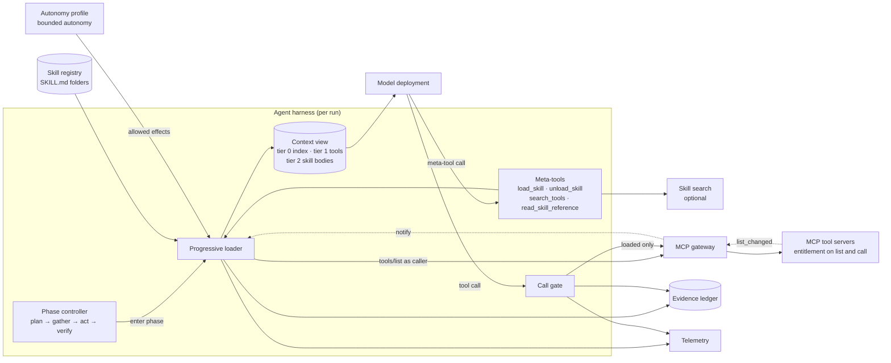
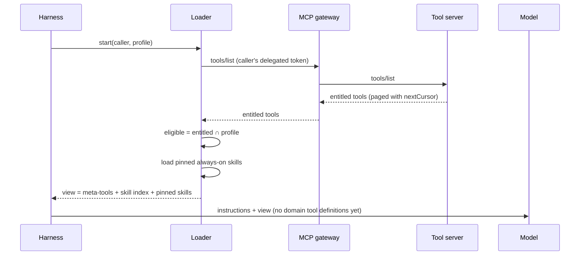
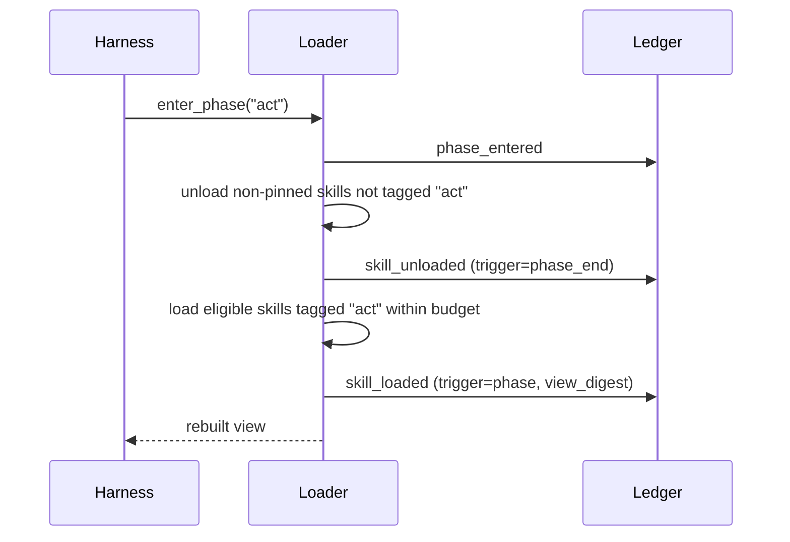
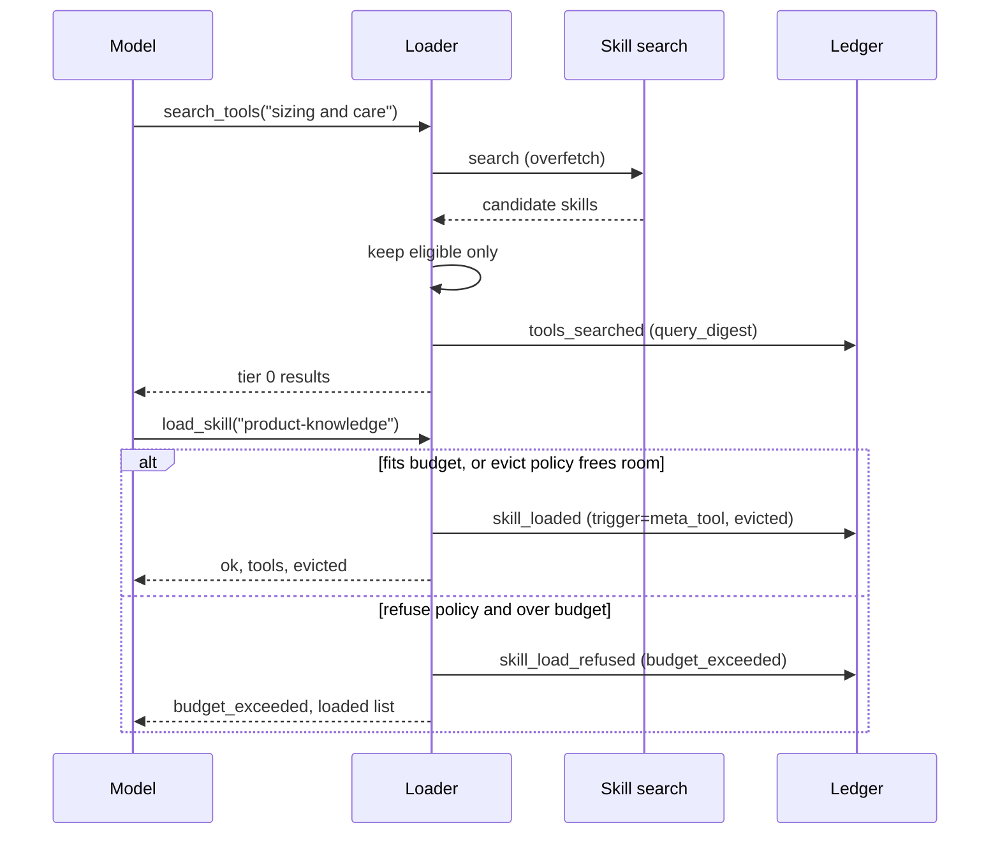
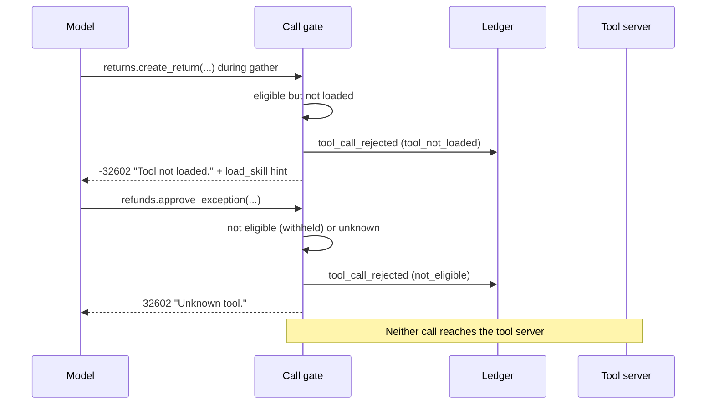
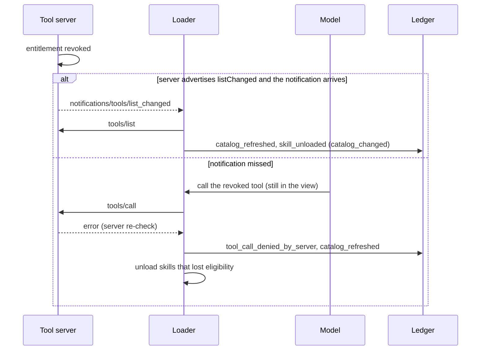

# Progressive Tool and Skill Loading: architecture

This document describes how an agent harness discloses tools and skills to a model in stages instead
of putting every tool schema and every skill instruction into the context at the start of a run. It
is the focused deep dive on the progressive skill disclosure step that the
[Governed Context-Aware Agent Harness](../../../orchestration-and-workflows/governed-context-aware-agent-harness/docs/architecture.md#91-progressive-skill-disclosure)
composes with planning, memory, verification, approval and the run certificate.

> **Core rule.** Entitlement decides **which** tools a caller may ever see. Progressive loading
> decides **when** an eligible tool is shown. The tool server still enforces entitlement on every
> call, and the harness rejects any call to a tool that is not currently loaded, even if the tool
> exists and the caller is entitled to it.

The executable reference is [`samples/progressive_loader.py`](../samples/progressive_loader.py).
Names such as `ProgressiveLoader`, `CatalogSource` and `load_skill` below refer to that sample.

## Contents

1. [Problem and forces](#1-problem-and-forces)
2. [Scope and relationship to sibling assets](#2-scope-and-relationship-to-sibling-assets)
3. [Components](#3-components)
4. [Component diagram](#4-component-diagram)
5. [Disclosure tiers](#5-disclosure-tiers)
6. [Loading triggers and decision matrix](#6-loading-triggers-and-decision-matrix)
7. [Context budgeting](#7-context-budgeting)
8. [Skills as folders](#8-skills-as-folders)
9. [MCP alignment](#9-mcp-alignment)
10. [Bounded autonomy and the evidence ledger](#10-bounded-autonomy-and-the-evidence-ledger)
11. [Telemetry and catalog tuning](#11-telemetry-and-catalog-tuning)
12. [Azure mapping](#12-azure-mapping)
13. [Sequence flows](#13-sequence-flows)
14. [Wire contracts](#14-wire-contracts)
15. [Domain Packs](#15-domain-packs)
16. [Failure modes](#16-failure-modes)
17. [Anti-patterns](#17-anti-patterns)
18. [Production checklist](#18-production-checklist)

## 1. Problem and forces

An enterprise agent can reach dozens of MCP servers and hundreds of tools, and it may have a library
of skills: named bundles of instructions, tool lists and reference material for one kind of task.
Putting all of it into the context at the start of every run has predictable costs:

- **Focus.** Long tool lists and unrelated instructions compete for the model's attention. Similar
  tools with overlapping descriptions act as distractors and raise the chance of a wrong-tool call.
- **Cost.** Every tool schema and skill body is re-sent on every model turn.
- **Misuse surface.** A model cannot call a write tool it has never seen. Hiding tools that are not
  needed yet narrows what a confused or manipulated model can attempt. This is a useful property but
  it is not a security control; see [section 2](#2-scope-and-relationship-to-sibling-assets).
- **Change.** When the catalog changes mid-run, an all-loaded prompt goes stale silently.

Progressive loading answers these, but it introduces forces of its own:

| Force | Tension |
|---|---|
| Coverage versus focus | Showing less helps focus, but the model must still be able to discover a capability it needs. |
| Determinism versus adaptivity | Phase-driven loading is predictable; model-requested loading handles the unexpected. |
| Extra turns | Every `search_tools` or `load_skill` round trip is a turn the model spends not doing the task. |
| Cache friendliness | A view that changes every turn defeats prompt-prefix reuse; a view that never changes is all-loaded. |
| Auditability | Reviewers need to reconstruct exactly what the model could see when it acted. |
| Safety boundary confusion | Teams are tempted to treat "not loaded" as "not allowed". It is not. |

## 2. Scope and relationship to sibling assets

This asset owns the **when**: tiers, triggers, budget, eviction, ordering, meta-tools and the
harness-side call gate. It deliberately does not re-explain the assets it depends on.

| Asset | What it owns | How this asset uses it |
|---|---|---|
| [Governed Context-Aware Agent Harness](../../../orchestration-and-workflows/governed-context-aware-agent-harness/README.md) | The end-to-end harness: plan before act, memory, verifier, approvals, ledger, run certificate | This asset expands its progressive skill disclosure step and its [budgets](../../../orchestration-and-workflows/governed-context-aware-agent-harness/docs/architecture.md#94-budgets-and-ceilings). |
| [Entitlement-Aware Tool Catalog](../../../ai-gateway/entitlement-aware-tool-catalog/README.md) | Filtering `tools/list` per caller and enforcing the same decision on `tools/call` | Supplies the entitled set. The loader never adds to it. |
| [Request Context Is Not Authorization](../../../agent-runtime/request-context-is-not-authorization/README.md) | Re-authorizing at the resource boundary from verified identity | Explains why the server re-checks every call regardless of what the harness showed. |
| [Multi-Tenant MCP Gateway](../../../ai-gateway/multi-tenant-mcp-gateway/README.md) | Tenant from the token, entitlement on every call, credential and cell selection | The path every `tools/list` and `tools/call` takes in production. |
| [Bounded Autonomy](../../../orchestration-and-workflows/bounded-autonomy/README.md) | The autonomy envelope: allowed effects, approvals, step limits | Bounds which entitled tools are eligible for loading at all. |
| [Evidence Ledger and Run Certificate](../../../orchestration-and-workflows/evidence-ledger-and-run-certificate/README.md) | Tamper-evident run evidence | Receives an event for every load, unload, refusal and rejected call. |

Four sets describe every run. Each is a subset of the one above it:

```text
entitled(caller)          = catalog.list_tools(caller)        # WHICH: decided by the tool server
eligible(caller, profile) = entitled(caller) ∩ profile.effects  # bounded by the autonomy envelope
disclosed(run, phase)     ⊆ eligible(caller, profile)          # WHEN: decided by the loader
callable(run)             = disclosed (harness gate) AND entitled (server re-check at call time)
```

The loader can only shrink what the model sees. Nothing a model writes, and nothing a skill body
says, can move a tool from outside `eligible` into `disclosed`. See
[ADR 0001](decisions/0001-loading-is-not-authorization.md).

## 3. Components

| Component | Responsibility | Sample | Production realization |
|---|---|---|---|
| Catalog source | Returns the entitled tools for a verified caller, re-checks entitlement on every call, signals changes | `CatalogSource`, `InMemoryCatalog`, `McpGatewayCatalog` (stub) | MCP servers behind a gateway such as Azure API Management |
| Skill registry | Versioned skill folders with `SKILL.md`, references and a content hash | `SkillSpec`, `to_skill_md`, `parse_skill_md` | A reviewed repository published with the harness, or a versioned store |
| Autonomy profile | Effect classes a run may use | `AutonomyProfile`, `PROFILES` | The bounded-autonomy envelope for the run |
| Progressive loader | Computes the eligible set, applies triggers and budget, builds the context view | `ProgressiveLoader` | Harness code, for example an Agent Framework context provider |
| Meta-tools | Let the model ask for more: `load_skill`, `unload_skill`, `search_tools`, `read_skill_reference` | `META_TOOLS`, `handle_tool_call` | Local functions registered with the agent; never forwarded to a tool server |
| Skill search | Finds candidate skills for a free-text need | `SkillSearch`, `KeywordSkillSearch`, `AzureAISearchSkillIndex` (stub) | Keyword, vector or hybrid search; optional |
| Call gate | Rejects calls to tools that are not loaded, not eligible or unknown | `ProgressiveLoader.call_tool` | Function-invocation middleware in the agent runtime |
| Event sink | Records each loading decision | `EventSink`, `ListSink` | The evidence ledger |
| Telemetry | Loaded versus used, misses, refusals, evictions | `Telemetry` | OpenTelemetry to Azure Monitor and Application Insights |

## 4. Component diagram



The model talks only to the view and to two entry points: meta-tools and the call gate. The
tool server is reached only through the gate, and the gate forwards only names that are loaded.

## 5. Disclosure tiers

| Tier | What the model sees | When it is disclosed | In the sample |
|---|---|---|---|
| 0: index | Meta-tool definitions, and `name` plus one-line `description` for each eligible skill | Always, from the first turn | `context_view()["meta_tools"]` and `["skill_index"]` |
| 1: tool schema | Full tool definitions (`name`, `description`, `inputSchema`, `annotations`) for the tools a loaded skill brings | When the skill is loaded | `context_view()["tools"]` |
| 2: skill body | The skill's instructions, version, tool names and reference names | When the skill is loaded, together with tier 1 | `context_view()["skills"]` |
| 3: references | Long material such as checklists, guides and examples | Only when the model calls `read_skill_reference` for a loaded skill | Returned as a tool result; never added to the view |

Design notes:

- **Load by skill, not by tool.** The sample discloses tier 1 and tier 2 together because a skill's
  instructions refer to its tools. Loading a tool without the instructions that say when to use it,
  or the instructions without the tools, produces confused calls. `search_tools` returns tier 0
  entries for the tools a skill brings so the model can choose the right skill, but loading is per
  skill.
- **The index is the discovery surface.** If a skill is not in the tier 0 index, the model cannot
  ask for it. Write descriptions for selection: what the skill does and when to use it, in one line,
  without overlap with sibling skills.
- **The index itself can outgrow the budget.** When the eligible skill count is large, replace the
  full index with a short category list plus `search_tools` (see [section 7](#7-context-budgeting)).
- **Tier 3 lives in the transcript, not the view.** A reference read is a tool result. It stays in
  conversation history until compaction removes it; it is not re-sent as part of the view on later
  turns.

## 6. Loading triggers and decision matrix

A trigger is any event that changes the disclosed set. The sample implements four and a fifth is an
optional add-on:

- **Always-on.** Policy skills such as conduct or safety rules load at start, are pinned, and are
  never evicted. They usually bring no tools.
- **Phase.** Entering `plan`, `gather`, `act` or `verify` loads the skills whose metadata lists that
  phase and unloads non-pinned skills that do not.
- **Meta-tool.** The model calls `load_skill(name)` for a skill in the index, optionally after
  `search_tools(query)`. The load lasts until the phase ends or the model calls `unload_skill`.
- **Catalog change.** When the entitled set changes, skills whose tools are no longer eligible are
  unloaded immediately.
- **Intent router (optional).** A classifier picks the initial skills for the request. When its
  confidence is low it should widen (load the phase defaults, or leave the choice to the model),
  never guess narrowly.

The **autonomy profile** is not a trigger. It is a filter applied before any trigger runs: a skill
whose tools are all outside the profile is not eligible, so no trigger can load it.

| Criterion | Phase-driven | Intent router | Meta-tool (model request) | Semantic search + meta-tool | Policy / profile | All loaded (baseline) |
|---|---|---|---|---|---|---|
| Who decides | Harness, from skill metadata | Classifier in the harness | The model | The model, helped by a search index | Envelope owner | Nobody |
| Predictability | High | Medium | Low | Low | High | High |
| Handles unexpected needs | Low | Medium | High | High | Not applicable | High |
| Extra model turns | None | None | One per load | One or two per load | None | None |
| Prompt-prefix stability | Stable within a phase | Stable after routing | Changes on each load | Changes on each load | Stable | Stable |
| Audit clarity | Clear: phase explains the load | Needs the router decision recorded | Needs the request recorded | Needs query digest and results recorded | Clear | Trivial but uninformative |
| Main risk | Phase map misses a need | Misroute narrows too far | Model loads the wrong skill or thrashes | Search returns distractors | Envelope too tight to finish | Distractors, cost, misuse surface |
| Use when | Workflows with known stages | Many distinct request types | Long tail of occasional skills | Large catalogs where the index alone is too big | Always, as the outer bound | Few tools, short runs |

**Recommended combination** ([ADR 0002](decisions/0002-phase-driven-loading-with-meta-tool-fallback.md)):
phase-driven loading as the primary trigger, always-on policy skills pinned, `load_skill` as the
fallback for needs the phase map did not anticipate, `search_tools` only when the index is too large
to show in full, and an intent router only where request types are clearly separable. The profile
bounds all of them.

**Phase policy for write skills.** The sample lets the model load any eligible skill at any phase,
because approval of write calls belongs to the bounded-autonomy layer. A stricter harness can also
refuse meta-tool loads of skills that bring write tools until the plan is approved. Either way, the
approval gate on the call stays in place.

## 7. Context budgeting

### 7.1 What is counted

The budget covers the whole view: meta-tool definitions, the skill index, loaded skill bodies and
loaded tool definitions. The sample measures the canonical JSON of the view in characters. That is
an **approximation** chosen because it is deterministic and needs no dependency; tokenizers differ
by model and language. In production, count with the tokenizer for your `<model-deployment>` and
keep the character count only as a fallback. The sample's default budget is an illustrative value
sized for its synthetic packs, not a recommendation.

### 7.2 Overflow policy

When a load would exceed the budget, the loader applies one of two policies:

| Policy | Behavior | Prefer when |
|---|---|---|
| `evict` | Unload the least recently used non-pinned skill, repeat until the new skill fits, and report `evicted` in the response | Interactive runs where the model should keep moving |
| `refuse` | Return `budget_exceeded` with the list of unloadable skills, change nothing | Regulated runs where the disclosed set must change only by explicit decision |

Rules that apply to both:

- Pinned (always-on) skills are never evicted. If they alone do not fit, the harness fails at start
  rather than running without its policy instructions.
- Recency is updated when a skill is loaded and when one of its tools is called, so a skill in
  active use is not the first to go.
- A skill that cannot fit even after evicting everything else is refused under either policy.
- Consider per-section caps, for example a ceiling on the index size, after which the harness
  switches from a full index to category names plus `search_tools`.

### 7.3 Unloading

Skills leave the view for four reasons, each recorded as a separate `trigger` on `skill_unloaded`:
`phase_end`, `budget_eviction`, `catalog_changed` and `meta_tool`. Unloading removes the skill body
and tool definitions from the view on the next turn. It does not erase earlier tool results from the
transcript; summarize or compact those separately.

### 7.4 Deterministic ordering and stable identifiers

Many model providers can reuse work for a prompt prefix that is identical to a recent request.
Prefix reuse rewards a view that changes as little and as late as possible:

- Put the stable parts first: system instructions, then meta-tools, then the sorted skill index.
- Put dynamic parts after them in a canonical order: pinned skills, then other loaded skills sorted
  by name, then tool definitions sorted by id. The sample's view is identical regardless of the
  order in which skills were loaded, and the `deterministic-ordering` scenario proves it with a
  byte-for-byte comparison and a view digest.
- Use stable identifiers: dotted lowercase tool ids, kebab-case skill names, explicit versions. Do
  not put timestamps, run ids or random values in the view.
- Change the view at phase boundaries rather than on every turn where possible.

Check your provider's documentation for how prefix reuse works and what invalidates it. This asset
makes no claim about the size of the effect.

### 7.5 Rebuild, do not append

The harness rebuilds the tool list and the skills section from loader state for every model call. It
does not append new tool definitions to the conversation as messages. Rebuilding keeps the view
bounded, keeps ordering canonical and makes unloading real.

## 8. Skills as folders

A skill is a folder with a `SKILL.md` file and optional reference files. The frontmatter carries the
tier 0 entry; the body is tier 2; files under `references/` are tier 3.

```text
skills/
  return-processing/
    SKILL.md
  product-knowledge/
    SKILL.md
    references/
      care-guide.md
      sizing-guide.md
```

The sample writes and parses this form (from the retail Domain Pack):

```markdown
---
name: return-processing
description: "Create return authorizations and record the outcome on the case."
metadata:
  version: "1.0.0"
  phases: "act"
  tools: "returns.create_return cases.add_note"
  always_on: "false"
---

## Purpose
Create return authorizations and record the outcome on the case.

## Steps
1. Create a return only for lines the eligibility check approved.
2. Add a case note listing return ids and any lines that were declined.
3. Stop and escalate if the customer asks for an exception.
```

Similar folder-and-frontmatter conventions exist across agent frameworks and coding agents. Field
names differ: some support a field that lists the tools a skill may use, others do not. Treat the
convention neutrally:

- `name` and `description` are the minimum. The description is what the model selects on.
- If your framework has no tools field, keep the skill-to-tool map in harness configuration keyed by
  skill name and version, not in free text in the body.
- A skill's tool list is a **request**, intersected with the eligible set at load time. A skill can
  never grant a tool.
- Hash the folder contents (`content_hash` in the sample) and record the hash on every load, so the
  ledger shows exactly which instructions the model saw.
- Skills with no tools are visible to every caller. Govern the registry itself; see
  [authentication and governance](authentication-and-governance.md).
- The sample's parser accepts only the restricted subset it writes. Use a real YAML parser in
  production.

## 9. MCP alignment

The Model Context Protocol separates what a server offers from what a client shows the model:

- A server lists its tools with the `tools/list` method. Results are paginated: a response can carry
  a `nextCursor`, and the client passes it back as `cursor` to get the next page.
- A server that declares `capabilities.tools.listChanged` in its initialize response sends
  `notifications/tools/list_changed` when its tool list changes. The client then calls `tools/list`
  again.
- The host application decides which listed tools it presents to the model. Presenting a subset is a
  client-side choice the protocol allows; progressive loading is exactly that choice.
- Tool annotations such as `readOnlyHint` are hints. Do not use them for authorization or to decide
  a tool's effect class. Take effect classes from governed catalog metadata, as the sample's
  `ToolSpec.effect` does.

Where each concern lives:

| Concern | Lives in | Why |
|---|---|---|
| Which tools a caller may ever use | MCP server, behind the gateway | Only the server can enforce it on `tools/call` |
| When an eligible tool is shown | Harness (this asset) | Depends on phase, budget and model requests |
| Whether a call is allowed | Both: harness gate first, server re-check always | The gate catches hallucinated and not-loaded names; the server is the boundary |

Practical notes:

- Treat `notifications/tools/list_changed` as an optimization. A client that misses one must still
  be safe, because the server re-checks on every call. Refresh at phase boundaries as a backstop.
- Aggregate several servers by namespacing tool ids (the sample uses `<area>.<action>`), and reject
  collisions at registration rather than at run time.
- Some model function-calling APIs restrict the characters allowed in function names. If dots are
  not allowed, map catalog ids to a reversible provider-safe form at the model boundary and map back
  before the call gate.
- The sibling [Entitlement-Aware Tool Catalog](../../../ai-gateway/entitlement-aware-tool-catalog/docs/architecture.md#9-versioned-catalog-and-change-notifications)
  uses the `2025-11-25` specification revision in its examples. Check the current MCP specification
  for method names, capability fields and pagination behavior before you build.

## 10. Bounded autonomy and the evidence ledger

The autonomy envelope from [Bounded Autonomy](../../../orchestration-and-workflows/bounded-autonomy/README.md)
bounds eligibility. The sample models it as an `AutonomyProfile` with allowed effect classes:
`observe-only` permits read tools, `supervised` permits read and write tools. Under `observe-only`,
write tools are not in the eligible set, so they do not appear in the index or the view, cannot be
loaded and receive the uniform `Unknown tool.` response if the model names them anyway. Approval
gates, step limits and plan approval stay in the bounded-autonomy layer; the loader does not
replace them.

Every loading decision is an event for the
[Evidence Ledger and Run Certificate](../../../orchestration-and-workflows/evidence-ledger-and-run-certificate/README.md):

| Event | Emitted when | Key fields |
|---|---|---|
| `catalog_refreshed` | Start, `list_changed`, after a server denial | `reason`, `catalog_version`, eligible counts |
| `phase_entered` | A phase begins | `phase` |
| `skill_loaded` | A skill is disclosed | `skill`, `version`, `content_hash`, `trigger`, `tools`, `evicted`, `context_chars`, `view_digest` |
| `skill_unloaded` | A skill leaves the view | `skill`, `trigger`, `context_chars`, `view_digest` |
| `skill_load_rejected` | Unknown or not-eligible name requested | `skill` (or `invalid:<hash>`), `reason`, `trigger` |
| `skill_load_refused` | Budget would be exceeded | `skill`, `reason`, `required_chars`, `budget_chars` |
| `tool_called` | A loaded tool was called and the server accepted | `tool`, `owner_skills`, `is_error` |
| `tool_call_rejected` | The gate rejected a call | `tool`, `reason` (`tool_not_loaded`, `not_eligible`, `unknown`), `hint_skills` |
| `tool_call_denied_by_server` | The server refused a call the harness allowed | `tool`, `code` |
| `tools_searched` | `search_tools` ran | `query_digest`, `candidates`, `returned` |
| `reference_read` / `reference_read_rejected` | A reference was read or refused | `skill`, `reference`, `content_hash` or `reason` |

The `view_digest` on load and unload events, together with skill `content_hash` values, lets a
reviewer reconstruct the exact disclosed set at any point in the run. Events carry no tool arguments
and no raw search queries. Malformed or injected names are recorded as `invalid:<hash>` so the ledger
cannot be used to smuggle text.

## 11. Telemetry and catalog tuning

| Signal | Definition | What it tells you |
|---|---|---|
| Tools exposed | Tool ids disclosed at any point in the run | Upper bound on what the model could use |
| Tools used | Tool ids called successfully | What the task actually needed |
| Exposed but unused | Exposed minus used | Phase map or skill too broad; candidates to split or move |
| Misses | Calls to an eligible tool whose skill was not loaded | Phase map too narrow, or skill descriptions unclear |
| Unknown tool calls | Calls to names that are not eligible or do not exist | Hallucinated names, prompt injection, or stale instructions naming withheld tools |
| Server denials | Calls the harness allowed but the server refused | Revocation lag or a catalog mismatch; investigate every one |
| Refused loads and evictions | Budget pressure | Budget too small, skills too large, or thrashing |
| Unknown skill requests | `load_skill` for names not in the eligible index | Model guessing skill names, or injection |
| Wrong-tool calls | A loaded tool was called when a different tool was correct | Measured only on labeled evaluation tasks; points to overlapping descriptions |

Use these to tune the catalog: move a skill into the phase where it keeps being missed, split skills
whose tools are mostly exposed but unused, rewrite descriptions that cause wrong-tool calls, and
shrink skill bodies that cause evictions. See
[evaluation and troubleshooting](evaluation-and-troubleshooting.md) for targets and release gates.

Emit these as attributes or events on OpenTelemetry GenAI spans (`invoke_agent`, `chat`,
`execute_tool`). Do not record tool arguments or raw user text in telemetry.

## 12. Azure mapping

| Concern | Azure option | Notes |
|---|---|---|
| Harness that controls the tool list per turn | Microsoft Foundry Agent Service hosted agents | A hosted agent runs your container, so harness code such as the loader decides which tools and instructions go to the model on each call. Prompt agents declare tools in the agent definition; when you need per-turn disclosure, run the loader in code. |
| Agent runtime building blocks | Microsoft Agent Framework | Register meta-tools as functions; inject the skill index and loaded skills with a context provider; enforce the call gate in function-invocation middleware. If your version provides a skills feature, check its documentation for how it discloses skills and whether it lets you control the tool list. |
| MCP gateway | Azure API Management | Validates the Microsoft Entra token, applies rate limits and passes JSON-RPC through to the MCP server. See [Multi-Tenant MCP Gateway](../../../ai-gateway/multi-tenant-mcp-gateway/README.md). Per-caller `tools/list` filtering belongs in the MCP server behind it, as described in [hosting on Azure](../../../ai-gateway/entitlement-aware-tool-catalog/docs/architecture.md#12-hosting-on-azure). |
| MCP servers | Azure Container Apps or another host for an MCP server built with an MCP SDK | Implements entitlement on both `tools/list` and `tools/call` and advertises `listChanged` if it can notify. |
| Semantic skill search (optional) | Azure AI Search | Index skill names and descriptions for keyword, vector or hybrid queries. Apply a security filter where possible; the loader still post-filters to the eligible set. Useful only when the catalog is too large for a full index. |
| Identity | Microsoft Entra ID | The caller identity reaches the catalog as a delegated token; see [Request Context Is Not Authorization](../../../agent-runtime/request-context-is-not-authorization/docs/architecture.md#8-agents-on-foundry-what-arrives-and-which-identity-to-use). |
| Telemetry | Azure Monitor and Application Insights | Export OpenTelemetry with the Azure Monitor OpenTelemetry distro; add loader signals to `execute_tool` and `invoke_agent` spans. |
| Evidence | Your evidence store | Append ledger events; see the evidence ledger asset for durability and verification. |

## 13. Sequence flows

### 13.1 Run start: index only



### 13.2 Phase transition



### 13.3 Meta-tool load



### 13.4 Call to a tool that is not loaded, or does not exist



### 13.5 Revocation during a run



## 14. Wire contracts

These are the shapes the sample uses. Meta-tools are local harness functions; only domain tool
calls travel as MCP `tools/call` requests.

**Tier 0 skill index entry**

```json
{"name": "product-knowledge", "description": "Answer product specification, sizing and care questions."}
```

**Tier 1 tool definition** (disclosed when its skill is loaded)

```json
{
  "name": "orders.get_order",
  "description": "Get an order with line items and payment status.",
  "inputSchema": {
    "type": "object",
    "properties": {"order_id": {"type": "string"}},
    "required": ["order_id"],
    "additionalProperties": false
  },
  "annotations": {"readOnlyHint": true}
}
```

**`load_skill` request from the model and success response**

```json
{"name": "load_skill", "arguments": {"name": "product-knowledge"}}
```

```json
{"ok": true, "skill": "product-knowledge", "version": "1.0.0", "tools": ["catalog.search_products"], "evicted": []}
```

A repeated load returns `"already_loaded": true` and refreshes recency. An unknown or not-eligible
name returns the same body, so the model cannot probe for withheld skills:

```json
{"ok": false, "error": "unknown_skill", "message": "Unknown skill."}
```

**Budget refusal** (`overflow=refuse`)

```json
{
  "ok": false,
  "error": "budget_exceeded",
  "message": "Loading this skill would exceed the context budget. Unload a skill first.",
  "loaded": ["order-lookup", "return-eligibility"]
}
```

**Call to an eligible tool that is not loaded**

```json
{"error": {"code": -32602, "message": "Tool not loaded.", "data": {"reason": "tool_not_loaded", "load_skill": ["return-processing"]}}}
```

**Call to a withheld, profile-excluded or non-existent tool**

```json
{"error": {"code": -32602, "message": "Unknown tool."}}
```

The harness response deliberately omits the name. The sibling entitlement catalog's server-side
error ([responses by outcome](../../../ai-gateway/entitlement-aware-tool-catalog/docs/architecture.md#146-responses-by-outcome))
echoes the requested name; either is fine as long as the response is identical for "withheld" and
"does not exist".

**`search_tools` response**

```json
{"ok": true, "results": [{"skill": "product-knowledge", "description": "Answer product specification, sizing and care questions.", "tools": [{"name": "catalog.search_products", "description": "Search product specifications and care instructions."}]}]}
```

**MCP excerpts** (check field names against the current specification)

```json
{"jsonrpc": "2.0", "id": 1, "result": {"protocolVersion": "2025-11-25", "capabilities": {"tools": {"listChanged": true}}, "serverInfo": {"name": "orders-server", "version": "1.4.0"}}}
```

```json
{"jsonrpc": "2.0", "id": 7, "method": "tools/list", "params": {"cursor": "page-2"}}
```

```json
{"jsonrpc": "2.0", "id": 7, "result": {"tools": [{"name": "orders.get_order", "description": "Get an order with line items and payment status.", "inputSchema": {"type": "object", "properties": {"order_id": {"type": "string"}}, "required": ["order_id"]}, "annotations": {"readOnlyHint": true}}], "nextCursor": "page-3"}}
```

```json
{"jsonrpc": "2.0", "method": "notifications/tools/list_changed"}
```

**Ledger event**

```json
{"seq": 6, "type": "skill_loaded", "tenant": "contoso-retail", "phase": "gather", "skill": "product-knowledge", "version": "1.0.0", "content_hash": "59133bac5a3f53c6", "trigger": "meta_tool", "tools": ["catalog.search_products"], "evicted": [], "context_chars": 4965, "view_digest": "f012f993c3a1d60b"}
```

`context_chars` is the character approximation described in [section 7.1](#71-what-is-counted).

## 15. Domain Packs

The pattern is domain-neutral. The sample ships four synthetic packs that exercise the same
scenarios; organization names are fictional.

| Pack | Organization and caller | Always-on skill | Phase skills (plan / gather / act / verify) | Off-phase skill with references | Withheld tool |
|---|---|---|---|---|---|
| Retail customer service | Contoso Retail, service agent | `service-conduct` | `case-triage` / `order-lookup`, `return-eligibility` / `return-processing` / `case-review` | `product-knowledge` (care guide, sizing guide) | `refunds.approve_exception` |
| Manufacturing maintenance | Fabrikam, maintenance planner | `maintenance-safety` | `work-request-triage` / `asset-history`, `spare-parts` / `work-order-scheduling` / `work-order-review` | `diagnostic-procedures` (vibration checklist, lubrication guide) | `safety.override_lockout` |
| Healthcare intake | Northwind Clinics, intake coordinator | `intake-privacy` | `referral-triage` / `coverage-check`, `slot-finder` / `appointment-booking` / `intake-review` | `form-guidance` (language access, accessibility requests) | `clinical.get_visit_notes` |
| Financial services operations | Contoso Financial Operations, operations analyst | `payment-controls` | `exception-triage` / `ledger-lookup`, `counterparty-check` / `exception-resolution` / `reconciliation-check` | `procedure-library` (reason codes, cutoff calendar) | `limits.override_limit` |

In every pack the act-phase skill brings write tools, so `observe-only` leaves the act phase with
nothing new to load. The healthcare pack's withheld tool is a read tool, which shows that
entitlement filtering is independent of effect class.

## 16. Failure modes

| Failure | Symptom | Mitigation |
|---|---|---|
| Phase map misses a needed skill | Misses climb; model calls a tool that is not loaded | `tool_not_loaded` hint names the skill; meta-tool fallback; move the skill into the phase |
| Model thrashes between skills | Repeated load and evict of the same skills | Larger budget for the phase, smaller skill bodies, or `refuse` with a clear message; cap loads per phase |
| Always-on skills exceed the budget | Harness fails at start | Shorten policy skills; this is the intended fail-closed behavior |
| Index too large | Start view near the budget before any skill loads | Category index plus `search_tools`; split the agent |
| Search returns withheld skills | Leakage risk if not filtered | Loader post-filters every search result to the eligible set; security filter in the index too |
| Missed `list_changed` notification | Revoked tool still in the view | Server re-checks on call; harness refreshes and unloads on denial; refresh at phase boundaries |
| Server does not support `listChanged` | No change signal | Refresh on phase boundaries and on any server denial |
| Skill body tells the model to call a withheld tool | Unknown tool calls | Uniform `Unknown tool.`; registry review; telemetry alert on unknown calls |
| View ordering depends on load order | Prefix reuse lost, digests differ for the same state | Canonical sorted view; `deterministic-ordering` test in CI |
| Unloaded skill's results still drive actions | Model acts on stale tool output from history | Re-gather in the verify phase; compaction policy for old tool results |
| Name mapping for provider-safe function names collides | Two catalog ids map to one model-facing name | Reversible mapping with collision check at registration |

## 17. Anti-patterns

- **Loading as authorization.** Hiding a tool from the model and assuming it cannot be called. Any
  name can be emitted; the gate and the server must reject it. See
  [ADR 0001](decisions/0001-loading-is-not-authorization.md).
- **Client-side entitlement.** Fetching the full catalog and filtering it in the harness by role.
  The server must filter `tools/list` and enforce `tools/call`; see the
  [Entitlement-Aware Tool Catalog](../../../ai-gateway/entitlement-aware-tool-catalog/README.md).
- **Skills that grant tools.** Letting a skill's tool list add tools the caller is not entitled to.
- **Appending definitions to the transcript.** The view grows without bound and unloading is
  impossible.
- **Leaky error messages.** Different responses for "withheld" and "does not exist", or echoing the
  withheld skill in a hint.
- **Unbounded meta-tool use.** No cap on loads per phase, no budget, no record of why a skill was
  loaded.
- **Overlapping skill descriptions.** Two skills that both claim the same need; the model picks one
  at random.
- **Trusting tool annotations.** Deciding a tool's effect class from `readOnlyHint` instead of
  governed metadata.
- **Timestamps or run ids in the view prefix.** Every turn becomes a new prefix.
- **Logging raw queries and arguments.** `search_tools` queries and tool arguments can carry personal
  data; record digests.

## 18. Production checklist

- [ ] The entitled set comes from the tool server for the verified caller, not from a harness role
      table.
- [ ] Eligible = entitled ∩ autonomy profile, recomputed at start, on `list_changed`, on any server
      denial and at phase boundaries.
- [ ] The call gate rejects not-loaded, not-eligible and unknown names before any server call.
- [ ] The tool server re-checks entitlement on every `tools/call`.
- [ ] Withheld and non-existent names produce identical responses for both `load_skill` and calls.
- [ ] Every skill has a version and content hash; the registry is reviewed and published through a
      pipeline.
- [ ] Always-on policy skills are pinned and fit the budget; start fails closed if they do not.
- [ ] The view is rebuilt per call in canonical order with stable ids and no volatile values.
- [ ] Budget counts use the tokenizer for the deployed model, with an illustrative default replaced
      by a measured one.
- [ ] Overflow policy (`evict` or `refuse`) chosen per workload and recorded in configuration.
- [ ] Meta-tool loads are capped per phase and recorded with their trigger.
- [ ] Ledger events cover load, unload, refusal, rejected call, server denial and reference read,
      with view digests.
- [ ] Telemetry reports loaded versus used, misses, unknown calls, evictions and refusals per
      agent version.
- [ ] Wrong-tool rate is measured on a labeled evaluation set before each catalog or skill change.
- [ ] Red-team prompts for withheld-tool calls, skill-name guessing and injected skill bodies pass.
- [ ] Production readiness reviewed against the
      [Agent Production Readiness Guide](../../../agentops-and-readiness/agent-production-readiness/README.md).
