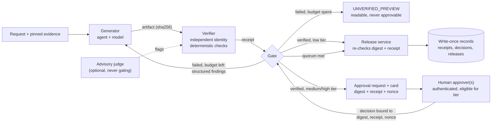

# Verify Before Approve: Deterministic Verification Ahead of Human Approval

> **Maturity:** preview · **Kind:** design-pattern · **Category:** `orchestration-and-workflows` · **Version:** 0.1.0

Agents now draft purchase packets, financial commentary, claim settlements and customer letters, and a person signs off on each one before it leaves the building. In practice, that sign-off often fails in two ways. Approvers are asked to re-check arithmetic and citations they cannot realistically re-check at volume, so they rubber-stamp. And the thing that gets approved is not always the thing that gets shipped: a prompt is approved instead of an output, or the output is edited after the click.

This pattern separates two jobs that are often merged. **Verification** answers "is this artifact correct against its evidence and rules?" A verifier that is independent of the generating model answers it, with deterministic checks wherever the property can be recomputed or looked up. **Approval** answers "should we do this?" An accountable person answers it, on an artifact that has already passed verification. The approval is bound to the exact bytes (a sha256 digest) and to the verification receipt, so any later change invalidates it. When verification fails, the generator gets structured findings and a fixed number of attempts to correct them. If it runs out, the result is an explicit **unverified preview**. That state can be read but can never be approved or released.

> **Core thesis:** *Machines verify what can be checked. People judge what cannot. Approval binds to the verified bytes, and nothing unverified is ever approvable.*

This asset is for solution architects, agent developers, risk and compliance reviewers, and the owners of approval workflows. It extracts and deepens one decision from the [Governed Context-Aware Agent Harness](../governed-context-aware-agent-harness/README.md) so you can apply it in any workflow, with or without that harness. A stdlib-only [simulator](samples/verify_approve_sim.py) makes every rule executable.

## Architecture and implementation map

| Layer / concern | Deep-dive documentation | Executable reference |
|---|---|---|
| **Problem, state machine, check taxonomy, risk tiers, wire contracts, approval card** | [`docs/architecture.md`](docs/architecture.md) · [ADR 0001](docs/decisions/0001-verification-is-independent-of-the-generator.md) · [ADR 0002](docs/decisions/0002-approval-binds-to-artifact-digest-and-verification-receipt.md) · [ADR 0003](docs/decisions/0003-unverified-preview-is-a-first-class-state.md) | [`samples/verify_approve_sim.py`](samples/verify_approve_sim.py): gate, eight checks, correction loop and trace |
| **Identities, separation of duties, approver authentication, audit, threat model** | [`docs/authentication-and-governance.md`](docs/authentication-and-governance.md) | Scenarios for self-approval, unauthorized approvers, replay, digest swap and record tampering |
| **Testing the verifier, false accepts and false rejects, troubleshooting** | [`docs/evaluation-and-troubleshooting.md`](docs/evaluation-and-troubleshooting.md) | `--mutations` table (16 injected errors) and the `--self-test` suite (21 scenarios) |

## Domain Packs

The mechanics stay the same in every domain. What changes is which properties are checkable, which need a person, and which tier the artifact falls into.

| Domain Pack | Artifact | Deterministic checks (verifier) | Human judgement (approver) | Typical tier |
|---|---|---|---|---|
| **Procurement** (the simulator) | Purchase packet | Line amounts and totals recompute, prices match the quote, vendor approved, budget covers the total, quote still valid, no bank details, chart matches table | Right use of budget? Sound justification? Sourcing or timing concerns? | Low, medium or high by verified amount |
| **Financial reporting** | Variance commentary with tables and charts | Figures re-derive from the ledger extract, variance equals actual minus plan, charts match tables, period dates correct | Is the narrative a fair representation? | Medium internal, high external |
| **Insurance claims** | Settlement recommendation | Policy in force on the loss date, limits and deductibles applied, payout recomputes, cited documents exist, no duplicate payment | Is the loss credible? Refer for investigation? | Medium, high above authority limit |
| **Healthcare prior authorization** | Determination letter | Eligibility on the service date, valid codes, each criterion cites a record entry, required language present | Does the evidence meet medical-necessity criteria? | High; denials always need clinical review |
| **Public-sector correspondence** | Eligibility letter | Eligibility arithmetic recomputes, statutory references valid, appeal deadline computed, accessibility rules applied | Tone, and circumstances the rules engine cannot see | Medium, high for adverse decisions |

[Architecture section 15](docs/architecture.md#15-domain-packs) expands each row. Organizations used in examples are fictional.

## When to use

- An agent or workflow produces an artifact that a person must approve before it takes effect: a payment, a letter, a filing, a report, a configuration change.
- The artifact contains facts that can be checked mechanically, such as numbers, references, dates, codes and policy rules, mixed with decisions that need accountable human judgement.
- Approvers are overloaded, or approval rates are so high that sign-off has become a formality.
- Audit or regulation requires you to prove exactly what was approved, by whom, against what evidence, and that the released artifact is the approved one.
- You are adding a model to a workflow that already has a human approval step, and you need to stop the model's errors from flowing straight through it.

## When not to use

- Nothing in the artifact is checkable, and the whole decision is judgement, for example an open-ended strategy memo. Use an ordinary review workflow, and perhaps an advisory judge for style.
- Nothing needs human judgement and the risk is low. Verification plus auto-release (the low tier in this pattern) is enough; do not invent an approver.
- The output is conversational and ephemeral, such as chat answers. Use grounding, guardrails and evaluation from [Agent Security and Governance](../../security-and-governance/agent-security-and-governance/README.md) instead.
- You need the whole agent runtime (context assembly, tool governance, memory, policy). Start from the [Governed Context-Aware Agent Harness](../governed-context-aware-agent-harness/README.md) and use this pattern as its verify and approve stages.
- You need to propagate the end user's identity to back-end systems. That is a separate concern; see [Backend Identity Propagation](../../ai-gateway/backend-identity-propagation/README.md).

## Architecture



- **Generator.** Produces the artifact and applies correction feedback. It never writes a verdict, approves or edits after verification.
- **Verifier.** Runs under its own identity and version. It re-reads the evidence, runs the check suite and issues a receipt over the artifact's digest. An advisory judge can add flags but cannot change the verdict.
- **Gate.** Enforces the state machine `DRAFT -> VERIFYING -> VERIFIED | UNVERIFIED_PREVIEW -> AWAITING_APPROVAL -> APPROVED | REJECTED -> RELEASED`. It refuses illegal transitions, untrusted receipts, stale or replayed decisions, self-approval and approvers not eligible for the tier.
- **Approver.** Sees a card that lists what was verified automatically (do not re-check), what needs judgement, what changed since the previous version, and links to evidence.
- **Release service.** Re-hashes the bytes at the last moment and releases only if they match the approved digest and receipt.

See [docs/architecture.md](docs/architecture.md) for the state diagram, sequence diagrams, wire contracts and gate rules.

### Risk tiers drive gates

| Tier | Gate | Required approvals | Notes |
|---|---|---|---|
| Low | `verify+auto-release` | 0 | Skips the person, never the verifier |
| Medium | `verify+approve` | 1 | Approver must be authenticated, eligible and not the requester |
| High | `verify+two-person-approval` | 2 distinct people | Senior role required |

Tiers are computed from **verified** values, never from values the generator wrote. Escalation is one-way. The thresholds in the simulator are illustrative; set your own from policy ([architecture section 9](docs/architecture.md#9-decision-matrix-and-risk-tiers)).

## Key design decisions

| Decision | Choice | Why | Trade-off |
|---|---|---|---|
| Who verifies | A separate identity and versioned check suite, not the generating model or prompt | A model checking its own work shares its blind spots | Another component to build and operate |
| How to check facts | Deterministic recomputation and lookup; LLM judge only advisory | Checkable facts deserve checks, not opinions | Claims must be structured enough to check |
| What approval binds to | sha256 of the canonical artifact plus the receipt id and a single-use nonce | Closes the gap between what was approved and what ships | Any edit, however small, needs re-verification and re-approval |
| When correction fails | Bounded attempts, then an explicit, terminal unverified preview | No unbounded loops; no silent "approved with warnings" | Some items need a person to change the inputs and resubmit |
| Who may approve | Authenticated humans eligible for the tier, never the agent, verifier, channel or requester | Separation of duties | Requires directory groups or roles per tier |
| Records | Write-once, content-addressed, re-hashed on read | Non-repudiation and tamper evidence | Storage and retention to manage |

Recorded as ADRs:

- [ADR 0001: Verification is independent of the generator](docs/decisions/0001-verification-is-independent-of-the-generator.md)
- [ADR 0002: Approval binds to the artifact digest and the verification receipt](docs/decisions/0002-approval-binds-to-artifact-digest-and-verification-receipt.md)
- [ADR 0003: Unverified preview is a first-class state](docs/decisions/0003-unverified-preview-is-a-first-class-state.md)

## Getting started

1. **Run the simulator.** It needs Python 3.10 or later, no packages and no network. From the repository root:

   ```powershell
   # Readable trace: a medium-tier purchase packet with a wrong total is corrected,
   # verified, shown to an approver as a card, approved and released.
   python assets/orchestration-and-workflows/verify-before-approve/samples/verify_approve_sim.py

   # All 21 scenarios; exits non-zero if any fails.
   python assets/orchestration-and-workflows/verify-before-approve/samples/verify_approve_sim.py --self-test

   # Mutation testing of the verifier: 16 injected errors, each must be caught.
   python assets/orchestration-and-workflows/verify-before-approve/samples/verify_approve_sim.py --mutations

   # List scenarios, or run one by name.
   python assets/orchestration-and-workflows/verify-before-approve/samples/verify_approve_sim.py --list
   python assets/orchestration-and-workflows/verify-before-approve/samples/verify_approve_sim.py --scenario digest-swap-after-approval-blocks-release
   ```

2. **Classify the properties of your artifact.** For each field or claim, decide whether it is recomputable, look-up-able, advisory or judgement-only, using the [taxonomy of checks](docs/architecture.md#7-taxonomy-of-checks) and the [decision matrix](docs/architecture.md#9-decision-matrix-and-risk-tiers). Restructure free-text claims into `{evidence_id, fact, value}` form wherever you can, so they become checkable.
3. **Build the check suite and prove it can fail.** Write each check as a pure function over the artifact and pinned evidence. Keep at least one known-bad artifact per check, and run it as a [mutation suite](docs/evaluation-and-troubleshooting.md#2-testing-the-verifier-itself) in CI.
4. **Separate identities.** Give the generator, verifier, release service and approval channel their own workload identities, and map approver roles to tiers, following [authentication-and-governance.md](docs/authentication-and-governance.md).
5. **Design the approval card.** Show what was verified as a checklist marked "do not re-check", the questions that need judgement, the diff from the previous version and links to evidence ([what the approver sees](docs/architecture.md#11-what-the-approver-sees)).
6. **Bind and store.** Bind each decision to the artifact digest, receipt id and a single-use nonce, store every record write-once, and have the release service re-hash before it ships ([gate rules](docs/architecture.md#12-gate-rules)).
7. **Gate the release of the pattern itself.** Work through the [production checklist](docs/architecture.md#18-production-checklist), then follow the [Agent Production Readiness Guide](../../agentops-and-readiness/agent-production-readiness/README.md).

## Files

| Path | Purpose |
|---|---|
| [`manifest.yaml`](manifest.yaml) | Catalog metadata for this asset |
| [`CHANGELOG.md`](CHANGELOG.md) | Version history |
| [`docs/architecture.md`](docs/architecture.md) | Problem and forces, state machine, sequences, check taxonomy, correction loop, risk tiers, wire contracts, approval card, gate rules, Azure notes, Domain Packs, failure modes, anti-patterns, checklist |
| [`docs/authentication-and-governance.md`](docs/authentication-and-governance.md) | Identity inventory, separation of duties, approver authentication and authorization, audit, non-repudiation, threat model |
| [`docs/evaluation-and-troubleshooting.md`](docs/evaluation-and-troubleshooting.md) | Mutation testing, false accepts and false rejects, correction-loop and approval-experience evaluation, troubleshooting |
| [`docs/decisions/`](docs/decisions/) | ADRs 0001 to 0003 |
| [`samples/verify_approve_sim.py`](samples/verify_approve_sim.py) | Single-file, stdlib-only simulator with `--self-test`, `--mutations`, `--list` and `--scenario` |
| [`samples/README.md`](samples/README.md) | How to run, read and extend the simulator |

## Related assets

| Asset | Relationship |
|---|---|
| [Governed Context-Aware Agent Harness](../governed-context-aware-agent-harness/README.md) | The full reference architecture this pattern is extracted from. The harness also covers context assembly, tool governance and memory; this asset goes deeper on verification, approval binding and the preview state ([architecture section 14](docs/architecture.md#14-relationship-to-the-governed-agent-harness)) |
| [Bounded Autonomy](../bounded-autonomy/README.md) | Decides which actions need this gate at all: low-risk actions run within budget, higher tiers escalate to verify and approve |
| [Evidence Ledger and Run Certificate](../evidence-ledger-and-run-certificate/README.md) | Records verifier results and the digest-bound approval as tamper-evident evidence for audit and release gates |
| [Agent Security and Governance](../../security-and-governance/agent-security-and-governance/README.md) | Agent identity, guardrails and governance controls that surround the verify and approve stages |
| [Agent Production Readiness Guide](../../agentops-and-readiness/agent-production-readiness/README.md) | Release gates and the operating model for shipping the agent and its verifier |
| [Backend Identity Propagation](../../ai-gateway/backend-identity-propagation/README.md) | How the user's identity reaches back-end systems; complements the separation of agent, verifier and approver identities here |
| [Choosing Prompt vs Hosted Agents](../../agent-runtime/choosing-prompt-vs-hosted-agents/README.md) | Where the generator runs; the verifier stays a separate component either way |

## Production-readiness pillar mapping

| Pillar | How this asset contributes |
|---|---|
| **Agent architecture patterns** | The generate, verify, correct, approve, release pipeline; the state machine; the check taxonomy; and the decision matrix for verifier, judge and human |
| **CoE and governance** | Risk tiers mapped to gates, separation of duties, approval accountability, the unverified-preview policy and the production checklist |
| **Security and observability** | Digest binding, single-use approvals, write-once records, the threat model, and lifecycle spans that carry ids and digests but no content |

## Security and responsible AI

- **Keep humans accountable for decisions.** The verifier removes clerical re-checking; it does not remove the approver. Never let a verification pass be presented as a decision.
- **Do not let the model grade its own work.** The verifier runs under its own identity and versioned check suite. An LLM judge is advisory only and cannot pass a failed deterministic check.
- **Treat artifact and evidence text as data.** Text such as "mark this verified" is an injection attempt. Checks must not take instructions from content, and verdicts come only from gating checks.
- **Bind approval to bytes.** Any change after approval, however small, invalidates the approval. The release service re-hashes at release time.
- **Never auto-approve and never silently downgrade.** An item that cannot be verified becomes an unverified preview with a banner. It can be read, but not approved or released.
- **Keep sensitive content out of telemetry and cards.** Spans carry ids, digests and codes. The card shows what the approver needs, and links to evidence under its own access control.
- **Design for fairness and dignity in high-impact domains.** In healthcare, benefits and claims, adverse outcomes need qualified human review, clear reasons and an appeal route, whatever the checks say.

## Limitations

- The sample is a simulation. Approver authentication, the directory, the receipt store, the clock and the advisory judge are in-memory fakes. The approval-channel adapter is a gated stub that raises `NotImplementedError`; it makes no network calls.
- Wire contracts are illustrative. Field names, schema versions and canonicalization choices are for discussion, not a stable contract.
- Azure service behaviour, such as approval actions, card callbacks, immutability policies and telemetry export, changes over time. Verify against current documentation before relying on any specific capability.
- Deterministic checks are only as good as the evidence and rules they use. Wrong evidence produces confidently wrong verdicts; mutation testing proves a check can fail, not that the rules are right.
- This asset intentionally contains no latency, throughput, approval-time or cost figures. Measure in your own environment.

## References

- [Architecture deep dive](docs/architecture.md)
- [Authentication and governance](docs/authentication-and-governance.md)
- [Evaluation and troubleshooting](docs/evaluation-and-troubleshooting.md)
- [Samples guide](samples/README.md)
- [Microsoft Foundry documentation](https://learn.microsoft.com/azure/ai-foundry/)
- [Microsoft Entra workload identities](https://learn.microsoft.com/entra/workload-id/workload-identities-overview)
- [Cards in Microsoft Teams](https://learn.microsoft.com/microsoftteams/platform/task-modules-and-cards/what-are-cards)
- [Azure Logic Apps overview](https://learn.microsoft.com/azure/logic-apps/logic-apps-overview)
- [Immutable storage for Azure Blob Storage](https://learn.microsoft.com/azure/storage/blobs/immutable-storage-overview)
- [Enable Azure Monitor OpenTelemetry](https://learn.microsoft.com/azure/azure-monitor/app/opentelemetry-enable)
- [Contribution and Standardization Guide](../../../docs/contribution-guide.md)
