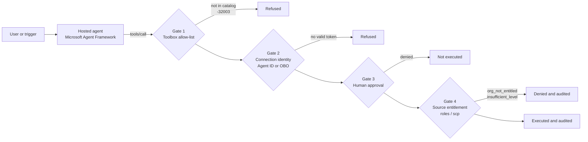

# Enterprise Agent Security and Tool Governance

A reference architecture for security architects, platform engineers and agent
developers who are moving AI agents from "answers questions" to "acts on real
systems". It places governance on the **tool call**, where risk actually
materializes, and composes Microsoft Foundry, Microsoft Entra Agent ID, Foundry
Toolbox, guardrails, Azure Monitor and Microsoft Agent 365 into a
defense-in-depth design. The outcome is an agent whose identity, tool reach,
approvals and data entitlements are platform configuration that a security team
can review, change and audit without touching agent code.

> **Core thesis:** *Assume the model can be fooled. Govern who the agent is,
> what it can reach, and what it can do, and prove it with platform traces and
> source audit.*

Every control in this asset is enforced **outside the model**: in Entra, in the
Toolbox endpoint, in the hosted-agent runtime and sandbox, and in the downstream
source system. Prompt instructions are a usability aid, never a control.

## When to use

- An agent calls tools that read sensitive data or change state in a business
  system (network operations, ITSM, finance, HR, customer records).
- A single agent or platform serves several tenants, business units or
  customers, and data boundaries between them must hold even if the model is
  manipulated.
- You must answer "who did this?" for every agent action, distinguishing the
  agent acting as itself from the agent acting on behalf of a signed-in user.
- Security or compliance teams need to own tool catalogs, approval policy and
  kill switches independently of the developers who ship agent code.
- You are planning for tenant-wide agent governance with Microsoft Agent 365 and
  want the identity design you build in Foundry today to carry forward.
- The agent writes and runs code (analysis scripts, generated SQL, uploaded
  notebooks or tenant-published skills). Add Gate 5, the execution boundary,
  from the [code-execution governance guide](docs/code-execution-governance.md).

## When not to use

- Pure retrieval or chat agents with no tools and no access to sensitive data.
  Baseline content safety and Foundry RBAC are usually enough; see the
  [Agent Production Readiness Guide](../../agentops-and-readiness/agent-production-readiness/README.md).
- Agents built entirely in Copilot Studio or Microsoft 365 Copilot extensibility
  with no custom tools. Governance is primarily tenant-admin configuration in
  Microsoft Agent 365 and the Microsoft 365 admin center.
- Network isolation and landing-zone design. This asset assumes a secured Foundry
  deployment and focuses on runtime tool governance on top of it.

## Architecture

### Four questions per tool call

Every tool call an agent makes must answer four questions. Each maps to a
platform capability rather than a prompt rule.

| # | Question | Answered by | Typical evidence |
|---|----------|-------------|------------------|
| 1 | **Who is calling?** | Entra Agent ID for the agent's own calls; OAuth passthrough (on-behalf-of) for a signed-in user | Token `oid`/`appid`, identity kind (agent or user), Entra agent sign-in logs |
| 2 | **Which tools exist and can run?** | Foundry Toolbox versioned allow-list (`allowed_tools`) plus approval policy (`require_approval`) | Toolbox version that served the call; `-32003` for tools outside the catalog; approval request in the trace |
| 3 | **What data and actions are permitted?** | The downstream source (MCP server or API), from validated token claims (`roles` / `scp`) | Allow or deny with a reason such as `org_not_entitled` or `insufficient_level` |
| 4 | **Who saw it and how do we stop it?** | Foundry tracing, source audit in Log Analytics, Entra sign-in logs; kill switch on the identity plus source revocation | One audit row per decision; disabled `accountEnabled`; revoked app role |

### Four serial runtime gates

A state-changing tool call has to pass four independent gates, in series. Any
gate can stop it; no gate can grant what a later gate refuses.

1. **Tool catalog allow-list (Foundry Toolbox).** Versioned MCP tool bundles.
   A tool that is not exposed by the current Toolbox version fails closed with
   MCP error `-32003`. Promoting or rolling back the Toolbox default version
   changes the tool surface without redeploying the agent.
2. **Connection identity.** The Toolbox connection obtains a token as the agent's
   own Entra Agent ID (autonomous or alert-triggered work) or passes through the
   signed-in user's token (assistive work). No shared static API keys exist in
   code or configuration.
3. **Human approval.** State-changing tools pause for a human decision before
   they run, declared as `require_approval` on the Toolbox and enforced by the
   agent runtime (Microsoft Agent Framework `approval_mode`).
4. **Source-side entitlement.** The source system validates the token and
   decides from Entra app roles or scopes. A human approval is not a permission:
   an approved call from an identity holding only `read` is still refused.

Around the gates sit defense-in-depth guardrails (deny-by-default network
egress, Prompt Shields, evaluation as a release gate) and an audit and
containment layer (platform traces, source audit, kill switch).

### Four-gate control matrix

The serial diagram numbers gates in the order a call meets them. The threat
model and release gates group the same controls by **owning platform**, so each
gate has one accountable team, one kill switch and one set of tests. Use this
crosswalk when moving between the two views.

| Control-matrix gate | Primary controls | Runtime gates above | Verified by |
|---------------------|------------------|---------------------|-------------|
| **Gate 1:** Foundry private tool catalog and toolsets | Catalog registration with version pinning; split toolsets (`ops-readonly-mcp` with read tools only, `ops-operator-mcp` with read and write tools); `require_approval` on every write tool | 1 and 3 | `S8`, kill-switch Tier 1 |
| **Gate 2:** Entra ID, RBAC and PIM | Entra Agent ID per agent; app roles `MCP.Tools.Read` and `MCP.Tools.Operate`; Operate only as a PIM-eligible or time-bound assignment; a named sponsor | 2 | `S1`, `S2`, Tier 3 |
| **Gate 3:** MCP server entitlement and poisoned-output framing | Token validation; entitlement from claims, never from arguments; approval bound to tool, arguments and caller; tool output framed as untrusted data; "no audit, no action" | 4 | `S3` to `S6`, `X1`, Tier 2 |
| **Gate 4:** Foundry guardrails, Purview and Sentinel | Prompt Shields on input and indirect-injection screening on tool output; egress and sensitive-data blocks; groundedness; Purview DSPM for AI; Sentinel analytics on a shared `correlation_id` | Guardrails and audit layer | `S7`, KQL queries 1 to 8 |

Each gate is designed to contain the failure of any other single gate. The
blast-radius analysis is in the
[threat model](docs/threat-model-and-control-matrix.md).

### Gate 5: when the agent executes code

Gates 1 to 4 govern which tools an agent may call. Once the agent can write and
run code, a single prompt injection becomes arbitrary code execution (OWASP
Agentic ASI05). Gate 5 assumes that has already happened and limits what the
code can reach:

| Control-matrix gate | Primary controls | Verified by |
|---------------------|------------------|-------------|
| **Gate 5:** Execution boundary | Generated code never runs in the agent process; hypervisor-isolated sandbox sessions keyed by the broker per user conversation; no identity, secrets or outbound network inside the sandbox; pre-screen, budgets and an output guard; digest-pinned runtimes, skills and prompts under change control; side effects only through governed tools and Gate 3; an execution record for every run | Isolation probe, `CX-T1` to `CX-T12`, KQL queries 9 to 11 |

The [code-execution governance guide](docs/code-execution-governance.md) sets
out ten principles, controls by code author (model, user, tenant or coding
agent), execution tiers 0 to 4, threats `CX-01` to `CX-15` and a production
checklist. The runtime mechanics (session pools, the session broker and an
offline simulator) are in
[Code Execution Sandboxes with Session Pools](../../agent-runtime/code-execution-sandbox-session-pools/README.md).

### Domain packs

The pattern is domain-agnostic. A domain pack supplies the tools, the partition
boundary and the approval-worthy actions; the gates, identities, tests and
queries stay the same. The samples use generic `list_records`, `get_record` and
`apply_change` tools and app roles of the form `Records.Org<Id>.Read` or
`Records.Org<Id>.Operate`; rename them for your domain.

| | ITSM and SecOps | FinOps and ERP | Customer support and CRM |
|-|-----------------|----------------|--------------------------|
| **Records** | Incidents, alerts, hosts, network devices | Invoices, purchase orders, journal entries, vendor master | Cases, accounts, contacts, orders |
| **Read tools** | `get_incident`, `get_device_status`, `get_alert_timeline` | `get_invoice`, `list_open_orders`, `get_budget_variance` | `get_case`, `search_accounts`, `get_order_history` |
| **Write tools** | `isolate_host`, `restart_service`, `close_incident` | `approve_invoice`, `post_journal_entry`, `update_vendor_bank_details` | `issue_refund`, `update_contact`, `close_case` |
| **Partition boundary** | Managed customer, business unit or environment | Legal entity, company code or cost center | Customer account, brand or region |
| **Approval-worthy actions** | Isolation, configuration push, bulk closure | Payment release, vendor bank change, period-end postings | Refunds above a threshold, contact or identity changes |
| **Signature threat** | Poisoned alert or log text steers containment to the wrong host | Poisoned invoice text changes remittance details | Customer-written case text asks the agent to export other customers' data |
| **Typical evidence consumer** | SOC and change advisory board | Internal audit and controllers | Privacy office and support quality |

### Architecture and implementation map

| Artifact | What it gives you |
|----------|-------------------|
| [Architecture walkthrough](docs/architecture.md) | The gates in depth, guardrails, unified audit schema and kill switch |
| [Threat model and control matrix](docs/threat-model-and-control-matrix.md) | Ten attack vectors mapped to OWASP, MITRE ATLAS and the four gates; blast radius per gate; red-team cases `S1` to `S8` |
| [Evaluation and release gates](docs/evaluation-and-release-gates.md) | Security smoke suite, Foundry evaluators, red-team safety evaluators and the `dev` to `staging` to `prod` promotion thresholds |
| [Agent 365 governance mapping](docs/agent365-governance-mapping.md) | Sponsor lifecycle, Access Packages and PIM for `MCP.Tools.Operate`, Purview label inheritance, Sentinel correlation rules |
| [ADR 0001: Four-gate tool governance](docs/decisions/0001-four-gate-tool-governance.md) | Why the controls sit where they do |
| [`samples/governed_mcp_server.py`](samples/governed_mcp_server.py) | Gate 3 reference server with an offline self-test |
| [`samples/governed_agent_example.py`](samples/governed_agent_example.py) | Hosted agent with no tool code, bound to a Toolbox |
| [`samples/provision_toolbox_and_guardrails.py`](samples/provision_toolbox_and_guardrails.py) | Desired-state provisioning and drift detection for Gates 1, 2 and 4 |
| [`samples/kill_switch_and_smoke_test.py`](samples/kill_switch_and_smoke_test.py) | `S1` to `S8` and the three-tier kill-switch rehearsal, runnable offline |
| [Code-execution governance](docs/code-execution-governance.md) | Gate 5 for agents that write or run code: principles, controls by author, execution tiers, threats `CX-01` to `CX-15`, red-team cases and a production checklist |
| [ADR 0002: Execution boundary for generated code](docs/decisions/0002-execution-boundary-for-generated-code.md) | Why generated code runs out of process with no identity and no egress |
| [`samples/execution_isolation_probe.py`](samples/execution_isolation_probe.py) | Gate 5 probe: run it inside a sandbox to prove no secrets, identity endpoint, metadata address or outbound network are reachable |
| [`samples/audit-queries.kql`](samples/audit-queries.kql) | Eleven detection and review queries joined on `correlation_id`; queries 9 to 11 cover code execution |

## Key design decisions

| Decision | Choice | Why | Trade-off |
|----------|--------|-----|-----------|
| Where to enforce authorization | In four platform and source gates, never in the prompt or agent code | A fooled model cannot bypass controls it does not execute | More moving parts to configure and test |
| Agent identity | Entra Agent ID per published agent; OAuth passthrough for assistive calls | Every call is attributable to an accountable principal; no shared secrets | Entra role assignments propagate at the next token (minutes, not seconds) |
| Tool catalog | Foundry Toolbox versions as the allow-list and change-control lever | Security owns the tool surface; promote and roll back without redeploying | Toolbox is in preview; pin and test versions before promotion |
| Approval | Declared on the Toolbox, enforced by the runtime, fail closed for unclassified tools | Policy changes ship as configuration; humans gate disruptive actions | Approval only binds clients that honor it; Gate 4 still required |
| Data entitlements | Enforced by the source from `roles` / `scp` claims, deny by default | Data rules live where the data lives and apply to every client | Each source must validate tokens and map roles |
| Evidence | Platform traces plus a uniform source audit schema | Answers "who saw what and why" without trusting agent logs | Extra Log Analytics ingestion cost |
| Tenant-scale governance | Microsoft Agent 365 and Entra ID Governance on the same identity object | No rework when the fleet grows; adds sponsors, reviews and expiry | Requires additional licensing and admin activation |
| Code execution | Out-of-process session pool behind a broker; no identity, secrets or egress in the sandbox; side effects only through governed tools | A fooled model that writes hostile code reaches nothing worth stealing or changing | Session capacity, cold starts and state loss to design for; custom images to patch and pin |

Significant decisions are recorded as ADRs in [`docs/decisions/`](docs/decisions/).

## Getting started

### Prerequisites

- A Microsoft Foundry project with a hosted agent, a model deployment, and
  Application Insights connected for tracing.
- Permission to manage Entra app registrations and app-role assignments in your
  tenant (for the downstream API and the agent identity).
- A downstream MCP server or API you control (for example on Azure Container
  Apps) that can validate Entra tokens and write structured audit logs to Log
  Analytics.

### Shortest path

1. **Model the entitlements in Entra.** Register the downstream API and define app
   roles per boundary and level, for example `NetOps.OrgA.Read` and
   `NetOps.OrgA.Operate`. Make the source deny anything not mapped.
2. **Publish the agent** so it receives a dedicated Entra Agent ID instead of the
   shared project identity. Assign the least-privilege app role to the agent
   identity, and the appropriate roles to user groups for assistive use.
3. **Create a Foundry Toolbox** that exposes the downstream MCP server with an
   explicit `allowed_tools` list and a `require_approval` policy for every
   state-changing tool. Create a read-only toolset and an operate toolset.
   [`samples/provision_toolbox_and_guardrails.py`](samples/provision_toolbox_and_guardrails.py)
   shows the desired state and detects drift from it.
4. **Bind the agent to the Toolbox** with no tool code in the agent. See
   [`samples/governed_agent_example.py`](samples/governed_agent_example.py).
5. **Attach a guardrail** with Prompt Shields, indirect prompt-injection
   screening on tool output and a deny-by-default network egress allow list.
   Start egress in Audit mode, review the decisions, then switch to Enforce.
6. **Wire the evidence.** Emit the audit schema from the source with a
   `correlation_id` on every record, and deploy the detections in
   [`samples/audit-queries.kql`](samples/audit-queries.kql) (cross-tenant probes,
   escalation attempts, unapproved writes, injection blocks, write-velocity
   anomalies, kill-switch timeline and entitlement review).
7. **Gate releases on evaluation.** Run the security smoke suite and the Foundry
   quality and safety evaluators with the thresholds in
   [Evaluation and release gates](docs/evaluation-and-release-gates.md).
8. **Rehearse containment.** Run
   [`samples/kill_switch_and_smoke_test.py`](samples/kill_switch_and_smoke_test.py)
   offline, then rehearse all three kill-switch tiers (Toolbox detach, server
   write flag, identity disable) in a test environment and record time-to-stop.
9. **If the agent executes code, add Gate 5.** Pick the lowest
   [execution tier](docs/code-execution-governance.md#4-execution-tiers) that
   works, run
   [`samples/execution_isolation_probe.py`](samples/execution_isolation_probe.py)
   inside every pool before release, and schedule KQL queries 9 to 11.

See [`samples/README.md`](samples/README.md) for what each sample demonstrates and
how to adapt it.

### Clean-up

Delete the Foundry project resources, the downstream service, the Entra app
registrations and app-role assignments, and the agent identities you created.
Entra objects are not removed when you delete an Azure resource group.

## Security and responsible AI

- **Identity and access.** Every tool call runs as an Entra principal: the agent's
  own Agent ID or the signed-in user. An agent acting for a user can never do more
  than that user. Use least-privilege app roles; never ship static keys.
- **Data handling.** Tool output (logs, tickets, telemetry, web pages) is
  untrusted input and may carry indirect prompt injection. Data boundaries are
  enforced by the source on every call. Network egress is deny by default to
  limit exfiltration.
- **Human oversight.** Disruptive actions require explicit approval, and every
  approval is still subject to source entitlement. Each agent should have a human
  sponsor and an end date.
- **Known risks and mitigations.**

  | Risk | Mitigation |
  |------|------------|
  | Direct jailbreak | Prompt Shields on input blocks the request before agent code runs |
  | Indirect injection through tool output | Treat tool output as data; approval and source entitlement still hold; egress blocks exfiltration |
  | Privilege escalation through approval | Approval is not permission; the source applies the caller's roles |
  | Cross-tenant or cross-org data access | Source enforces org boundaries from token claims; deny by default |
  | Clients that ignore approval policy | Allow-list, connection identity and source entitlement still apply |
  | Approval replay or payload swap | Approval bound to the exact tool, arguments and caller, single use, short-lived |
  | Over-broad tool catalog | Split read and operate toolsets; unclassified tools are never exposed |
  | Credentials or personal data in logs and traces | Sensitive-data egress filter; audit records carry IDs, not payloads |
  | Shadow agents or stale entitlements | Sponsor and expiry on every agent identity; access reviews; entitlement-review query |
  | Compromised or runaway agent | Three-tier kill switch: Toolbox detach, server write flag, identity disable |
  | Silent regressions after a model, prompt or framework change | Evaluation release gate with deterministic checks |
  | Generated code reaches the agent's identity, secrets or network | Gate 5: out-of-process sandbox with no identity and egress off, proved by the isolation probe |
  | Poisoned or drifting runtime image, package or skill | Digest and lock-hash pinning, review before promotion, read-back after deployment, KQL query 10 |
  | The model reports results from code that never ran | Treat an answer as computed only when a matching execution record exists |

  The full analysis, with OWASP and MITRE ATLAS mappings and per-gate blast
  radius, is in the
  [threat model and control matrix](docs/threat-model-and-control-matrix.md).

## Limitations

- Several capabilities are in **preview**: Foundry Toolbox (versions,
  `allowed_tools`, `require_approval`), agent-identity and OAuth-passthrough
  connections, hosted-agent network egress guardrails, Entra agent sign-in logs,
  and `accountEnabled` changes on agent identities through Microsoft Graph beta.
  See the maturity table in the
  [Agent 365 governance mapping](docs/agent365-governance-mapping.md#capability-maturity).
- Toolbox `require_approval` is declared policy that the agent runtime honors. A
  direct MCP client that ignores it is not stopped by approval; it is stopped by
  the other three gates.
- Guardrail intervention points for tool calls and tool responses apply only to
  specific tool types; validate coverage for MCP tools and hosted agents.
- Disabling an agent identity is eventual, bounded by token lifetime (about five
  minutes in testing). Use source-side revocation for an immediate stop.
- Entitlement logic and the audit schema in the source system are your code. The
  platform supplies validated identity, not row-level authorization.
- Microsoft Agent 365 requires licensing and admin activation; registry sync and
  activity data have prerequisites described in the mapping document.
- Parts of the code-execution stack are in preview, including some session-pool
  types, settings and regional availability. Provisioning can succeed while a
  setting is ignored, so the guide requires read-back and an isolation probe
  for each pool; see its
  [preview caveats](docs/code-execution-governance.md#20-preview-caveats).

## References

- [Microsoft Foundry Agent Service](https://learn.microsoft.com/azure/foundry/agents/overview)
- [Agent identity concepts in Microsoft Foundry](https://learn.microsoft.com/azure/foundry/agents/concepts/agent-identity)
- [Microsoft Entra Agent ID](https://learn.microsoft.com/entra/agent-id/identity-platform/what-is-agent-id)
- [Governing agent identities with Entra ID Governance](https://learn.microsoft.com/entra/id-governance/agent-id-governance-overview)
- [Microsoft Agent 365 overview](https://learn.microsoft.com/microsoft-agent-365/overview)
- [Foundry and Agent 365 integration](https://learn.microsoft.com/azure/foundry/agents/concepts/agent-365-integration)
- [Tool governance in Foundry](https://learn.microsoft.com/azure/foundry/agents/how-to/tools/governance)
- [Prompt Shields](https://learn.microsoft.com/azure/ai-services/content-safety/concepts/jailbreak-detection)
- [Agent evaluators](https://learn.microsoft.com/azure/foundry/concepts/evaluation-evaluators/agent-evaluators)
- [Microsoft Purview for Foundry](https://learn.microsoft.com/purview/ai-azure-foundry)
- [Microsoft Agent Framework](https://learn.microsoft.com/agent-framework/overview/agent-framework-overview)
- [Model Context Protocol](https://modelcontextprotocol.io/)
- [OWASP Top 10 for Agentic Applications](https://genai.owasp.org/)
- Related assets: [Code Execution Sandboxes with Session Pools](../../agent-runtime/code-execution-sandbox-session-pools/README.md), [Agent Production Readiness Guide](../../agentops-and-readiness/agent-production-readiness/README.md), [Microsoft 365 Integration with Azure Custom Engine Agent](../../m365-and-copilot/m365-azure-custom-agent/README.md), [Secured Microsoft Foundry Landing Zone](../../landing-zones-and-infra/secured-foundry-landing-zone/README.md)
