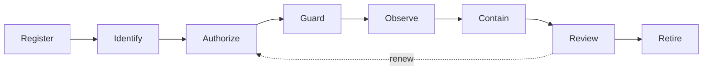
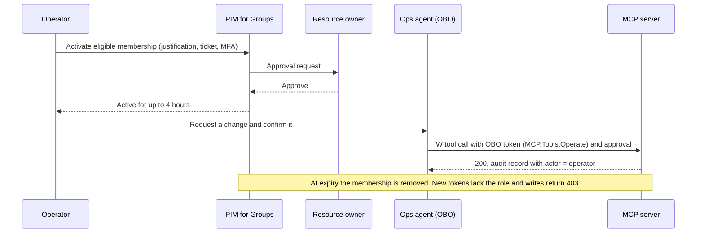

# Agent 365 governance mapping

The [four runtime gates](architecture.md) govern each tool call. Organizations
also need to govern agents as a **fleet**: who owns each agent, whether it is
still needed, which agents nobody approved, and how security tooling sees agent
activity across Microsoft 365. This document maps what you can do natively in
Microsoft Foundry and Azure today to what **Microsoft Agent 365** and **Microsoft
Entra ID Governance** add at tenant scale.

Key point: Agent 365 does **not** replace any runtime gate, and it does not
enforce row-level data access in your own APIs. It acts on the **same Entra Agent
ID object** your Foundry agent already uses, so the per-call design carries
forward without rework.

## Agent governance lifecycle



| Stage | Goal | Foundry and Azure today | Agent 365 and Entra ID Governance add |
|-------|------|-------------------------|---------------------------------------|
| **Register** | Every agent is known and owned | Foundry project inventory, SDK listing, Azure Resource Graph | Tenant-wide registry across Foundry, Copilot Studio and third parties; IT approval of new agents |
| **Identify** | Every agent has its own accountable identity | Entra Agent ID per published agent; blueprint; tags | Sponsors and owners enforced; ownerless agents flagged |
| **Authorize** | Least privilege, time-bound | App roles, Azure RBAC, Toolbox `allowed_tools` and `require_approval` | Access packages with expiry and approval for agents; Conditional Access for agents |
| **Guard** | Limit what a fooled model can do | Guardrails, Prompt Shields, egress allow-list, source entitlement | Purview DLP and Insider Risk on agent activity in Microsoft 365 |
| **Observe** | Evidence for every action | OpenTelemetry traces, Toolbox and egress telemetry, source audit, agent sign-in logs | Agent map and usage dashboards; Defender XDR correlation |
| **Contain** | Stop a misbehaving agent quickly | Disable `accountEnabled`, disable agent version, revoke roles, roll back Toolbox | Central block from the admin center; risk-based Conditional Access |
| **Review** | Entitlements stay justified | Manual review of role assignments | Recurring access reviews for agent identities, sponsor attestation |
| **Retire** | No orphaned agents or access | Delete agent, identity and role assignments | Lifecycle policies that expire or remove inactive or sponsorless agents |

## Foundry agent identity archetypes

Choose the archetype per agent before designing Gate 2. It determines which token
reaches the source and what Microsoft 365 can do with the agent.

| Archetype | Acts as | Token at the source | Typical use | Governance notes |
|-----------|---------|--------------------|-------------|------------------|
| **Assistive** | The signed-in user, on their behalf (OBO) | Delegated: `scp` plus the user's `roles` | Copilot-style helpers, engineer-in-the-loop remediation | The agent can never exceed the user. Requires user consent; audit records the user as principal and the agent as actor. |
| **Background service** | Itself, app-only | Application: `roles` on the Entra Agent ID | Alert triage, scheduled jobs, pipeline agents | No Microsoft 365 mailbox or presence. Least-privilege app roles; sponsor required. |
| **Autopilot** | Itself, as a digital worker | Agent identity plus a Microsoft 365 **agent user account** | Agents that join Teams, own a mailbox, are "hired" by people | Created from a blueprint with admin approval; people add instances in Teams. Highest governance need: sponsors, access reviews, lifecycle. |

A single solution can combine archetypes, for example a background service
identity for alert triage and assistive passthrough when an engineer approves a
remediation. Keep them on separate Toolbox connections so the identity used for
each call is explicit.

## Five-pillar comparison

Microsoft Agent 365 organizes tenant governance into five pillars. The table
shows what to build natively today and what Agent 365 adds.

| Pillar | Native in Foundry and Azure today | Added by Microsoft Agent 365 and Entra ID Governance |
|--------|-----------------------------------|-----------------------------------------------------|
| **Registry** | Foundry project and Control Plane inventory; SDK and REST listing; Azure Resource Graph queries; tags on the agent identity | Single tenant-wide registry of agents from Foundry, Copilot Studio and partners; **shadow-agent discovery**; ownerless and inactive flags; IT approval and publishing workflow |
| **Access control** | Entra Agent ID; app roles and OBO; Azure RBAC; Azure Policy; Toolbox `allowed_tools` and `require_approval`; AI gateway policies | **Sponsors** with accountability; **access reviews** for agent identities; **access packages** with expiry and approval; **lifecycle policies**; Conditional Access and ID Protection for agents |
| **Visualization** | Application Insights and OpenTelemetry traces; Foundry monitoring dashboards; Log Analytics workbooks over the source audit | Agent map of agents, users and resources; usage and adoption dashboards across the tenant |
| **Interoperability** | MCP, A2A and OpenAPI tools with agent-identity or passthrough auth through Toolbox | Agents acting in Microsoft 365 as themselves (mail, Teams, files) with an agent user account; Work IQ context |
| **Security** | Guardrails and Prompt Shields; egress allow-list; Defender for Cloud AI threat protection; Purview DSPM for AI; source entitlement; kill switch | **Defender XDR** incidents spanning agents; **Purview DLP**, **Insider Risk Management**, audit and eDiscovery over agent activity in Microsoft 365 |

### Foundry integration notes

- Published Foundry prompt agents and hosted agents can sync to the Agent 365
  registry automatically. Hosted agents additionally use the Agent 365 SDK and
  need Entra permissions to send activity data.
- Data flows to Agent 365 only when the tenant is licensed and an administrator
  has accepted the terms.
- Entra ID Governance features for agents (sponsors, access reviews, access
  packages, lifecycle policies) require Agent 365 plus Entra ID P1 (or Microsoft
  365 E3), or a suite that includes them. Confirm current licensing with your
  account team.

## Entra Agent ID sponsor lifecycle

Every agent identity needs a person who answers for it. Entra Agent ID separates
three roles, and the rules below assume all three are filled:

| Role | Who | Accountable for |
|------|-----|-----------------|
| **Sponsor** | A named business owner of the use case | Whether the agent should exist and what it may do; attests at every review |
| **Owner** | The team that operates the agent | Configuration, credentials, toolset bindings, incident response |
| **Blueprint owner** | The platform team | The template that agent identities are created from, and its default permissions |

Enforce these rules in the publishing pipeline and in Entra ID Governance. The
day counts are starting points; set them to your risk appetite.

| # | Rule | Enforced by |
|---|------|-------------|
| L1 | **No sponsor, no identity.** Publishing fails unless the agent identity has at least two sponsors, both active employees, in different reporting lines. | Publishing pipeline check; Agent 365 ownerless flag |
| L2 | **Sponsors do not approve their own agent's elevation alone.** Requests for `MCP.Tools.Operate` need the resource owner of the target system as a second approver. | Access package approval stages |
| L3 | **Leaver or mover.** When a sponsor leaves or changes role, a replacement is named within 14 days. At day 15 the identity is disabled (kill-switch Tier 3); at day 45 it is retired. | Entra lifecycle workflows and sponsor notifications (verify); scheduled job |
| L4 | **Quarterly attestation.** The sponsor confirms that the agent is still needed and that its app roles and toolset bindings are still justified. No response means access is removed. | Access review on the agent identity with "remove access" as the default |
| L5 | **Inactivity.** No successful tool call for 30 days triggers a review; 60 days, disable; 90 days, retire. | KQL query 8; lifecycle policy |
| L6 | **Scope change means re-attestation.** A new `W` tool in the operator toolset needs sponsor sign-off before the Toolbox version is promoted to default. | Release gate in [evaluation and release gates](evaluation-and-release-gates.md) |
| L7 | **Tags are mandatory.** `sponsor`, `owner-team`, `domain-pack`, `data-classification` and `cost-center` are set on the identity and the Foundry agent. | Azure Policy on the Foundry resource; pipeline check |
| L8 | **Retire in order.** Unbind toolsets, remove app-role assignments, disable the identity, then delete it after the audit retention period. Audit records are kept. | Retirement runbook |

L3 and L5 use the same Tier 3 lever as the [kill switch](architecture.md#kill-switch),
so an orphaned agent is contained by the mechanism the team already rehearses.

## Time-bound write access for `MCP.Tools.Operate`

`MCP.Tools.Read` may be a standing assignment. `MCP.Tools.Operate` is never
standing: it is eligible, approved per use and expires on its own. The mechanism
depends on the identity archetype.

### Human operators (assistive archetype): PIM for Groups

1. Create a role-assignable security group per domain pack, for example
   `grp-mcp-operate-itsm`, and assign it the `MCP.Tools.Operate` app role on
   the MCP server's enterprise application.
2. Onboard the group to Privileged Identity Management (PIM) for Groups. Make
   operators **eligible** members; do not create active members.
3. Set the activation policy: a maximum of 4 hours, MFA through an
   authentication context, a justification and a ticket number, and approval
   by the resource owner. Requesters cannot approve themselves.
4. After activation, the operator's next token carries
   `roles: MCP.Tools.Operate`, and so does the OBO token that the Toolbox
   connection brokers to the MCP server. Approval (runtime gate 3) is still
   required for each write.
5. Deactivation is eventual: a token issued during the window keeps the role
   until it expires. The server write flag (Tier 2) is still the immediate lever.



### Agent identities (background and autopilot archetypes): access packages

Group-based app-role assignment does not flow to service principals, so agent
identities get `MCP.Tools.Operate` as a direct, time-bound assignment:

- Create an access package `ops-agent-operate` in an `agent-tools` catalog whose
  resource is the `MCP.Tools.Operate` app role on the MCP server application.
- Policy: the requester is the agent identity, with the sponsor or owner
  requesting on its behalf. Approval stage 1 is a sponsor and stage 2 is the
  resource owner. Expiry is 7 days at most, extension needs fresh approval, and
  an access review runs monthly.
- Pair the role with the `ops-operator-mcp` toolset binding. The role without
  the binding, or the binding without the role, both fail closed.
- Access packages for agent identities are preview; validate them in your
  tenant. Until then, use a pipeline job that creates the app-role assignment
  with a ticket reference and a scheduled removal. Both changes land in
  `AuditLogs`, and query 8 finds anything left behind.

| Setting | `MCP.Tools.Read` | `MCP.Tools.Operate` |
|---------|------------------|---------------------|
| Assignment type | Active (standing) | Eligible (people) or expiring (agents) |
| Maximum active duration | Not applicable | 4 hours (people), 7 days (agents) |
| Approval | Sponsor, at assignment | Resource owner, on every activation or request |
| MFA or authentication context | Sign-in policy | Required on activation |
| Justification and ticket | Not required | Required |
| Eligibility or package expiry | 365 days, with review | 180 days, with review |
| Review cadence | Semiannual | Quarterly (people), monthly (agents) |
| Detection | Query 8 (unused access) | Queries 2, 3, 6 and 8 |

## Purview DSPM for AI and sensitivity label inheritance

Purview DSPM for AI discovers AI applications and interactions, recommends
policies and gives audit and eDiscovery coverage. Foundry prompts and responses
reach Purview once the subscription's Purview integration is enabled through
Defender for Cloud AI threat protection; custom applications can also call the
Purview data security APIs directly (verify availability in your tenant).

Microsoft 365 Copilot responses inherit the highest sensitivity label of the
content they reference. **A custom agent calling your MCP tools does not inherit
labels automatically**: the label lives in the system of record, so the tools
must carry it and the agent and server must honor it.

| # | Rule | Where it is enforced |
|---|------|----------------------|
| P1 | **Tool results carry the label.** Every `R` tool returns the record's `sensitivity_label` (label ID and display name) from the system of record. Unlabeled records get the data domain's default label, never the lowest one. | MCP server (runtime gate 4) |
| P2 | **The highest label wins per turn.** The agent tracks the highest label across all tool outputs that share a `correlation_id`. Its response and any artifact it creates inherit that label. | Agent code; Microsoft Information Protection SDK or Graph for files |
| P3 | **Never downgrade.** `W` tools that publish content (comments, notes, emails) take the inherited label as an argument. The server refuses a destination with a lower classification, with a stable reason such as `label_downgrade`. | MCP server; add this check to publishing tools |
| P4 | **Respect egress.** Content labeled Highly Confidential does not leave through external channels, such as customer-visible ticket comments or external email. | Purview DLP where the agent acts in Microsoft 365; server rule P3 elsewhere |
| P5 | **Audit the label, not the content.** Add `label_id` to the source audit record so investigations can scope impact without copying sensitive data. | Audit schema in [architecture](architecture.md#unified-audit-schema) |
| P6 | **Retain and discover.** Labeled interactions follow Purview retention and are reachable by eDiscovery for the label's retention period. | Purview retention policies |

| Domain pack | Typical labeled records | P3 example |
|-------------|-------------------------|------------|
| ITSM and SecOps | Security incidents, vulnerability details, device credentials | An incident summary does not go into a ticket queue visible to all staff |
| FinOps and ERP | Vendor bank details, unreleased financial results, contract terms | A forecast note does not go to a supplier portal |
| Customer support and CRM | Customer personal data, account health, legal holds | Internal account notes do not appear in a customer-visible reply |

## Sentinel correlation rules

The queries in [`audit-queries.kql`](../samples/audit-queries.kql) become
Microsoft Sentinel analytics rules. Map entities so that incidents group by
principal: map Account to `principal_oid` (object GUID), Cloud application to
the MCP server's app ID, and add `correlation_id`, `org` and `record_id` as
custom details.

| Rule | Base query | Schedule / lookback | Trigger | Severity | Response |
|------|-----------|---------------------|---------|----------|----------|
| AGT-01 Cross-tenant probe | 1 | 15 min / 1 h | Any row; High when it spans several partitions | Medium to High | Notify sponsor and owner; open incident |
| AGT-02 Privilege escalation | 2 | 15 min / 1 h | Any row | Medium | Check the toolset binding for a leaked write tool |
| AGT-03 Approval tampering | 3 | 1 h / 1 h | `suspicious` is true, or 5 or more `409`s from one principal | Medium | Review approvals and the requesting user |
| AGT-04 Poisoned tool output | 5 | 15 min / 1 h | Any block | Medium | Quarantine the listed records; notify the data owner |
| AGT-05 Write velocity | 6 | 1 h / 14 d | Anomaly flag with 5 or more writes | High | Playbook proposes Tier 2; on-call approves |
| AGT-06 Kill switch activated | 7 | 5 min / 1 h | Any activation | Informational | Attach to the open incident |
| AGT-07 Standing or unused Operate | 8 | Daily / 30 d | Any finding | Low | Create an access review task for the sponsor |

Single signals are noisy, but sequences are not. These multi-stage rules raise
**High** incidents:

- **C1, probe then escalation:** the same `principal_oid` triggers AGT-01 and
  AGT-02 within one hour.
- **C2, poisoned output then write:** an AGT-04 block and a `W` call share a
  `correlation_id`, or come from the same principal within 10 minutes.
- **C3, risky identity then writes:** a risky or unfamiliar sign-in for the
  agent identity in the service principal sign-in logs is followed by
  successful writes.
- **C4, orphaned agent writing:** an identity that violates L1 or L3 makes a
  successful write.

```kusto
// C1: cross-tenant probe followed by an escalation attempt from the same principal
let window = 1h;
let probes = MCPToolAudit_CL
    | where TimeGenerated > ago(window) and event == "tool_call"
    | where (isnotempty(claimed_tenant) and claimed_tenant != org)
         or reason in ("org_not_entitled", "unmapped_principal")
    | summarize probes = count(), first_probe = min(TimeGenerated),
                partitions = make_set(claimed_tenant, 10) by principal_oid, principal_name;
let escalations = MCPToolAudit_CL
    | where TimeGenerated > ago(window) and event == "tool_call"
    | where reason == "insufficient_level"
    | summarize attempts = count(), first_attempt = min(TimeGenerated),
                write_tools = make_set(tool, 10) by principal_oid;
probes
| join kind=inner escalations on principal_oid
| project principal_oid, principal_name, probes, partitions, attempts, write_tools,
          first_probe, first_attempt
```

Playbooks may *propose* Tier 1 or Tier 2 containment and run it after an
on-call approval. Keep Tier 3 a human decision, because it stops reads as well
as writes.

## Capability maturity

Status at the time of `last_reviewed`. **Verify** means the capability exists but
the specific behavior described here should be validated in your tenant before
you depend on it.

| Capability | Status |
|------------|--------|
| Foundry hosted agents | GA |
| Microsoft Entra Agent ID | GA |
| Entra app roles and OBO for downstream APIs | GA |
| Prompt Shields and content filters | GA |
| Application Insights tracing and Log Analytics | GA |
| Defender for Cloud AI threat protection | GA |
| Purview DSPM for AI | GA |
| Microsoft Agent Framework `approval_mode` | GA |
| Microsoft Agent 365 registry | GA |
| Foundry Toolbox (catalog, versions, `allowed_tools`, `require_approval`) | Preview |
| Agent-identity and OAuth passthrough Toolbox connections | Preview |
| Hosted-agent network egress guardrail | Preview |
| Toolbox and egress telemetry | Preview |
| Entra agent sign-in logs; `accountEnabled` on agent identities through Graph beta | Preview |
| Foundry Control Plane inventory | Preview |
| Hosted runtime honoring Toolbox `require_approval` end to end | Verify |
| Hosted agent OBO round trip through Toolbox | Verify |
| Agent 365 registry sync timing for Foundry agents | Verify |
| Conditional Access for agent identities | Verify |
| Additional enrollment programs required for Agent 365 data collection | Verify |

## Data residency

- **Foundry data** (agent definitions, threads, traces in your resources) stays
  in the **Azure region** of your Foundry and monitoring resources.
- **Agent 365 data** (registry metadata, activity) is stored according to the
  **Entra tenant's geography**, which can differ from the Azure region.
- If that difference is not acceptable for a workload, **opt the Foundry resource
  out** of Agent 365 data sharing with the `agent365Config` setting on the
  resource, and keep governance on the native Foundry and Azure controls above.
- Record the decision in an ADR, since it affects the Registry, Visualization and
  Security pillars for that workload.

## Recommended adoption path

1. Build the four runtime gates in Foundry first; they are required regardless
   of Agent 365.
2. Publish agents so each has a dedicated Entra Agent ID, a sponsor and tags.
3. Activate Agent 365 to get the tenant registry and shadow-agent discovery.
4. Add Entra ID Governance: sponsors, access reviews and lifecycle policies on
   agent identities; access packages for time-bound elevated roles.
5. Extend Purview and Defender XDR policies to agent activity.
