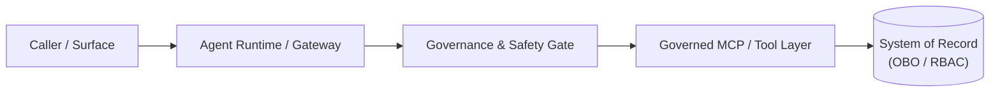

# Short descriptive title

> **Maturity:** preview · **Kind:** design-pattern · **Category:** `<category>` · **Version:** 0.1.0

One paragraph: what this asset is, who it is for (platform engineers, solution architects, security reviewers, agent developers), and the concrete engineering outcome it enables. State the core architectural thesis in a single callout:

> **Core thesis:** *Summarize the non-negotiable architectural invariant in one sentence.*

## Domain-agnostic applicability ("Domain Packs")

Keep the core architecture, wire contracts, and safety gates domain-agnostic. Show how the same pattern adapts across at least three enterprise domains by swapping only the **Domain Pack** (entity vocabulary, tool schemas, and specialist instructions):

| Domain Pack | Primary Entity | Signal & Context Sources | Specialist / Tool Capabilities | Governed Write Actions (`W2`–`W4`) |
|---|---|---|---|---|
| **ITSM / SecOps** (`secops`) | Service, asset, or incident | SIEM alerts, change logs, runbooks | Status triage, remediation planner, incident briefer | Draft incident update (`W2`), update ticket (`W3`), page on-call (`W4`) |
| **CRM / Enterprise Sales** (`sales`) | Customer account or opportunity | Usage telemetry, CRM pipeline, external signals | Account pulse, next-best action, deal coach | Draft outreach email (`W2`), log CRM activity (`W3`), bulk outreach (`W4`) |
| **FinOps / HR / Operations** (`ops`) | Cost center, team, or case | Budget variance, requisition queues, policy knowledge | Queue analyst, policy advisor, case briefer | Draft case note (`W2`), record milestone (`W3`), publish schedule (`W4`) |

## Architecture and implementation map

| Layer / Concern | Deep-Dive Documentation | Executable Reference Implementation / IaC |
|---|---|---|
| **Core Topology & Wire Contracts** | [`docs/architecture.md`](docs/architecture.md) · [`ADR 0001`](docs/decisions/0001-decision-title.md) | [`samples/reference_sample.py`](samples/reference_sample.py) — Runnable reference module with offline `--self-test` |
| **Identity, Authentication & Entitlements** | [`docs/authentication-and-governance.md`](docs/authentication-and-governance.md) | Token validation, OBO / RBAC enforcement, and two-principal isolation harness |
| **Evaluation, Release Gates & Troubleshooting** | [`docs/evaluation-and-troubleshooting.md`](docs/evaluation-and-troubleshooting.md) | [`samples/README.md`](samples/README.md) · [`infra/README.md`](infra/README.md) |

## When to use

- The recurring architectural problem or enterprise scenario this asset solves.
- Technical signals (for example, multi-hop identity, network isolation, tool governance, or custom routing) that make this pattern the right fit.

## When not to use

- Simpler situations where a lower-overhead option is sufficient, with a direct link to the alternative pattern in [`assets/`](../../README.md).
- Scenarios outside the boundary of this asset.

## Architecture



Summarize the components, trust boundaries, identity flow, and control flow. Link to [`docs/architecture.md`](docs/architecture.md) for sequence diagrams, JSON schemas, scaling, and failure modes.

### Pattern selection matrix

| Criterion | Option A (This Pattern) | Option B (Simpler Alternative) | Option C (Complementary Pattern) |
|---|---|---|---|
| **Best for** | | | |
| **Identity & Authorization** | | | |
| **Operational Footprint** | | | |
| **Failure / Blast Radius** | | | |

## Key design decisions

| Decision | Choice | Why | Trade-off |
|----------|--------|-----|-----------|
| | | | |

Significant architectural decisions are recorded as ADRs in [`docs/decisions/`](docs/decisions/0001-decision-title.md).

## Getting started

1. **Verify prerequisites.** Python 3.11+ (for offline samples) or Azure CLI + Bicep CLI (for infrastructure templates).
2. **Run the offline verification suite.**
   ```bash
   python assets/<category>/<asset-id>/samples/reference_sample.py --self-test
   ```
3. **Configure identity and environment parameters.** Follow [`docs/authentication-and-governance.md`](docs/authentication-and-governance.md).
4. **Apply release and evaluation gates.** Follow [`docs/evaluation-and-troubleshooting.md`](docs/evaluation-and-troubleshooting.md) and [Agent Path to Production](../../delivery-and-ops/agent-path-to-production/README.md).

## Security and responsible AI

- **Authorize at the data/tool layer, never in prompts.** Validate bearer tokens (`iss`, `aud`, `exp`, `tid`, `oid`, `scp`/`roles`) and bind scope from token claims rather than model-supplied arguments.
- **Gate every side effect (`R` / `W1`–`W4`).** Enforce draft-before-send, human approval tokens bound to payload hashes, per-principal daily caps, and a runtime kill switch.
- **Treat tool outputs as untrusted data.** Frame retrieved content against indirect prompt injection (XPIA) and redact credentials/tokens from all logs and traces.
- **Accountable ownership.** Assign a human business owner, an Entra Agent ID sponsor, and primary/secondary technical maintainers.

## Limitations

- Known product preview constraints, regional availability limits, throughput/latency considerations, and scenarios requiring custom extension.

## References

- [Architecture deep dive](docs/architecture.md)
- [Authentication and governance](docs/authentication-and-governance.md)
- [Evaluation, release gates, and troubleshooting](docs/evaluation-and-troubleshooting.md)
- [ADR 0001](docs/decisions/0001-decision-title.md)
- [Samples guide](samples/README.md)
- [Agent Path to Production](../../delivery-and-ops/agent-path-to-production/README.md)
- [Contribution & Standardization Guide](../../../docs/contribution-guide.md)
