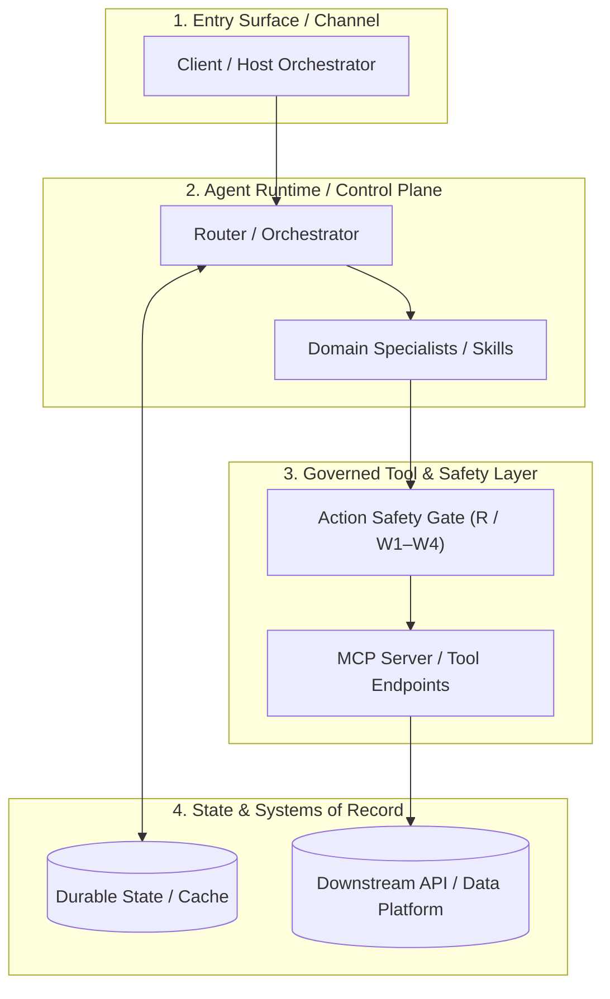
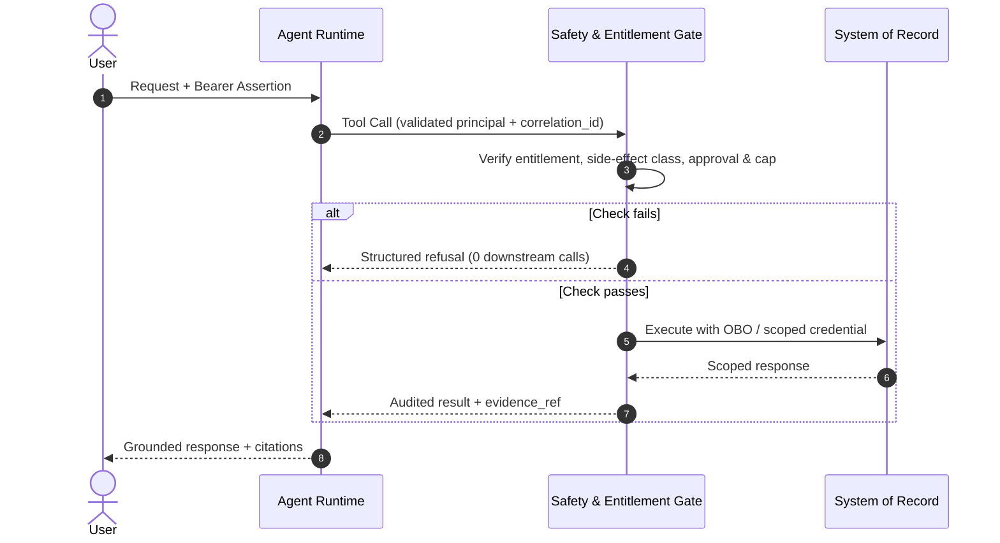

# Architecture

This document defines the topology, component responsibilities, wire contracts, sequence flows, state/scaling model, and server-side safety gates for this asset. Keep the architecture **domain-agnostic** and demonstrate how Domain Packs supply industry-specific vocabulary and tools without altering the runtime invariants.

Related documents:

- [Asset README](../README.md)
- [Authentication and governance](authentication-and-governance.md)
- [Evaluation, release gates, and troubleshooting](evaluation-and-troubleshooting.md)
- [ADR 0001](decisions/0001-decision-title.md)
- [Reference samples](../samples/README.md)

## 1. Architectural thesis and invariants

State the core architectural principles and the invariants that hold across every request:

1. **Invariant 1 (e.g., Surface vs. Engine vs. Tool separation):** ...
2. **Invariant 2 (e.g., Token-derived scope binding):** ...
3. **Invariant 3 (e.g., Deterministic safety gates before side effects):** ...

## 2. Component topology and responsibility split



| Component | Owns | Does Not Own | Failure / Degradation Behavior |
|---|---|---|---|
| **Entry Surface** | | | |
| **Agent Runtime** | | | |
| **Governed Tool Layer** | | | |
| **State / Data Store** | | | |

## 3. End-to-end protocol sequence

Provide a protocol-level Mermaid sequence diagram showing exact headers, token exchanges, and refusal paths:



## 4. Wire contracts and JSON schemas

Document the exact JSON schemas or data structures exchanged at each seam (for example: routing decisions, handoff envelopes, tool input/output schemas, or audit records):

```json
{
  "correlation_id": "req-00000000-0000-0000-0000-000000000001",
  "principal_oid": "00000000-0000-0000-0000-000000000010",
  "tenant_id": "00000000-0000-0000-0000-000000000001",
  "side_effect_class": "W3",
  "evidence_refs": ["ev:tool_name:a1b2c3d4"]
}
```

## 5. State, caching, scaling, and reliability

- **Externalized state & partitioning:** How conversation state, idempotency keys, and caches are partitioned (e.g., `/tenant_id` + `/principal_oid`) and concurrency-controlled (e.g., ETag `If-Match`).
- **Latency & token budgets:** Per-turn token ceilings, timeout budgets, and single-flight / stale-while-revalidate caching rules.

## 6. Side-effect classification and action safety gates

| Class | Meaning | Representative Tools | Server-Side Gate Enforced |
|---|---|---|---|
| **R** | Read-only | `get_entity_profile`, `list_records` | Validated token + tenant/row entitlement |
| **W1** | User-scoped, reversible | `save_preference`, `pin_entity` | Scope check + audit |
| **W2** | Draft creation (human still controls) | `create_draft` | Scope + recipient allow-list + grounding claim |
| **W3** | System-of-record mutation | `apply_change`, `submit_order` | Prior `W2` draft + confirmation + per-principal daily cap + audit |
| **W4** | External, bulk, or irreversible | `dispatch_notification` | Human-minted approval token bound to payload hash + fan-out cap + kill switch |

